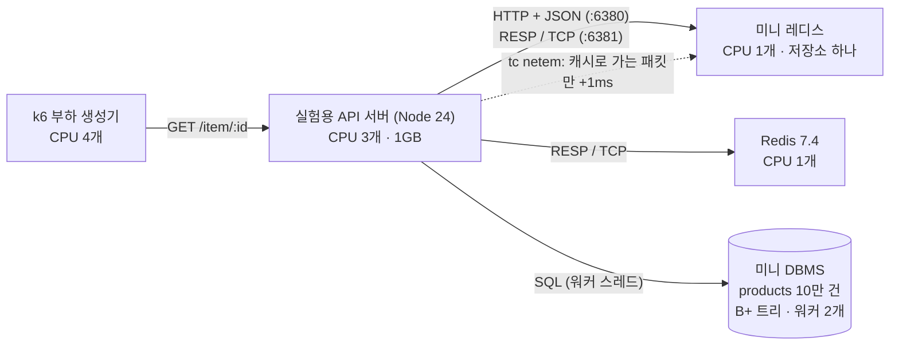
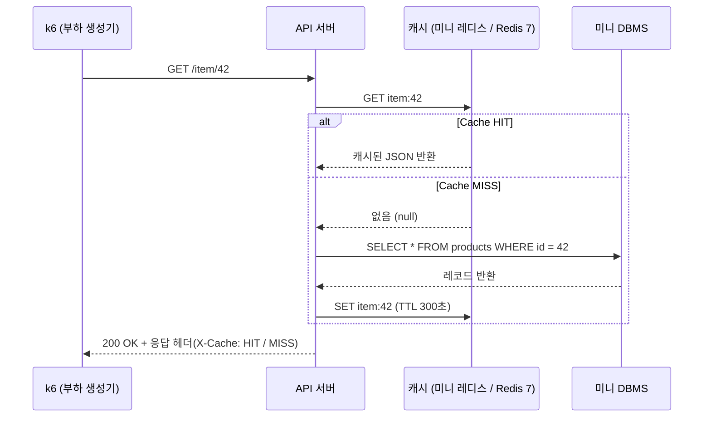
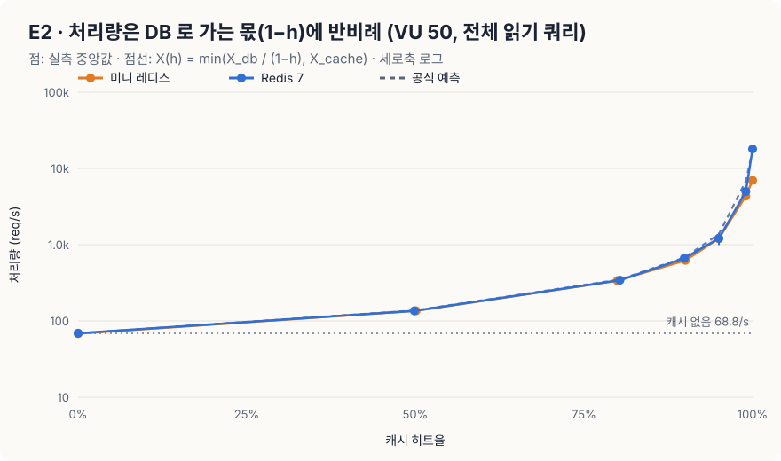
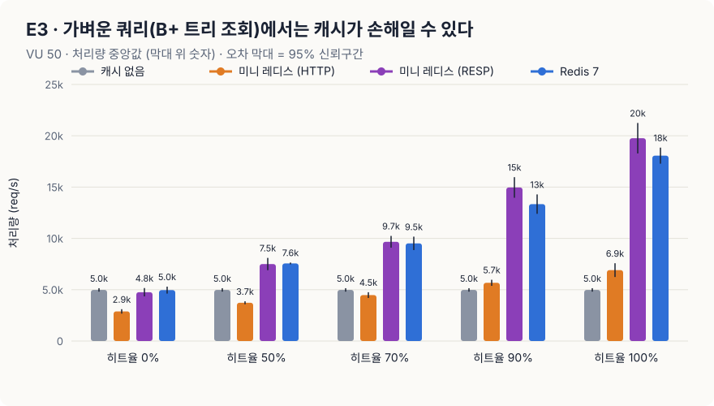
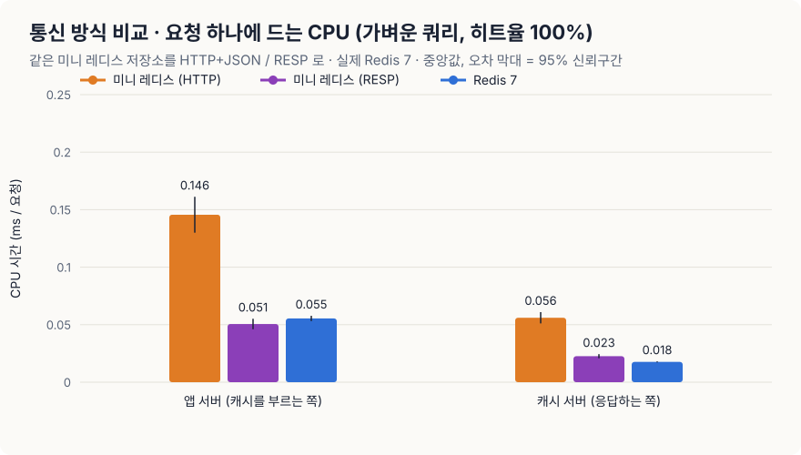
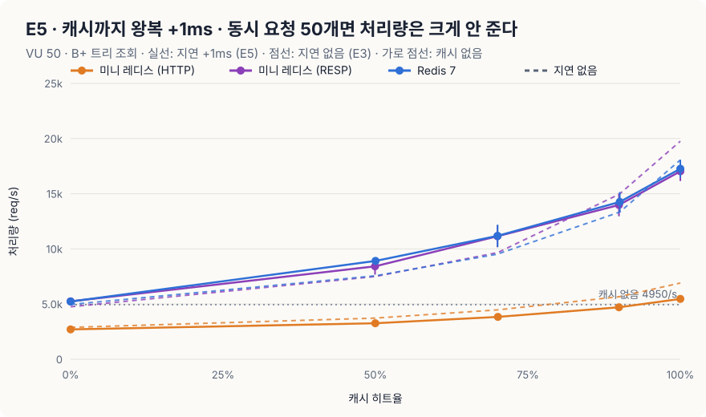
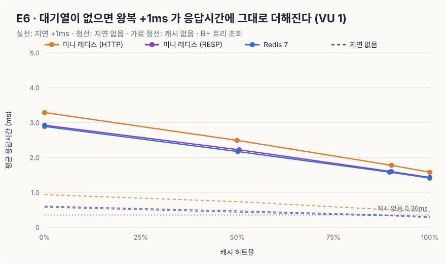
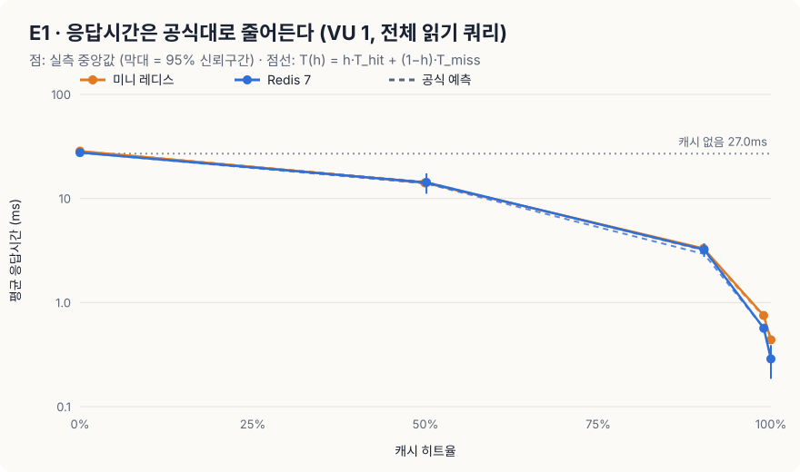
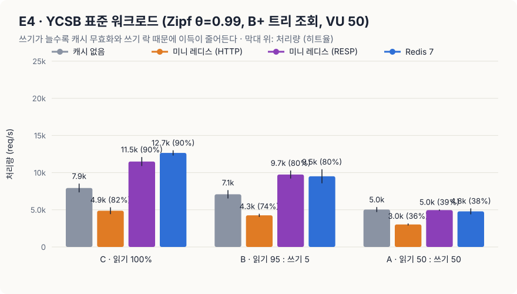

# miniReact · miniRedis · miniDBMS — 2주차 발표 자료

> 🗂️ **2주차(캐시 실험) 발표용으로 보관한 README 입니다.** 1주차(miniReact diff 의 MOVE · LIS) 발표 자료는 [README.md](README.md) 에 있습니다.

> 외부 프레임워크 의존성 없이 순수 Vanilla JS로 직접 구현한 3대 코어 엔진(Virtual DOM, In-memory K-V Store, B+ Tree SQL DBMS)과 대규모 실측 벤치마크 프로젝트입니다.

| 코어 엔진 | 직접 구현한 핵심 기능 |
| :--- | :--- |
| **1주차 · miniReact** | Virtual DOM · 5가지 Diff & LIS Patch · FunctionComponent · Hooks (`useState`, `useEffect` 등) |
| **2주차 · miniRedis** | FNV-1a 해시 테이블 · 점진적 리해시 · TTL 만료 · 태그/패턴 무효화 · AOF 영속성 · HTTP API |
| **2주차 · miniDBMS** | SQL 토크나이저/파서 · B+ 트리 인덱스 · 페이지 스토리지 · 읽기/쓰기 락 · 워커 스레드 풀 API |

> 📢 **발표 안내:** 아래 [🔬 발표: 캐시는 정말 몇 배 빠를까?](#-발표-캐시는-정말-몇-배-빠를까--미니-레디스--미니-dbms-실측) 섹션을 위에서부터 스크롤하며 발표합니다. (발표 대본 및 1분 Q&A 스크립트는 [`experiment/PRESENTATION.md`](experiment/PRESENTATION.md) 참고)

---

## 🔬 발표: 캐시는 정말 몇 배 빠를까? — 미니 레디스 · 미니 DBMS 실측

> **핵심 요약**  
> 직접 만든 **미니 레디스** · **미니 DBMS**와 실제 **Redis 7**을 같은 격리 환경(Docker cpuset 고정)에서 k6로 **576회(96개 조건 × 6회)** 측정했습니다.  
> 1. 캐시 효과는 막연한 '항상 N배'가 아니라 **공식으로 예측**됩니다 (히트율 90%까지 오차 ±7% 이내).  
> 2. 가벼운 쿼리에서 미니 레디스가 Redis보다 훨씬 느렸던 원인은 저장소가 아니라 **HTTP + JSON 통신**이었습니다. 같은 저장소를 RESP/TCP로 말하게 하자 **1.39배 → 3.97배**, 요청당 CPU가 **Redis와 같아졌습니다** (0.073ms).  
> 3. 캐시까지 **왕복 1ms**가 생기면, 대기열이 없는 요청(VU 1)에서는 가벼운 쿼리의 캐시가 **히트율 100%여도 손해**입니다.

### ① 무엇을 만들었고, 무엇이 문제였나

| 우리가 만든 것 | 핵심 구현 |
| :--- | :--- |
| **미니 레디스** | 직접 구현한 해시 테이블 키-값 저장소 · TTL · 태그 무효화 · AOF 영속성 · HTTP API (+ 실험용 RESP/TCP 포트) |
| **미니 DBMS** | SQL 처리기 · B+ 트리 인덱스 (10만~100만 건) · 읽기/쓰기 락 · 워커 스레드 풀 |

초기 테스트에서 **'캐시를 붙이면 10.7배 빨라진다'**는 수치가 나왔습니다. 그러나 원본 DB 로직을 분석한 결과, 실제 디스크/인덱스 쿼리가 아닌 인위적인 `await sleep(120ms)` 지연이었습니다.

| 이론 상한 계산 (VU 50명, 120ms 대기) | 실제 측정 결과 |
| :---: | :---: |
| 50 ÷ 0.120s = **416 req/s** | **401 req/s** |

즉, 10.7배라는 수치는 캐시의 성능이 아니라 **임의로 지정한 sleep 값이 만든 착시**였습니다. 이에 따라 본질적인 질문으로 실험을 다시 설계했습니다.

> *"진짜 DB 엔진 앞에서, 캐시는 언제 몇 배 이득이고 언제 손해인가? 그리고 누가 측정해도 재현 가능한 객관적 근거는 무엇인가?"*

---

### ② 실험 구조와 데이터 흐름

모든 컴포넌트는 Docker 컨테이너로 격리하고 CPU 코어(`cpuset`)를 분리 할당하여, 부하 생성기(k6)가 서버의 CPU를 잠식해 측정 결과가 왜곡되는 현상을 차단했습니다.



모든 조회 요청은 실무 표준인 **Cache-Aside** 패턴에 따라 처리됩니다.



| 통제 변수 | 설정 값 | 목적 및 의의 |
| :--- | :--- | :--- |
| **캐시 대상** | 없음 · 미니 레디스(HTTP + JSON) · **미니 레디스(RESP/TCP)** · Redis 7 | 같은 저장소의 통신 방식만 바꿔, 느린 원인이 저장소인지 통신인지 분리 |
| **원본 쿼리** | **무거움**: `WHERE name = ?` (전체 스캔, 약 27ms)<br>**가벼움**: `WHERE id = ?` (B+ 트리 단건 조회, 응답 약 0.36ms) | 쿼리 비용에 따른 캐시 손익분기점 측정 |
| **히트율** | 0% · 50% · 70% · 80% · 90% · 95% · 99% · 100% | 응답 헤더 실측값으로 공식과의 오차 검증 |
| **부하 조건** | VU 1명 (대기열 없음) · VU 50명 (동시 요청) · YCSB 표준 | 순수 지연시간(Latency)과 최대 처리량(Throughput) 분리 |
| **네트워크 지연** | 없음 (왕복 0.05ms) · **왕복 +1ms ± 0.2ms** (`tc netem`) | 캐시가 다른 서버에 있을 때 손익분기점이 어떻게 움직이는지 |

| 실험 | 무엇을 | 조건 수 |
| :---: | :--- | :---: |
| **E1** | 무거운 쿼리 · VU 1 → 응답시간 공식 | 11 |
| **E2** | 무거운 쿼리 · VU 50 → 처리량 공식 | 15 |
| **E3** | 가벼운 쿼리 · VU 50 · 캐시 4종 → 손익분기 · 통신 방식 | 16 |
| **E4** | YCSB A/B/C · 캐시 4종 → 쓰기 비중 | 12 |
| **E5** | E3 + 캐시까지 왕복 +1ms | 16 |
| **E6** | 가벼운 쿼리 · VU 1 · 지연 없음 / +1ms → 응답시간 손익분기 | 26 |

---

### ③ 공정한 비교를 위한 통제와 트러블슈팅

공정한 벤치마크를 위해 다음 원칙을 적용했습니다:
1. **CPU 코어 격리 (`cpuset`)**: 부하 생성기와 피측정 서버 간 자원 간섭 배제.
2. **동일 조건 통제**: 미니 레디스와 Redis 7 모두 싱글 스레드 및 영속성 OFF로 순수 인-메모리 처리 성능 비교. HTTP 모드와 RESP 모드는 **같은 프로세스 · 같은 저장소**를 씁니다.
3. **히트율 고정 기법**: MISS 대상 요청에는 고유 쿼리 파라미터를 붙여 캐시 워밍업과 무관하게 정확한 $h\%$ 히트율 유지.
4. **6회 반복 무작위 셔플**: 발열 등 시간 효과 배제를 위해 반복마다 조건 순서를 무작위로 섞고 95% 신뢰구간 산출.
5. **업계 표준 YCSB 워크로드**: Zipf 분포($\theta=0.99$)를 활용한 실무 트래픽 패턴 모사.
6. **지연은 캐시 경로에만**: 목적지 IP 필터로 API 서버 → 캐시 패킷만 늦추고 k6 → API 서버는 그대로 둡니다. 그래서 '캐시 없음'은 지연을 넣어도 같아야 하는 **대조군**입니다 (실측: 4,979 → 4,950 req/s, −0.6%).

#### 🛠️ 측정 중 발생한 오염과 해결

| 증상 | 원인 분석 | 해결 방법 |
| :--- | :--- | :--- |
| **일부 회차에서 요청 0건 발생** | 측정 전 1,000건 캐시 워밍업 시 무거운 쿼리를 실행하여 60초 타임아웃 초과 | 워밍업 시에만 인덱스(B+ 트리) 조회를 활용하도록 개선 (60초 $\rightarrow$ **0.08초** 단축) |
| **회차별 2~4배 성능 편차 발생** | YCSB 쓰기(INSERT)로 인해 테이블이 **10만 건 $\rightarrow$ 34만 건**으로 팽창하여 전체 스캔 비용 증가 | DBMS의 파일 쓰기가 append-only 구조임을 활용, 매 측정 전 원본 크기로 `truncate`하여 **정확히 10만 건 원상복구** |
| **지터를 넣으면 TCP 재전송 우려** | `netem`의 지터는 패킷 순서를 바꿀 수 있음 | netem 안쪽 큐를 `pfifo`로 바꿔 순서 유지 (netem 공식 문서 방식) |

<details>
<summary>🔍 핵심 코드: 히트율 고정 · 데이터 원상복구 · 지연 주입</summary>

```javascript
// k6: 확률 HIT로 기저장된 키 요청, MISS는 난수 접미사를 붙여 반드시 MISS 유도
Math.random() < HIT
  ? http.get(url(rnd(HOT)))
  : http.get(url(rnd(ROWS), `&v=${vu}-${iter}`));

// API 서버: 매 회차 시작 전 append-only 파일을 원본 크기로 잘라 정확히 10만 건 유지
await db.close();
truncateSync(TBL, BASE_BYTES);
db = createDbService({ dir: DATA_DIR, workers: DB_WORKERS }); // B+ 트리 재구성 및 레코드 검증
```

```sh
# experiment/netem.js: API 서버 → 캐시 컨테이너로 가는 패킷만 1ms(± 0.2ms) 늦춘다
tc qdisc add dev eth0 root handle 1: prio bands 3 priomap 2 2 2 …       # 기본: 지연 없는 칸
tc qdisc add dev eth0 parent 1:1 handle 10: netem delay 1000us 200us distribution normal
tc qdisc add dev eth0 parent 10:1 pfifo limit 10000                     # 순서 유지
tc filter add dev eth0 parent 1: protocol ip u32 match ip dst <캐시 IP>/32 flowid 1:1
```
</details>

---

### ④ 핵심 결과 — 576회 측정, 재현 신뢰도 97.6%

| 번호 | 핵심 발견 | 검증 수치 |
| :---: | :--- | :--- |
| **1** | 처리량은 **$X_{\text{db}} \div (1 - h)$** 공식대로 증가 | 히트율 90%까지 공식 예측값과 **오차 ±7% 이내** (95% 이상은 공식보다 10~38% 낮음) |
| **2** | 미니 레디스가 느렸던 원인은 저장소가 아니라 **HTTP + JSON** | 같은 저장소를 RESP로: 히트율 100%에서 **1.39배 → 3.97배** · 요청당 CPU **0.202 → 0.073ms (Redis 7과 같음)** |
| **3** | 캐시까지 **왕복 +1ms**: 동시 요청이 많으면 견디지만, 대기열이 없으면 손해 | VU 50 처리량은 **4~21% 감소**에 그침 · VU 1 응답시간은 **히트율 100%여도 캐시 없음의 3.9배** |
| **4** | 쓰기(Write) 비중이 늘어날수록 캐시 이득 급감 | Redis 7 기준: 읽기 100% **1.60배** $\rightarrow$ 쓰기 50% **0.95배** |

#### 발견 1 · 무거운 쿼리: 히트율이 곧 처리량 배율



| 히트율 ($h$) | 이론 공식 배율 $\frac{1}{1-h}$ | 미니 레디스 실측 | Redis 7 실측 |
| :---: | :---: | :---: | :---: |
| **0%** | 1.0배 | 68.1 req/s (1.0배) | 68.9 req/s (1.0배) |
| **50%** | 2.0배 | 131.9 req/s (1.9배) | 128.1 req/s (1.8배) |
| **80%** | 5.0배 | 321.0 req/s (4.6배) | 334.0 req/s (4.8배) |
| **90%** | 10.0배 | 646.2 req/s (9.3배) | 666.7 req/s (9.6배) |
| **95%** | 20.0배 | 1,217 req/s (17.6배) | 1,255 req/s (18.1배) |
| **99%** | 100.0배 | 4,350 req/s (62.8배) | 5,010 req/s (72.3배) |
| **100%** | 캐시 자체의 처리 한계 | 7,088 req/s (102배) | **18,067 req/s (261배)** |

*(배율은 캐시 없음 69.3 req/s 대비. 공식은 실측한 히트율로 계산하며, 50%의 실측 히트율이 48~51%라 배율이 2.0보다 조금 낮습니다)*

- **원리 분석**: DBMS 워커 2개 $\times$ 27ms 풀 스캔의 한계로 DB 처리량은 초당 약 69건입니다 (이론상 2 ÷ 0.027 ≈ 74). DB로 가는 트래픽 비율이 정확히 $(1 - h)$이므로, 전체 처리량은 $X_{\text{db}} \div (1 - h)$를 따릅니다.
- **95% 이상에서 공식보다 낮은 이유**: VU 50명 고정 부하에서는 드물게 오는 MISS가 VU를 오래 붙잡아, 캐시로 보낼 요청 수 자체가 줄어듭니다. 게다가 히트율 99%의 예측값(약 7,000 req/s)은 캐시 자체의 한계(미니 레디스 7,088 req/s)와 겹칩니다.
- **의의**: 하드웨어 절대 성능과 무관하게 **'내 DB 처리량과 히트율'만 알면 캐시 도입 효과를 사전에 예측**할 수 있습니다.

#### 발견 2 · 가벼운 쿼리: 미니 레디스가 느렸던 진짜 원인은 HTTP + JSON



| 캐시 없음(4,979 req/s) 대비 | 히트율 0% | 50% | 70% | 90% | 100% | 손익분기 히트율 |
| :--- | :---: | :---: | :---: | :---: | :---: | :---: |
| **미니 레디스 · HTTP + JSON** | 2,887 (0.58배) | 3,729 (0.75배) | 4,477 (0.90배) | 5,674 (1.14배) | 6,909 (1.39배) | **78%** |
| **미니 레디스 · RESP/TCP** | 4,758 (0.96배) | 7,501 (1.51배) | 9,670 (1.94배) | 14,964 (3.01배) | **19,762 (3.97배)** | 0% |
| **Redis 7.4** | 4,961 (1.00배) | 7,561 (1.52배) | 9,517 (1.91배) | 13,341 (2.68배) | 18,063 (3.63배) | 0% |

*(단위 req/s · 6회 중앙값. 손익분기 0%는 히트율 0%에서도 캐시 없음과 신뢰구간이 겹친다는 뜻)*



| 요청 하나당 CPU 시간 (E3 · 히트율 100%) | API 서버 (부르는 쪽) | 캐시 서버 (응답하는 쪽) | 합계 | 처리량 |
| :--- | :---: | :---: | :---: | :---: |
| 캐시 없음 (B+ 트리 조회) | 0.245ms | - | 0.245ms | 4,979 req/s |
| **미니 레디스 · HTTP + JSON** | **0.146ms** | **0.056ms** | **0.202ms** | 6,909 req/s |
| **미니 레디스 · RESP/TCP** | 0.051ms | 0.023ms | **0.073ms** | 19,762 req/s |
| **Redis 7.4** | 0.055ms | 0.018ms | **0.073ms** | 18,063 req/s |

- **저장소는 그대로, 통신만 바꿨습니다.** RESP 모드는 같은 프로세스 · 같은 해시 테이블을 씁니다. 그런데 API 서버 쪽 비용이 **2.9배**, 미니 레디스 쪽 비용이 **2.4배** 줄어 합계가 Redis 7과 같아졌습니다. → **느린 원인은 HTTP 요청 만들기 · HTTP 서버 처리 · JSON 변환**이었습니다.
- **저장소 자체의 차이는 작습니다.** 캐시 서버 쪽만 보면 Redis(C 구현)가 0.018ms, 미니 레디스(JS)가 0.023ms로 Redis가 약 1.3배 효율적입니다. 하지만 병목은 API 서버(Node 메인 스레드 1개)라서 처리량은 오차 범위 안에서 같습니다 (19,762 ± 1,485 vs 18,063 ± 783).
- **손익분기 78%**: 지난 측정에서 '64%'로 적었던 값은 0%와 90% 사이를 직선으로 이은 추정이었습니다. 이번에 50% · 70%를 직접 재 보니 곡선이 아래로 휘어 있어서 실제로는 **78%**였습니다.
- 측정 방법: k6가 측정 구간의 시작 · 끝에 각 프로세스의 누적 CPU 시간(`process.cpuUsage()`, Redis `INFO cpu`)을 기록하고, 차이 ÷ 요청 수로 계산합니다 ([`CODE-NOTES.md` 8-3](experiment/CODE-NOTES.md)).

#### 발견 3 · 캐시까지 왕복 +1ms: 동시 요청이 많으면 견디고, 대기열이 없으면 손해

캐시까지 PING 왕복 (API 서버 안에서 500회 중앙값): Redis **0.054 → 1.185ms** · 미니 레디스 RESP **0.059 → 1.167ms** · 미니 레디스 HTTP **0.181 → 1.354ms**





| 손익분기 히트율 | 처리량 · VU 50 · 지연 없음 (E3) | 처리량 · VU 50 · +1ms (E5) | 응답시간 · VU 1 · 지연 없음 (E6) | 응답시간 · VU 1 · +1ms (E6) |
| :--- | :---: | :---: | :---: | :---: |
| **미니 레디스 · HTTP** | 78% | **93%** | 100%여도 손해 (0.89배) | 100%여도 손해 |
| **미니 레디스 · RESP** | 0% | 0% | 88% | **100%여도 손해** |
| **Redis 7.4** | 0% | 0% | 81% | **100%여도 손해** |

- **VU 50 (동시 요청 많음)**: 1ms를 기다리는 동안 API 서버는 다른 요청을 처리할 수 있어서, 히트율 100% 처리량은 Redis **−4%**, 미니 RESP **−14%**, 미니 HTTP **−21%** 만 줄었습니다. 통신 비용이 큰 HTTP 쪽만 손익분기가 78% → 93%로 올라갔습니다.
- **VU 1 (대기열 없음)**: 지연이 응답시간에 그대로 더해집니다. 캐시 없음의 B+ 트리 조회가 **0.36ms**인데 캐시 왕복 하나가 1.2ms라서, 히트율 100%여도 **1.41ms (캐시 없음의 3.9배)** 입니다. → **원본 쿼리가 네트워크 왕복보다 싸면, 캐시는 응답시간을 늘릴 뿐입니다.**
- **확인하지 못한 점**: 히트율 0%에서 지연을 넣은 RESP · Redis가 캐시 없음보다 6% 빨랐습니다 (5,235 vs 4,950 req/s). 캐시를 기다리는 동안 DB 워커 앞 대기열이 짧아진 효과로 추정하지만, 따로 검증하지 않았습니다.
- **해석의 범위**: 미니 DBMS는 API 서버 안(워커 스레드)에서 돌기 때문에 **DB 쪽에는 네트워크 지연이 없습니다.** 이 결과는 "캐시만 멀리 있는" 캐시에 가장 불리한 경우이고, 실제 클라우드처럼 DB도 원격이면 MISS가 더 비싸져 캐시가 더 유리해집니다.

<details>
<summary>📊 추가 실험 데이터 (E1 레이턴시 공식 & E4 YCSB 혼합 부하)</summary>

#### E1 · 대기열이 없을 때(VU 1명)의 응답 시간 공식: $T = h \cdot T_{\text{hit}} + (1 - h) \cdot T_{\text{miss}}$

- 캐시 없음: 무거운 쿼리 1건 **26.9ms**
- 미니 레디스: 실측 14.69ms (히트 50.3%), 3.28ms (히트 89.9%), 0.70ms (히트 99.1%) $\rightarrow$ 공식 오차 **±2.7% 이내**
- Redis 7: 실측 14.06ms (히트 50.4%), 3.05ms (히트 89.9%), 0.58ms (히트 99.0%) $\rightarrow$ 공식 오차 **±2.7% 이내**

#### E4 · YCSB 표준 워크로드 (Zipf $\theta=0.99$, B+ 트리 조회, VU 50명)


| 워크로드 | 캐시 없음 | 미니 레디스 HTTP | 미니 레디스 RESP | Redis 7 |
| :--- | :---: | :---: | :---: | :---: |
| **C (읽기 100%)** | 7,933/s | 4,874/s (0.61배) | 11,495/s (1.45배) | **12,655/s (1.60배)** |
| **B (읽기 95 : 쓰기 5)** | 7,086/s | 4,257/s (0.60배) | 9,746/s (1.38배) | 9,509/s (1.34배) |
| **A (읽기 50 : 쓰기 50)** | 5,034/s | 3,029/s (0.60배) | 4,956/s (0.98배) | 4,789/s (0.95배 - 이득 소멸) |

- *분석*: 쓰기 발생 시 캐시 무효화(DEL)로 인해 히트율이 급감하고(C 90% → A 38%), 쓰기 락이 읽기 락을 대기시키므로 캐시의 장점이 상쇄됩니다. 통신 방식을 RESP로 바꾸면 미니 레디스도 Redis 7과 비슷한 이득을 냅니다.
</details>

#### 🏆 이 측정값을 신뢰할 수 있는 객관적 근거

| 검증 지표 | 측정 결과 | 해석 |
| :--- | :---: | :--- |
| **전체 측정 성공률** | **576 / 576 (100%)** | 10초 측정 중 에러율 1% 미만 |
| **회차별 재현 신뢰도** | **562 / 576 (97.6%)** | 각 회차 측정값이 동일 조건 중앙값의 $\pm 15\%$ 이내 |
| **조건별 변동계수 (CV)** | **96개 모두 10% 미만** | 최대 9.7% (YCSB-B · Redis 7) |
| **시간에 따른 변화** | **96개 중 4개가 ±10% 초과** | 앞 회차(r1·r2)와 뒤 회차(r5·r6)의 처리량 비교. 최대 +15.6% (E2 Redis 히트율 95%) |
| **대조군 (지연 경로 확인)** | **캐시 없음 −0.6% / −0.5%** | 지연을 넣어도 캐시를 안 쓰는 요청은 그대로 → 지연이 캐시 경로에만 걸림 |

- **±15%를 벗어난 14회 중 13회가 '느린 쪽'**, 그중 8회가 3번째 반복(16:05~16:19, 14분)에 몰려 있습니다. 그 반복은 96개 조건 전체가 중앙값보다 3.4% 느렸습니다 (다른 반복은 0% 안팎). 같은 시각 Windows 이벤트 로그에 전원 정책 재적용(`UserModePowerService`)이 반복 기록되어 있어, **호스트(노트북)가 일시적으로 느려진 것**으로 봅니다. 결과는 6회 중앙값이라 이 회차들이 결론을 바꾸지 않으며, 골라 빼지 않았습니다.

<details>
<summary>📜 이전 측정(210회)과 비교</summary>

| 항목 | 최적화 전 210회 | 최적화 후 210회 | **이번 576회** |
| :--- | :---: | :---: | :---: |
| 조건 × 반복 | 42 × 5 | 42 × 5 | **96 × 6** |
| 무거운 쿼리 1건 (E1, 캐시 없음) | 약 82ms | 27.0ms | 26.9ms |
| DB 처리량 $X_{\text{db}}$ (E2, 캐시 없음) | 22.8 req/s | 68.8 req/s | 69.3 req/s |
| 미니 레디스 HTTP · 히트율 100% (E3) | 0.92배 | 1.48배 | 1.39배 (± 0.14) |
| 미니 레디스 HTTP 손익분기 | 손해 | 64% (0~90% 직선 추정) | **78% (50 · 70% 실측)** |
| 재현 신뢰도 / 성공률 | 96.2% / 100% | 96.2% / 100% | **97.6% / 100%** |
| CV 10% 미만 조건 | - | 38 / 42 | **96 / 96** |

최적화 내용 (기능은 그대로, 이전 코드와 결과가 같은지 무작위 입력으로 대조):
- **미니 DBMS 전체 읽기**: 조건에 쓰는 열만 먼저 꺼내 검사하고 맞는 줄만 전체를 해석 · 64KB 덩어리를 한 번에 문자열로 변환 · 역슬래시/따옴표가 없는 값은 정규식을 건너뜀
- **미니 레디스 호출**: 내장 `fetch` → 연결을 재사용하는 `node:http` 요청 · 서버 응답에 `Content-Length`
- 최적화 전 원본 데이터는 커밋 `f655b7b`, 최적화 후 210회 데이터는 커밋 `37647d9` 의 `experiment/results/`에 남아 있습니다.
</details>

---

### ⑤ 재현 방법 및 한계

```bash
# 1. 격리된 Docker 컨테이너 빌드 및 기동 (자원 제한 · tc 권한 포함)
docker compose -f experiment/docker-compose.yml up -d --build --wait

# 2. 96개 조건 × 6회 반복 = 576회 전수 측정 (약 2시간 30분, 지연은 --delay 로 바꿀 수 있음)
node experiment/run.js --reps 6 --delay 1ms

# 3. 신뢰구간 · 공식 검증 · 손익분기 · 요청당 CPU 분석 및 SVG 차트 자동 생성
node experiment/analyze.js

# (선택) 지연만 따로 켜고 끄기 · 확인
node experiment/netem.js 1ms
node experiment/netem.js status
node experiment/netem.js off
```

| 실험의 한계 | 시스템에 미치는 영향 | 향후 과제 |
| :--- | :--- | :--- |
| **단일 머신 환경 (Docker/WSL2)** | 절대 수치는 이 노트북에서만 유효 · 다른 컴퓨터에서 같은 배율이 나오는지 미확인 | 팀원 노트북에서 같은 576회 측정 후 `compare-hosts.js`로 비교 |
| **호스트 전원 관리 · 하이브리드 CPU** | `cpuset`은 VM 안에서만 고정 · Windows가 P/E 코어 배치와 클럭을 바꿀 수 있음 (3번째 반복 −3.4%) | 전원 모드 '최고 성능' · 화면 꺼짐 해제 · CPU 클럭 기록 |
| **DB 구간에는 지연 없음** | 미니 DBMS가 API 서버 안에서 돌아, 지연이 캐시에만 붙는 캐시에 불리한 경우만 측정 | 미니 DBMS를 별도 컨테이너로 분리해 DB 쪽에도 지연 주입 |
| **단순화된 메모리 모델** | 데이터 크기 약 100B, Eviction 제외 | 대용량 데이터 및 LRU/LFU 메모리 퇴출 정책 부하 검증 |
| **반복 6회** | 조건별 95% 신뢰구간 약 ±3~10% | 손익분기 근처 조건만 반복 횟수 확대 |

---

## 🚀 빠른 시작 (Getting Started)

```bash
npm install     # 테스트용 jsdom 설치 (런타임 의존성 0개)
npm test        # 1주차 + 2주차 전체 893개 단위/기능/퍼즈 테스트 실행
npm start       # 로컬 학습 및 시연 서버 실행 (http://localhost:5200)
```

<details>
<summary>💻 2주차 엔진 단독 실행 명령어</summary>

```bash
npm run redis                                 # 미니 레디스 단독 서버 (포트 6380, AOF 영속성)
node week2/dbms/cli.js run query.sql          # SQL 파서 및 실행기 CLI (100만 건 시드 지원)
npm run bench:dbms                            # B+ 트리 인덱스 vs 선형 탐색 100만 건 성능 비교
npm run dbms                                  # 멀티스레드 풀 기반 DBMS API 서버 (포트 7000)
```
</details>

---

## 📊 부록: 유사 대안 기술과의 트레이드오프 검증 (Q&A 대비)

면접 및 테크 리뷰에서 단골로 등장하는 기술 선택 질문에 대한 정량적 비교 데이터입니다. *(테스트 실험실에서 위 최적화 전에 잰 값입니다. B+ 트리 · AOF 비교는 바뀐 코드가 아니고, 캐시 · 스레드 풀 수치는 최적화 후 달라질 수 있습니다.)*

| 영역 | 우리 기술 | 유사 대안 기술 | 정량적 비교 수치 | 기술 선택 이유 (트레이드오프) |
| :--- | :--- | :--- | :--- | :--- |
| **캐시** | **미니 레디스** | 서버 인-메모리 `Map` | `Map` 14,702/s vs 레디스 3,735/s (**3.9배 빠름**) | 단일 서버는 네트워크가 없는 `Map`이 압도적이지만, **다중 서버 간 캐시 공유** 및 **재시작 시 AOF 복구**를 위해 외부 캐시를 채택 |
| **인덱스** | **B+ 트리** | 해시 인덱스<br>정렬 배열 | 범위 검색 시 해시가 **65배 느림**<br>삽입 시 정렬 배열이 **27배 느림** | 단건 조회, 범위 스캔(`Range Query`), 삽입 3가지 성능을 모두 고르게 만족하는 표준 구조 채택 |
| **동시성** | **워커 스레드 풀 (4개)** | 온디맨드 스레드 생성<br>메인 스레드 직접 실행 | 요청마다 생성 시 25ms 지연<br>메인 직접 실행 시 CPU 점유율 **100%** | 풀 방식을 통해 쿼리 지연을 5.2ms로 낮추고, **메인 스레드 점유율을 3%로 유지**하여 이벤트 루프 차단 방지 |
| **영속성** | **AOF everysec** | AOF always<br>전체 스냅샷 (RDB) | `always` 475/s (441ms 멈춤)<br>스냅샷 65ms 멈춤 | `always` 대비 처리량을 비약적으로 높이면서, 최대 1초 이내의 손실만 감수하는 최적의 내구성 균형점 채택 |

---

## 🧩 구현 엔진별 핵심 차별점

- **miniReact**:
  - **LIS (최장 증가 부분 수열) 알고리즘 기반 DOM 재정렬**: `[a,b,c,d] → [b,c,d,a]` 변환 시 전체를 다시 그리지 않고 MOVE 1회로 최적화.
  - **MutationObserver 검증**: patch 함수가 브라우저 실제 DOM에 가한 조작 횟수를 실시간 시각화.
  - **Hooks 순서 보장 및 안전장치**: 컴포넌트 렌더링 간 `hookIndex` 무결성을 검증하고 조건부 Hook 호출 시 런타임 예외 발생.
- **miniRedis**:
  - **점진적 리해시(Incremental Rehash)**: 버킷 확장/축소 시 메인 스레드가 멈추지 않도록 접근할 때마다 한 버킷씩 점진 이동.
  - **AOF 복원 및 파일 압축(Rewrite)**: 임의 프로세스 강제 종료 후에도 손상되지 않은 줄까지 완벽 복구.
- **miniDBMS**:
  - **B+ Tree 페이지 구조**: 디스크 블록 단위(4KB) I/O 시뮬레이션 및 분할(Split)/병합(Merge) 경로 시각화.
  - **기아 방지(Starvation-free) Read/Write Lock**: 쓰기 대기열이 있을 때 후속 읽기 요청을 대기시켜 쓰기 기아 상태 원천 차단.

---

## 🧪 테스트 무결성 (96개 스위트, 893개 전수 통과)

모든 엔진 코드는 외부 프레임워크 없이 Node.js 내장 테스트 러너(`node:test`)로 검증되며, 비결정적 요소를 제거하여 **언제 실행해도 100% 동일한 결과**를 보장합니다.

```
✔ VNode 생성, 속성 정규화, XSS 방어 및 직렬화 왕복 테스트 통과
✔ 5가지 diff 케이스, LIS 이동 최적화 및 2,000쌍 무작위 트리 퍼즈 일치
✔ FunctionComponent 훅 라이프사이클, 배치 렌더링, 클린업 타이밍 통과
✔ FNV-1a 해시 충돌, 점진적 리해시, 가짜 시계를 활용한 TTL 만료 및 AOF 복원 통과
✔ SQL 토크나이저/AST 파서, B+ 트리 차수별 구조 검증, 다중 트랜잭션 동시성 통과
✔ 캐시 실험: RESP 서버 대조 · 조각난 요청 · 지연 주입 스크립트 · 분석 통계 검증 통과
✔ 96 suites / 893 tests passed (0 failed, 100% deterministic)
```
