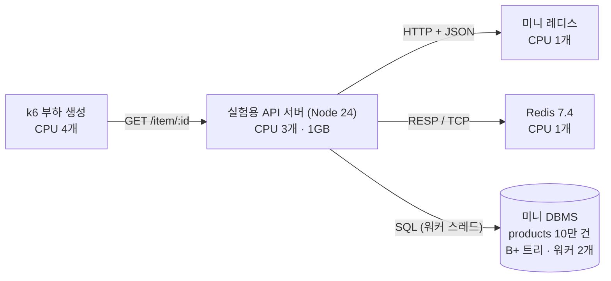
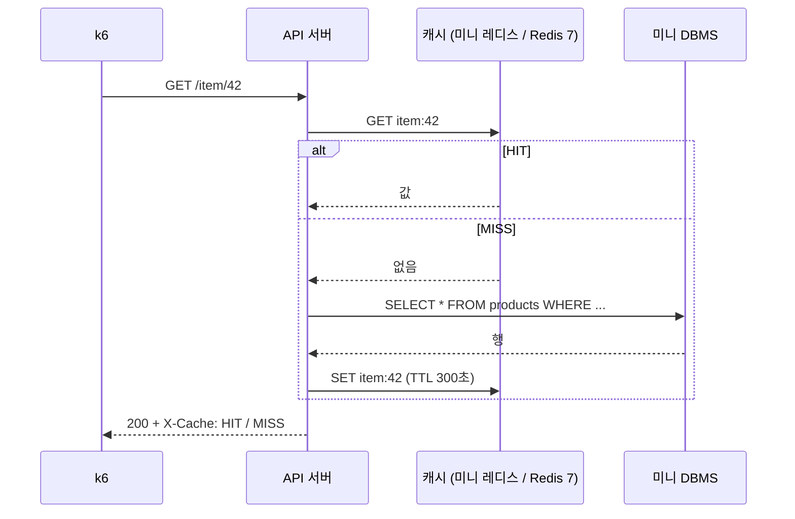

11~12주차

# miniReact · miniRedis · miniDBMS

정글 과제를 외부 프레임워크 없이 직접 구현하고, 공부하기 위한 학습 도구를 함께 만든 프로젝트입니다. 홈 왼쪽에서 주차를 고릅니다.

- **1주차 — 미니 리액트**: Virtual DOM · Diff · Patch 와 FunctionComponent · Hooks
- **2주차 — 미니 레디스**: 직접 만든 해시 테이블 키-값 저장소 (TTL, 무효화, AOF, HTTP API)
- **2주차 — 미니 DBMS**: SQL 처리기(CLI + 파일) → B+ 트리 인덱스(100만 건 비교) → 스레드 풀 API 서버

> 📢 **2주차 발표 자료:** 아래 [🔬 발표: 캐시는 정말 몇 배 빠를까?](#-발표-캐시는-정말-몇-배-빠를까--미니-레디스--미니-dbms-실측) 섹션을 위에서부터 스크롤하며 발표합니다.

## 🔬 발표: 캐시는 정말 몇 배 빠를까? — 미니 레디스 · 미니 DBMS 실측

> **한 줄 요약** — 직접 만든 미니 레디스 · 미니 DBMS 와 실제 Redis 7 을 같은 조건(Docker 자원 고정)에서 k6 로 210회 측정했습니다. 캐시 효과는 "항상 N배" 가 아니라 **공식으로 예측되고**, 가벼운 쿼리에서는 **오히려 손해**일 수 있습니다.

### ① 무엇을 만들었고, 무엇이 문제였나

| 우리가 만든 것 | 핵심 |
| --- | --- |
| **미니 레디스** | 직접 만든 해시 테이블 키-값 저장소 · TTL · 태그 무효화 · AOF · HTTP + JSON API |
| **미니 DBMS** | SQL 처리기 · B+ 트리 인덱스 · 읽기/쓰기 락 · 스레드 풀 워커 |

지난주 측정에서 **"캐시를 붙이면 10.7배"** 가 나왔습니다. 그런데 원본 "DB" 는 진짜 쿼리가 아니라 `await sleep(120)` 이었습니다.

| | 계산 |
| --- | --- |
| VU 50명이 120ms 씩 기다리면 이론 상한 | 50 ÷ 0.120s = **416 req/s** |
| 실측 | **401 req/s** |

→ 10.7배는 캐시의 성능이 아니라 **sleep 값이 정한 숫자**였습니다. 그래서 질문을 바꿨습니다.

> **진짜 DB 앞에서, 캐시는 언제 몇 배 이득이고 언제 손해인가? 그리고 그걸 누가 돌려도 같은 결과로 말할 수 있는가?**

### ② 실험 구조와 데이터 흐름



요청 하나는 **cache-aside** 순서로 처리됩니다.



| 바꿔 가며 잰 것 | 값 |
| --- | --- |
| 캐시 | 없음 · 미니 레디스 · Redis 7 |
| 원본 쿼리 | **무거움**: `WHERE name = ?` 전체 읽기 (약 82ms) · **가벼움**: `WHERE id = ?` B+ 트리 조회 |
| 히트율 | 0 · 50 · 80 · 90 · 95 · 99 · 100% (설정이 아니라 응답 헤더로 **실측**) |
| 부하 | VU 1명 (대기열 없음) · VU 50명 (DB 가 병목) · YCSB A/B/C (Zipf θ=0.99) |

### ③ 공정한 비교를 위한 결정과, 측정 중 만난 문제

| 결정 | 이유 |
| --- | --- |
| 컨테이너마다 **다른 CPU 코어**(cpuset)와 메모리 제한 | k6 와 서버가 CPU 를 뺏으면 누가 느린지 구분 불가 |
| 두 캐시 모두 **영속성 끔 · 스레드 1개** | 미니 레디스와 Redis 의 조건을 맞춤 |
| 히트율은 **MISS 요청마다 새 캐시 키** | 무작위 키는 캐시가 차면서 히트율이 계속 변함 → 정확히 h% 로 고정 |
| 조건마다 **5회 반복, 반복마다 순서를 섞음** + 95% 신뢰구간 | 한 번 잰 숫자는 우연일 수 있음 · 발열 같은 시간 효과가 한 조건에 몰리지 않게 |
| 업계 표준 **YCSB** 워크로드 | "내 마음대로 정한 패턴" 이라는 비판을 피함 |

측정하면서 **결과가 오염된 것을 두 번 발견하고 고쳤습니다.**

| 증상 | 원인 | 해결 |
| --- | --- | --- |
| 210회 중 10회가 **요청 0건** | 측정 전 캐시 채우기를 무거운 쿼리로 1,000번 → 60초 제한 초과 | 값은 같으므로 채울 때만 B+ 트리 조회로 (60초 → 0.08초) |
| 같은 조건인데 **앞 회차와 뒤 회차가 2~4배 차이** | YCSB 쓰기(INSERT)가 테이블을 **10만 → 34만 건**으로 키워 전체 읽기가 점점 느려짐 | 측정마다 테이블 파일을 처음 크기로 잘라 **정확히 10만 건**으로 되돌리고 검증 → 210회 전부 다시 측정 |

<details><summary>코드 보기 — 히트율 고정, 테이블 되돌리기</summary>

```js
// k6: 확률 HIT 로 미리 데운 키, 나머지는 한 번도 쓴 적 없는 키 → 반드시 MISS
Math.random() < HIT
  ? http.get(url(rnd(HOT)))
  : http.get(url(rnd(ROWS), `&v=${vu}-${iter}`));

// API 서버: INSERT 는 파일 끝에만 붙으므로(append-only) 처음 크기로 자르면 정확히 되돌아간다
await db.close();
truncateSync(TBL, BASE_BYTES);
db = createDbService({ dir: DATA_DIR, workers: DB_WORKERS });   // B+ 트리 재구성 후 10만 건인지 검사
```

</details>

### ④ 결과 — 210회 측정, 신뢰도 96.2%

| # | 발견 | 숫자 |
| --- | --- | --- |
| 1 | 처리량은 **X_db ÷ (1 − 히트율)** 공식대로 늘어난다 | 히트율 95% 까지 공식과 오차 **±7% 이내** |
| 2 | 가벼운 쿼리에서 미니 레디스는 **히트율 100% 여도 손해** | 캐시 없음 대비 **0.92배** (Redis 7 은 3.95배) |
| 3 | 쓰기가 늘수록 캐시 이득이 사라진다 | Redis 7: 읽기 100% **1.51배** → 쓰기 50% **1.01배** |

#### 발견 1 · 무거운 쿼리: 히트율이 곧 배율


| 히트율 | 공식이 말하는 배율 1/(1−h) | 미니 레디스 | Redis 7 |
| --- | --- | --- | --- |
| 0% | 1배 | 22.8/s (1.0배) | 22.8/s (1.0배) |
| 50% | 2배 | 45.6/s (2.0배) | 44.9/s (2.0배) |
| 90% | 10배 | 207.9/s (9.1배) | 217.3/s (9.5배) |
| 95% | 20배 | 429.5/s (18.8배) | 450.5/s (19.8배) |
| 99% | 100배 | 1,805/s (79배) | 1,953/s (86배) |
| 100% | 캐시의 한계 | 4,335/s (190배) | **18,856/s (827배)** |

- **이유:** DB 는 1초에 22.8건밖에 못 합니다(무거운 쿼리 82ms × 워커 2개). DB 로 가는 몫이 (1 − h) 이니, 전체 처리량은 X_db ÷ (1 − h).
- **99% 에서 공식보다 16~19% 낮은 이유:** VU 50명으로 부하를 고정했기 때문에, 드물게 오는 MISS 가 수 초씩 VU 를 붙잡아 캐시로 보낼 요청 자체가 줄어듭니다.
- **이 공식이 "모두에게 같은 결과" 입니다.** 내 DB 처리량과 히트율만 알면 캐시 이득을 계산할 수 있습니다.

#### 발견 2 · 가벼운 쿼리: 캐시가 손해일 수 있다


| 캐시 없음 4,969/s 대비 | 히트율 0% | 90% | 100% |
| --- | --- | --- | --- |
| 미니 레디스 | 1,919/s (**0.39배**) | 3,832/s (**0.77배**) | 4,555/s (**0.92배**) |
| Redis 7 | 4,900/s (0.99배) | 13,585/s (2.73배) | 19,602/s (3.95배) |

**왜 미니 레디스만 느린가 — 히트율 100% 동안 CPU 사용률**

| | API 서버 | 캐시 서버 | k6 (4코어 중) |
| --- | --- | --- | --- |
| 미니 레디스 | **122%** | 28% | 120% |
| Redis 7 | 99% | 37% | 282% |

미니 레디스 **서버는 28% 만 씁니다.** 느린 건 저장소가 아니라 **API 서버가 캐시를 부를 때마다 HTTP 요청을 만드는 비용**(헤더 · URL · JSON)입니다. B+ 트리 조회 한 번이 그보다 싸서, 캐시를 거치는 게 손해가 됩니다. Redis 는 연결 하나로 짧은 RESP 메시지를 이어 보내므로 이 비용이 거의 없습니다.

<details><summary>추가 실험 — E1 응답시간 공식 · E4 YCSB</summary>

**E1 · 대기열이 없을 때(VU 1명) 응답시간 = h × T_hit + (1 − h) × T_miss**


| 캐시 | 히트율 | 실측 | 공식 예측 | 오차 |
| --- | --- | --- | --- | --- |
| 미니 레디스 | 47.7% | 45.13ms | 43.68ms | +3.3% |
| 미니 레디스 | 89.4% | 9.60ms | 9.28ms | +3.5% |
| Redis 7 | 49.2% | 42.35ms | 41.36ms | +2.4% |
| Redis 7 | 90.3% | 8.56ms | 8.17ms | +4.7% |
| Redis 7 | 98.9% | 1.15ms | 1.16ms | −1.2% |

**E4 · YCSB 표준 워크로드 (Zipf θ=0.99, B+ 트리 조회, VU 50)**


| 워크로드 | 캐시 없음 | 미니 레디스 | Redis 7 |
| --- | --- | --- | --- |
| C · 읽기 100% | 7,940/s | 3,318/s (0.42배, 히트 78%) | 12,021/s (**1.51배**, 히트 90%) |
| B · 읽기 95 : 쓰기 5 | 7,111/s | 2,795/s (0.39배, 히트 71%) | 8,127/s (1.14배, 히트 79%) |
| A · 읽기 50 : 쓰기 50 | 5,002/s | 2,138/s (0.43배, 히트 35%) | 5,060/s (1.01배, 히트 39%) |

쓰기마다 캐시를 지우니(DEL) 히트율이 떨어지고, 쓰기 락이 읽기를 막습니다.
※ 미니 DBMS 에 UPDATE 가 없어 쓰기는 INSERT + 캐시 DEL 로 대신했습니다.

</details>

**이 숫자를 믿을 수 있는 이유**

| 점검 | 결과 |
| --- | --- |
| 성공률 (요청 1건 이상 · 에러 1% 미만) | **210 / 210** |
| 재현성 (각 회차가 그 조건 중앙값의 ±15% 안) | **202 / 210 (96.2%)** |
| 조건별 변동계수(CV) | 최대 12.2% · 42개 중 37개가 10% 이하 |
| 시간에 따른 변화 (앞 회차 vs 뒤 회차) | ±10% 를 넘는 조건 4 / 42개 (약한 워밍업 효과) |
| k6 가 병목이 아닌지 | 가장 빠른 조건에서도 k6 는 4코어 중 282% 사용 (여유 있음) |

### ⑤ 재현 방법 · 한계 · 다음 과제

```bash
docker compose -f experiment/docker-compose.yml up -d --build --wait   # 컨테이너 4개 (자원 제한 포함)
node experiment/run.js --reps 5                                         # 42개 조건 × 5회 (약 1시간)
node experiment/analyze.js                                              # 중앙값 · 신뢰구간 · 공식 오차 · 그래프
```

절대값은 컴퓨터마다 다릅니다. 같아야 하는 것은 **배율, 경향, 공식과의 오차**입니다. 측정 환경은 [`experiment/results/env.json`](experiment/results/env.json), 전체 표는 [`summary.md`](experiment/results/summary.md) 에 있습니다.

| 한계 | 영향 |
| --- | --- |
| 노트북 한 대 (Intel Core Ultra 5 125H, Docker/WSL2) | 네트워크 지연이 거의 0 → 실제 서버보다 캐시 왕복 비용이 작게 나옴. **가벼운 쿼리에서의 손해는 실제로 더 클 것** |
| 프로토콜이 다름 (HTTP+JSON vs RESP) | 저장소 엔진만의 비교가 아니라 "만든 그대로의 시스템" 비교 |
| 값 약 100바이트, 측정 10초 | 큰 값 · 메모리 가득 찬 상황(eviction)은 다루지 않음 |

**다음 과제:** 팀원 노트북에서 재현해 배율 비교 · 미니 레디스에 RESP(TCP) 프로토콜 붙여서 HTTP 비용만 따로 측정 · 네트워크 지연을 넣은 상태(`tc netem`)에서 손익분기 히트율 다시 재기

> 실험 코드는 AI 와 함께 작성했습니다. 코드의 원리는 [`experiment/CODE-NOTES.md`](experiment/CODE-NOTES.md), 발표 대본과 예상 질문은 [`experiment/PRESENTATION.md`](experiment/PRESENTATION.md) 에 정리했습니다.

## 실행

```bash
npm install     # 테스트용 jsdom 만 설치됨 (런타임 의존성 없음)
npm start       # http://localhost:5200  (시작 전에 자동으로 build)
npm test        # 단위 + 기능 테스트 429개 (1주차 + 2주차)
npm run build   # file:// 용 번들 생성 + 모든 페이지 상단 메뉴 동기화
```

2주차 명령 (자세한 것은 `/week2/redis/guide/`, `/week2/dbms/guide/`):

```bash
npm run redis                                 # 미니 레디스 단독 서버 (포트 6380, AOF: week2/data/redis.aof)
node week2/dbms/cli.js run query.sql          # Phase 1: SQL 파일 실행 (exec "SQL", seed users 1000000, info)
npm run bench:dbms                            # Phase 2: 100만 건 INSERT 후 인덱스 vs 선형 탐색 (임시 폴더)
npm run dbms                                  # Phase 3: 스레드 풀 API 서버 (포트 7000, POST /sql)
```

`npm start` 서버에도 같은 API 가 붙어 있습니다: `/api/redis/*`, `/api/demo/products/*`(미니 레디스를 캐시로 쓰는 느린 API), `/api/sql`. 데이터는 `week2/data/`(gitignore, 브라우저에서 열 수 없음).

HTML 파일을 더블클릭해서(`file://`) 열어도 동작합니다. 이때는 브라우저가 ES Module import 를 막기 때문에 `node build.js` 로 미리 합쳐 둔 `bundle.js` 를 대신 불러옵니다. 서버로 열면 원본 모듈을 그대로 씁니다. 소스를 고친 뒤 더블클릭으로 볼 때는 `npm run build` 를 먼저 실행하세요.

## 테스트 실험실 (나만 들어가는 페이지)

`npm start` 후 `http://localhost:5200/testlab/` → 비밀번호를 넣으면 버튼 하나로 테스트를 돌리고 출력을 실시간으로 볼 수 있습니다.

| 작업 | 내용 |
| --- | --- |
| 단위 · 기능 테스트 | `npm test` 와 같음 |
| 부하 테스트 / 한계 찾기 (k6) | 임시 데이터로 별도 서버를 띄워서 두드림 (`week2/data` 는 건드리지 않음). 끝나면 `load/reports/` 에 리포트 |
| DBMS 인덱스 vs 선형 탐색 | 10만 / 100만 건 |
| 브라우저 벤치마크 | `/bench/` — 1주차 미니 리액트를 실제 브라우저에서 측정 |
| 비교 실험 (기술 있음 vs 없음) | 같은 부하를 두 번, 매번 새 서버에서: 캐시 있음/없음 · 인덱스/전체 읽기 · 스레드 풀 4개/1개 · AOF everysec/always (`load/k6-compare.js`) |

결과는 `load/results/history.json` 에 쌓여서, 실험실의 **비교 결과**(있음 vs 없음, 몇 배)와 **지난번과 비교**(±10% 안은 측정 오차로 표시)에서 볼 수 있습니다.

첫 측정 (2026-11-07, 50명 · 20초씩):

| 비교 | 기술 있음 | 기술 없음 | 차이 |
| --- | --- | --- | --- |
| 캐시 | 4,296/s · p95 16ms | 401/s · p95 136ms | 10.7배 (다시 돌려도 10.4배) |
| 인덱스 | 10,534/s · p95 6ms | 406/s · p95 135ms | 26배 |
| 스레드 풀 | 워커 4개 422/s | 워커 1개 133/s | 3.2배 |
| AOF | everysec 13,983/s | always 843/s | 16.6배 (대신 always 는 끊겨도 잃는 쓰기가 없음) |

> ⚠️ 위 "캐시 10.7배" 는 원본이 `sleep(120ms)` 인 가짜 DB 라서 나온 숫자입니다 (50 ÷ 0.12s = 416/s 상한). 진짜 미니 DBMS 쿼리로 다시 잰 결과는 [🔬 발표 섹션](#-발표-캐시는-정말-몇-배-빠를까--미니-레디스--미니-dbms-실측)을 보세요.

**대안 비교** (우리 기술 vs 비슷한 다른 기술, `load/alt-bench.js` · 캐시는 k6) — 첫 측정 2026-11-07:

| 비교 | 우리 기술 | 대안 | 결론 |
| --- | --- | --- | --- |
| 캐시 | 미니 레디스 3,735/s | 서버 안 Map 14,702/s · 없음 396/s | Map 이 3.9배 빠름 (네트워크 없음). 대신 서버 여러 대가 나눠 쓰지 못하고 재시작하면 비워짐 |
| 인덱스 | B+ 트리: 범위 1,000개 0.016ms · 점 조회 0.12μs | 해시: 범위 1.04ms (65배 느림) · 점 조회 0.03μs / 정렬 배열: 10만 개 넣기 613ms (27배 느림) | 점 조회 · 범위 · 넣기를 고르게 잘하는 것은 B+ 트리 |
| 동시성 | 스레드 풀: 쿼리 5.2ms · 메인 스레드 3% | 요청마다 워커 25ms · 메인 스레드에서 바로 16.7ms (메인 100%) | 풀이 가장 빠르고 서버가 다른 요청에 답할 수 있음 |
| 영속성 | AOF everysec 587,596/s · 멈춤 15ms | always 475/s · 멈춤 441ms / 스냅샷 407,747/s · 멈춤 65ms | everysec 가 가장 빠르고 덜 멈춤. 대신 최대 1초치 손실 · 파일이 커짐 (재작성으로 줄임) |

결과 파일은 서버 여러 개가 같이 써도 서로 지우지 않습니다 (저장할 때 파일을 다시 읽어 합침).

- 잠금: `/testlab/`, `/bench/`, `/load/`. 비밀번호는 서버에서만 확인하고 `.env` 에는 scrypt 해시(`TESTLAB_PASSWORD_HASH`)만 저장합니다. 해시가 없으면 실험실은 열리지 않습니다.
- 로그인 세션 12시간 (HttpOnly · SameSite=Strict 쿠키), 15분 안에 5번 틀리면 로그인이 막힙니다.
- 비밀번호 바꾸기: `node server/testlab.js --set-password` (입력은 화면에 안 보임) → 서버 다시 켜기
- 서버는 같은 와이파이의 다른 기기에서도 접속할 수 있는 상태로 뜨므로, 비밀번호는 남에게 알려 주지 마세요.

## 학습 도우미 챗봇 (선택)

모든 페이지 오른쪽 아래의 **🤖 학습 도우미**는 Gemini API 를 씁니다. 키는 서버에만 두고 브라우저로 보내지 않습니다.

1. [Google AI Studio](https://aistudio.google.com/apikey) 에서 API 키 발급
2. `.env.example` 을 복사해 `.env` 로 저장하고 `GEMINI_API_KEY=발급받은키` 입력
3. `npm start` 로 서버 실행 → `http://localhost:5200/guide/`

- `.env` 와 `server/` 폴더는 개발 서버가 브라우저에 보여주지 않도록 막혀 있고, `.gitignore` 에도 들어 있습니다.
- 키가 없으면 챗봇은 "꺼짐" 으로 표시되고 나머지 페이지는 그대로 동작합니다. 파일을 더블클릭해서 열면 서버가 없으므로 챗봇은 쓸 수 없습니다.
- 선택: `GEMINI_MODEL` 로 모델 변경 (기본 `gemini-flash-lite-latest`)
- 빠른 `gemini-flash-lite-latest` 를 먼저 쓰고, 바쁘거나(503) 한도를 넘으면(429) `gemini-flash-latest` 로 자동으로 다시 시도합니다. `GEMINI_FALLBACK_MODELS=모델1,모델2` 로 순서를 바꾸거나, 빈 값으로 끌 수 있습니다. 모델 하나당 최대 10초를 기다리고(`GEMINI_TIMEOUT_MS`), 그보다 느려도 다음 모델로 넘어갑니다.
- 지금 보고 있는 페이지와 학습 가이드 진행 상황을 함께 보내서, "이 페이지에서 뭘 해?" 같은 질문에 그 페이지 기준으로 답합니다.

## 페이지

| 페이지 | 내용 |
|---|---|
| `/guide/` | **학습 가이드** — 볼 순서(12단계, 진행 체크), 예측 → 실행 → 확인 → 설명, 발표용 질문-시연 짝짓기 |
| `/phase1/` | **Diff Playground** — 실제/테스트 영역, Patch·뒤로가기·앞으로가기, 예시 케이스 9개, 단계별 Patch, 예측 퀴즈, 이전 ↔ 새 트리 비교 |
| `/phase2/` | **스터디 플래너** — Hooks 데모 + Inspector (렌더 원인, 단계별 시간, Hook 저장소) |
| `/examples/` | **예제 7개** — 장바구니, 회원가입, 칸반, 1,000행 리스트, 스톱워치, Effect 타이밍, Context. 망가뜨리기 실험 7개, Virtual DOM vs 전체 다시 그리기 비교 |
| `/sandbox/` | **샌드박스** — 틀 9개 + 조각 15개로 직접 만들고 실행. 콘솔, 에러 줄 표시, Inspector, 자동 저장 |
| `/walkthrough/` | **핵심 코드 해설** — 핵심 함수 9개를 조각마다 설명, 설명 연습 칸 |
| `/theory/` | **React 이론** — 브라우저 렌더링부터 React 19 까지, 직접 해보는 예제 4개 |
| `/deepdive/` | **개념 더 파고들기** — "왜 그렇게 만들었을까" 12주제(클로저 스냅샷, O(n) 가정, key 정체성, LIS, Hook 순서 설계, 이벤트 루프, 경쟁 상태, 불변성, Fiber 시간 쪼개기, Render/Commit, VDOM vs Signals, miniReact 한계)와 miniReact 로 실제 돌아가는 실험 9개, 이해 체크 저장 |
| `/cheatsheet/` | **한 장 요약** — A4 한 장 인쇄용 |
| `/docs/` | **설명서** — 과제 중점 포인트 정리 |
| **2주차 · 미니 레디스** | 홈 왼쪽 WEEK 2 → 미니 레디스 (1주차와 같은 메뉴 구성) |
| `/week2/redis/guide/` | **레디스 학습 가이드** — 요구사항 → 구현 → 테스트 → 시연 체크리스트, 볼 순서, 발표 질문 |
| `/week2/redis/` | **미니 레디스 Playground** — 명령 콘솔, 해시 테이블 버킷·점진적 리해시, 만료, 캐시 성능·무효화, 동시성, AOF 강제 종료·복원, HTTP API |
| `/week2/redis/examples/` | **레디스 예제** — 로그인 세션, 요청 제한, 분산 락, 좋아요 카운터. 망가뜨리기 스위치 5개 |
| `/week2/redis/sandbox/` | **레디스 샌드박스** — redis · print() · time() 으로 직접 코딩, 틀 7개, 키 상태 보기 |
| `/week2/redis/walkthrough/` | **레디스 코드 해설** — 핵심 함수 7개 |
| `/week2/redis/theory/` | **레디스 이론** — 해시 테이블, 충돌, 리해시, TTL, 캐시·무효화, 퇴출, 동시성, AOF/RDB, API, 예상 질문 |
| `/week2/redis/deepdive/` | **레디스 더 파고들기** — 8주제: 해시 분포, 부하율, 점진적 리해시, KEYS 차단, 만료 표본, 스탬피드, AOF 크기 |
| `/week2/redis/cheatsheet/`, `/week2/redis/docs/` | **한 장 요약**(10칸) · **설명서** |
| **2주차 · 미니 DBMS** | 홈 왼쪽 WEEK 2 → 미니 DBMS |
| `/week2/dbms/guide/` | **DBMS 학습 가이드** |
| `/week2/dbms/phase1/` | **Phase 1 · SQL** — 토큰 → AST → 계획 → 결과와 읽은 파일 줄 |
| `/week2/dbms/phase2/` | **Phase 2 · B+ 트리** — 분할·검색 경로, 100만 건 인덱스 vs 선형 탐색 |
| `/week2/dbms/phase3/` | **Phase 3 · API 서버** — 스레드 풀·락 시뮬레이션, 실제 API 서버 |
| `/week2/dbms/examples/` | **DBMS 예제** — 회원 가입(SQL 인젝션), 게시판 캐시, 페이지 넘기기, 이메일 인덱스. 망가뜨리기 스위치 3개 |
| `/week2/dbms/sandbox/` | **DBMS 샌드박스** — db · sql() · tokenize() · parse() 로 직접 코딩, 틀 7개, 테이블 상태 보기 |
| `/week2/dbms/walkthrough/` | **DBMS 코드 해설** — 핵심 함수 9개 (Phase 순서) |
| `/week2/dbms/theory/` | **DBMS 이론** — SQL 처리 흐름, 파서, 저장, 인덱스, B+ 트리, 실행 계획, 스레드 풀, 락, API, 실제 DB, 예상 질문 |
| `/week2/dbms/deepdive/` | **DBMS 더 파고들기** — 8주제: 차수와 높이, 채움률, 교착, 스레드 수, 인덱스의 비용, 선택도, 계획기 |
| `/week2/dbms/cheatsheet/`, `/week2/dbms/docs/` | **한 장 요약**(10칸) · **설명서** |

## 구조

```
src/lib/
  vdom.js        VNode, h(), domToVNode, createElement, setProp, 직렬화, key 경고
  diff.js        diff (INSERT/REMOVE/REPLACE/TEXT/PROPS + MOVE), key 재조정, LIS
  patch.js       applyPatches: path 기반으로 실제 DOM 반영
  history.js     StateHistory (뒤로/앞으로/go)
  component.js   FunctionComponent(hooks, mount, update), useState / useEffect / useLayoutEffect /
                 useMemo / useCallback / useRef / useReducer, createContext / useContext
  warn.js        개발 모드 경고 (key 누락, 중복 key, 언마운트 후 setState)
phase1/          playground.js (로직, 단계별 Patch), presets.js (예시 케이스), vtree.js (트리 비교), main.js (UI)
phase2/          app.js (컴포넌트), main.js
examples/        apps.js (예제 7개), experiments.js (망가뜨리기 실험), main.js
sandbox/         templates.js (틀, 조각), main.js
deepdive/        labs.js (실험 앱 + 계산 함수), main.js
week2/redis/     hashtable.js (FNV-1a, 체이닝, 점진적 리해시), miniredis.js (명령, TTL, 태그 무효화, AOF 재생/재작성),
                 persistence.js (AOF 파일, fsync 정책), api.js (HTTP API), client.js, demo-api.js (cache-aside), server.js, main.js (실습)
week2/dbms/      sql.js (토크나이저 + 파서), engine.js (실행기 + 실행 계획), bptree.js, storage.js (형식 + 메모리), storage-file.js,
                 cli.js, seed.js, bench.js, lock.js (읽기/쓰기 락), pool.js (스레드 풀), worker.js, service.js (API), server.js
week2/redis/{guide,examples,sandbox,walkthrough,theory,deepdive,cheatsheet,docs}   레디스 학습 페이지
week2/dbms/{phase1,phase2,phase3}   DBMS Phase 실습, view.js (표·트리 그리기)
week2/dbms/{guide,examples,sandbox,walkthrough,theory,deepdive,cheatsheet,docs}   DBMS 학습 페이지
week2/shared/    sandbox-runner.js (실행기, 시간 제한), sandbox-ui.js, examples-lab.js, deepdive-ui.js, theory-page.js, walkthrough-render.js
week2/week2.css  2주차 위젯 (나머지는 1주차 CSS 그대로)
server/          chat.js (챗봇 API: 시스템 프롬프트, 요청 검증, Gemini 중계)
tools/           inspector.js (공용 Render Inspector), sync-nav.js (상단 메뉴 동기화)
walkthrough/ theory/ cheatsheet/ guide/ docs/   학습용 정적 페이지
tests/           node:test + jsdom
```

## 핵심 흐름

```
setState → microtask 예약(batching) → render() → diff(prev, next) → applyPatches()
        → useLayoutEffect (그리기 전) → 브라우저가 화면 그림 → useEffect (그린 뒤)
```

## 차별점

- **LIS 기반 리스트 재정렬**: key 리스트의 이동 횟수를 최소화 (`[a,b,c,d] → [b,c,d,a]` 는 MOVE 1회)
- **MutationObserver 검증**: patch 가 실제 DOM 에 일으킨 변경 수를 화면에 표시
- **단계별 Patch / 예측 퀴즈 / 트리 비교**: Diff 결과를 하나씩 적용하며 순서 규칙을 눈으로 확인
- **Inspector**: 어떤 setState 들이 모여 렌더 1번이 됐는지, render·diff·patch·effect 단계별 시간, Hook 저장소의 각 칸
- **망가뜨리기 실험 7개**: 불변성 위반, 자식에서 Hook, 조건부 Hook, key 제거, useMemo 끄기, cleanup 제거, index key 를 버튼 하나로
- **실제 React 와 같은 effect 타이밍**: useLayoutEffect(그리기 전) / useEffect(그린 뒤), 언마운트·다음 업데이트 전 밀린 effect 처리
- **Context**: createContext / useContext (상태를 만들지 않는 읽기라서 자식에서도 허용)
- **안전장치**: 자식 컴포넌트 Hook 호출, Hook 개수·순서 변화, 무한 업데이트 루프를 에러로 감지. 사용자 HTML 의 `<script>`·`on*` 속성 제거
- **useMemo 로 VNode 재사용 시 diff 생략** (참조 동일성)
- **퍼즈 테스트**: 무작위 트리 400쌍으로 "patch 결과 == 새로 그린 결과" 검증

## 테스트 (429개)

| 파일 | 내용 |
|---|---|
| `vdom.test.js` | h, domToVNode, createElement, setProp, 직렬화 왕복, sanitize, SVG |
| `diff-patch.test.js` | 5가지 케이스 + MOVE/LIS, 혼합 변경, 중복 key, 무작위 트리 퍼즈 |
| `history.test.js` | push / back / forward / go, 미래 기록 삭제, limit |
| `hooks.test.js` | 모든 Hook, batching, bail-out, effect 순서와 타이밍, cleanup, 규칙 위반 감지 |
| `advanced.test.js` | Context, 개발 모드 경고, 렌더 단계 시간·원인 기록 |
| `functional.test.js` | Phase 1 시나리오, Phase 2 클릭·입력·정렬·타이머·저장 |
| `examples.test.js` | Phase 1 예시 케이스, 예제 앱, 망가뜨리기 실험 |
| `chat.test.js` | 챗봇 서버: 요청 변환, 키를 헤더로만 전달, 키 없음/잘못된 요청/Gemini 오류 처리, `.env` 차단 (가짜 Gemini 서버 사용) |
| `deepdive.test.js` | 개념 더 파고들기: LIS 계획 = 실제 diff MOVE 수, Hook 칸 비교, 스냅샷/ref, index vs id key, 경쟁 상태 cleanup, 같은 배열 setState 무시, 조건부 Hook 에러 |
| `week2-redis.test.js` | 해시 테이블(충돌·확장·축소·점진적 리해시·퍼즈), 명령·옵션, 만료(가짜 시계), 태그/패턴 무효화, AOF 기록·재생·잘린 줄·재작성·강제 종료 후 복원 |
| `week2-redis-api.test.js` | HTTP API·클라이언트, 특수 문자 키, 잘못된 요청(400/404/405/409/413), 동시 INCR, cache-aside(HIT/MISS, 무효화, negative caching), 캐시 유무 성능 비교, 메인 서버 연결 |
| `week2-dbms.test.js` | SQL 파싱·에러 위치, 저장 형식 왕복(퍼즈), B+ 트리 구조 검증(차수 3~8), 실행 계획, 경계 조건, 원자적 다중 INSERT, 파일 재시작·64KB 넘는 레코드, CLI, 성능 비교 |
| `week2-dbms-server.test.js` | 읽기/쓰기 락(기아 방지), 동시 INSERT id 무결, 워커 간 인덱스 공유, 병렬 조회, 쓰기 중 읽기 대기, 에러 후 복구, 재시작 |
| `week2-pages.test.js` | 2주차 실습 페이지를 파일로 열어 실험 실행, 홈 3개 패널(1주차·레디스·DBMS), 트랙별 메뉴(1주차와 같은 모양), 모든 페이지 챗봇, 내부 링크 |
| `week2-learning.test.js` | 2주차 예제 앱과 망가뜨리기 스위치, 샌드박스 틀 전부·시간 제한, 코드 해설 = 실제 코드, 더 파고들기 실험의 결론(두 트랙), 학습 페이지 열기 |
| `alt-bench.test.js` | 서버 안 메모리 캐시(?cache=local · 무효화), 대안 비교 세 가지가 맞는 결과를 내는지 (작은 크기) |
| `testlab.test.js` | 테스트 실험실: 비밀번호 해시, 잠긴 경로, 쿠키, 5번 틀리면 잠금, 다른 사이트 요청 거절, 정해진 작업만 실행, 한 번에 하나, 로그아웃 |
| `learning-tools.test.js` | 단계별 Patch, 트리 비교, 샌드박스 틀 전부 실행, Effect 타이밍·Context 예제, Inspector 표시 |
