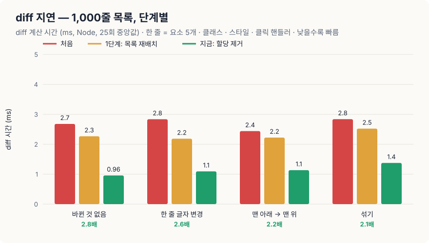
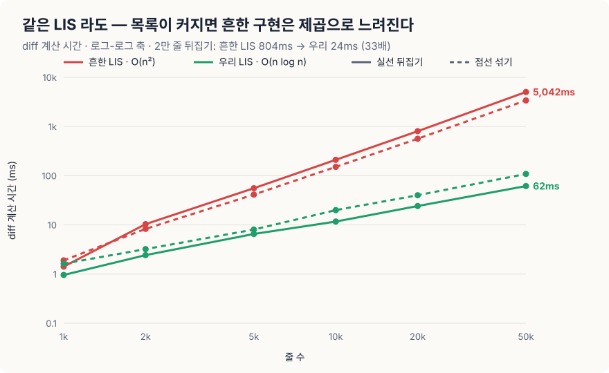
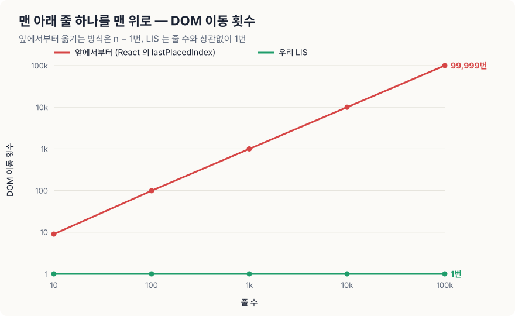
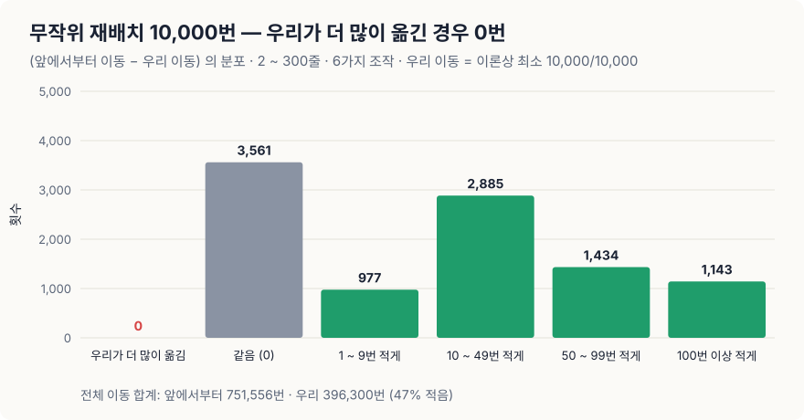
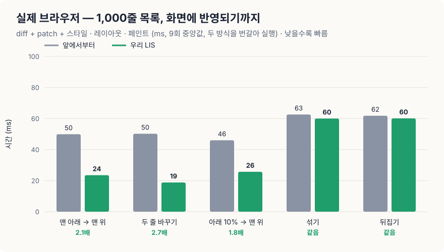
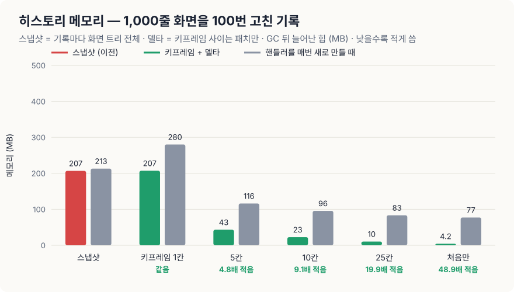

# miniReact · miniRedis · miniDBMS

> 외부 프레임워크 의존성 없이 순수 Vanilla JS로 직접 구현한 3대 코어 엔진(Virtual DOM, In-memory K-V Store, B+ Tree SQL DBMS)과 실측 벤치마크 프로젝트입니다.

| 코어 엔진 | 직접 구현한 핵심 기능 |
| :--- | :--- |
| **1주차 · miniReact** | Virtual DOM · 5가지 Diff & **LIS 기반 MOVE** Patch · **diff 지연 최적화** · **키프레임 + 델타 히스토리** · FunctionComponent · Hooks (`useState`, `useEffect` 등) |
| **2주차 · miniRedis** | FNV-1a 해시 테이블 · 점진적 리해시 · TTL 만료 · 태그/패턴 무효화 · AOF 영속성 · HTTP API |
| **2주차 · miniDBMS** | SQL 토크나이저/파서 · B+ 트리 인덱스 · 페이지 스토리지 · 읽기/쓰기 락 · 워커 스레드 풀 API |

> 📢 **발표 안내:** 아래 [🔬 발표: diff 지연을 줄이다](#-발표-diff-지연을-줄이다--minireact) 섹션을 위에서부터 스크롤하며 발표합니다. (발표 대본 및 1분 Q&A 스크립트는 [`move/PRESENTATION.md`](move/PRESENTATION.md) 참고)
> 🗂️ 2주차 발표(캐시는 정말 몇 배 빠를까?) 자료는 [`README-week2.md`](README-week2.md) 에 따로 보관했습니다.

---

## 🔬 발표: diff 지연을 줄이다 — miniReact

> **핵심 요약**  
> 1. 프로파일해 보니 diff 시간의 대부분은 알고리즘이 아니라 **노드마다 생기는 작은 메모리 할당**(경로 배열 · 속성 목록 배열)이었습니다. 이걸 없애 **모든 업데이트에서 2.1 ~ 3.3배** 빨라졌습니다 (1만 줄을 바뀐 것 없이 다시 그리기 38ms → 12ms).  
> 2. 목록 순서가 바뀔 때는 **흔한 LIS 구현에 숨은 O(n²)** 가 있었습니다. Fenwick 트리로 O(n log n) 으로 바꿔 5만 줄 뒤집기 diff 가 **2,978ms → 23ms** 가 됐습니다.  
> 3. diff 가 만드는 DOM 작업도 **이론상 최소**입니다. 1,000줄의 맨 아래 줄을 맨 위로 올리면 앞에서부터 옮기는 방식(React 의 `lastPlacedIndex`)은 999번, 우리는 1번 옮기고, 화면 반영이 2.0 ~ 3.4배 빠릅니다.  
> 4. 과제 요구사항인 **뒤로가기 · 앞으로가기**는 이동할 때마다 diff 를 했습니다. 이를 **키프레임 + 델타** 구조로 바꿔 한 칸 이동은 diff 없이 저장된 패치만 적용하고, 기록 메모리는 **207MB → 23MB** 가 됐습니다. 실제 영역을 다시 그리지 않아 입력하던 값과 포커스도 남습니다.  
> 5. 바꾸기 전 코드와 무작위 **4만 3천 건**의 패치를, 예전 히스토리와 무작위 **2,100번**의 이동을 대조해 결과가 하나도 다르지 않습니다.

### ① 무엇을 줄이려 했나 — diff 지연

상태가 바뀔 때마다 diff 는 **옛 VNode 트리와 새 트리 전체를 비교**해 실제 DOM 에 적용할 패치를 만듭니다. 바뀐 게 한 글자여도 트리 전체를 훑으므로, diff 시간은 **화면에 그린 노드 수에 비례**합니다. 브라우저가 화면을 다시 그리는 간격은 약 16.7ms 이고, diff · DOM 반영 · 레이아웃 · 페인트가 모두 이 안에 들어가야 끊기지 않습니다.

그래서 목표를 세 가지로 잡았습니다.
- **diff 자체를 빠르게** — 모든 업데이트에 해당
- **diff 가 만드는 DOM 작업을 최소로** — 목록 순서가 바뀔 때
- **diff 를 아예 안 해도 되는 곳에서는 없애기** — 히스토리 이동 (뒤로가기 · 앞으로가기)

### ② 어디서 시간이 쓰이나 — 프로파일

1만 줄(한 줄 = 요소 5개 · 클래스 · 스타일 · 클릭 핸들러)을 **바뀐 것 없이 다시 그리는 diff** 를 4초 동안 반복하며 CPU 프로파일을 떴습니다 ([`move/bench/profile.js`](move/bench/profile.js)).

| 함수 (할당 제거 전) | 자기 시간 | 무엇을 하나 |
| --- | ---: | --- |
| `diffChildren` | **44%** | 자식마다 `parentPath.concat(i)` 로 **경로 배열을 새로 만듦** — 바뀐 게 없어도 노드 수만큼 |
| `diffProps` | **16%** | 노드마다 `Object.keys` 배열 2개와 빈 결과 배열을 만듦 |
| `diffNode` · `diff` | 21% | 노드 비교 자체 |
| 쓰레기 수집 (GC) | 8% | 위에서 만든 배열을 치우는 비용 |
| LIS | **2 ~ 4%** | 옮길 줄을 고르는 계산 (목록 순서가 바뀔 때만) |

**놀라웠던 점:** 시간을 잡아먹는 건 LIS 같은 알고리즘이 아니라, 노드마다 "경로" 와 "속성 목록" 을 담으려고 만드는 **작은 배열**이었습니다. 패치가 하나도 안 생기는 경우에도 이 배열은 노드 수만큼 만들어졌습니다.

### ③ 공정하게 재기 위한 통제와 트러블슈팅

| 통제 | 방법 |
| --- | --- |
| **매번 새 VNode** | 실제 다시 그리기처럼 비교할 때마다 트리를 새로 만듭니다 (같은 객체면 diff 가 바로 끝나므로) |
| **단계를 번갈아 실행** | 처음 · 1단계 · 지금 세 버전을 돌아가며 먼저 실행하고, 워밍업 5회를 뺀 25회의 중앙값을 씁니다 |
| **결과가 같아야 비교한다** | 버전끼리 패치를 하나하나 대조하고, 브라우저 비교에서는 최종 순서와 입력칸이 같은지 확인합니다 |
| **실제 DOM 으로 센다** | DOM 이동 횟수는 패치 수가 아니라 브라우저의 **MutationObserver** 로 셉니다 |
| **비교 대상도 같은 조건** | "앞에서부터" 방식은 key 매칭 · 패치 형식 · 위치 계산 기법까지 우리와 같게 만들고, 옮길 줄을 고르는 규칙만 다르게 했습니다 ([`move/naive.js`](move/naive.js)) |

| 트러블슈팅 | 원인 | 해결 |
| --- | --- | --- |
| 비교 대상이 큰 목록에서 **불공정하게 느렸다** (1만 줄 섞기 203ms) | 처음 만든 "앞에서부터" 구현의 위치 계산이 O(n²) | 우리와 같은 기법으로 고치고 전부 다시 측정 |
| 섞기에서 **우리가 더 느렸다** (2,000줄 patch 25.3 vs 23.1ms) | `childNodes[i]` 는 DOM 이 바뀔 때마다 브라우저 내부 캐시가 무효가 되어, 무작위 위치를 찾을 때마다 앞에서부터 다시 센다 | 이어진 MOVE 는 형제 목록을 JS 배열로 들고 적용 → 동률 |
| 브라우저 창이 가려지면 **측정이 멈췄다** | 화면을 그리지 않는 탭에서는 `requestAnimationFrame` 이 멈춤 | 창을 띄운 상태에서 화면 반영(페인트 포함)까지 다시 측정 |
| 섞기에서 **LIS 만 27 ~ 31% 느리게** 나왔다 | 옮긴 줄을 1.2초 번쩍이는 애니메이션이 다음 측정 프레임의 페인트에 섞임 | 측정 중에는 애니메이션을 끄고 다시 측정 → 같은 속도 |

### ④ 개선 1 — 노드마다 생기던 할당을 없앴다 (모든 업데이트)

```
예전: 자식마다 새 경로 배열                      지금: 경로 배열 하나를 덮어쓰며 내려감
  diff(자식0, [0,3,0])  ← 새 배열                  stack = [0, 3, 0]   ← 같은 배열, 칸만 바꿈
  diff(자식1, [0,3,1])  ← 새 배열                  stack = [0, 3, 1]
  diff(자식2, [0,3,2])  ← 새 배열                  패치가 생길 때만 stack.slice(0, 깊이) 로 한 번 복사
```

- **경로**: 하나의 배열을 덮어쓰며 내려가고, 패치를 만들 때만 그 순간의 경로를 잘라 냅니다. 바뀐 게 없으면 경로를 하나도 만들지 않습니다.
- **속성 비교**: `Object.keys` 대신 `for..in` 으로 돌고, 바뀐 게 없으면 같은 빈 배열을 돌려줍니다.

<p align="center"></p>

| 줄 수 · 상황 | 처음 | 1단계 (목록 재배치) | **지금 (할당 제거)** | 처음 대비 |
| --- | ---: | ---: | ---: | ---: |
| 1,000줄 · 바뀐 것 없음 | 2.68 | 2.27 | **0.96** ms | **2.8배** |
| 1,000줄 · 한 줄 글자 변경 | 2.84 | 2.19 | **1.09** ms | **2.6배** |
| 1,000줄 · 맨 아래 → 맨 위 | 2.44 | 2.22 | **1.13** ms | **2.2배** |
| 1,000줄 · 섞기 | 2.84 | 2.52 | **1.38** ms | **2.1배** |
| 1만 줄 · 바뀐 것 없음 | 38.4 | 23.5 | **12.0** ms | **3.2배** |
| 1만 줄 · 한 줄 글자 변경 | 39.2 | 29.1 | **11.9** ms | **3.3배** |
| 1만 줄 · 맨 아래 → 맨 위 | 35.5 | 25.6 | **13.1** ms | **2.7배** |
| 1만 줄 · 섞기 | 179.3 | 35.5 | **23.4** ms | **7.6배** |

<sub>diff 계산 시간 (Node 24, 25회 중앙값). "처음" = 최적화 전 코드 ([`move/bench/lis-common.js`](move/bench/lis-common.js)), "1단계" = 목록 재배치 최적화 뒤 ([`move/bench/diff-v1.js`](move/bench/diff-v1.js)), "지금" = [`src/lib/diff.js`](src/lib/diff.js).</sub>

### ⑤ 개선 2 — 목록 재배치에 숨은 O(n²)

목록 순서가 바뀌면 diff 는 key 로 같은 줄을 찾고, **LIS(최장 증가 부분 수열)** 로 "이미 순서가 맞는 줄" 은 두고 나머지만 옮깁니다. LIS 는 "누구를 옮길지" 만 정하고, 각 줄을 **몇 번째에서 몇 번째로** 옮길지는 따로 계산해야 합니다. 흔한 구현(우리 첫 구현도)은 옮길 때마다 배열을 `indexOf` 로 훑고 `splice` 로 빼고 넣습니다. 한 번에 n, 그걸 n번 하니 **O(n²)** 입니다.

<p align="center"></p>

| 줄 수 | 섞기: 흔한 LIS → **우리** | 배율 | 뒤집기: 흔한 LIS → **우리** | 배율 |
| ---: | ---: | ---: | ---: | ---: |
| 1,000 | 1.8 → **0.66** ms | 2.8× | 1.4 → **0.46** ms | 3.0× |
| 10,000 | 146 → **9.5** ms | 15× | 204 → **3.5** ms | 58× |
| 50,000 | 3,027 → **69** ms | 44× | 2,978 → **23** ms | **127×** |

<sub>한 줄 = 요소 3개 (Node 24, 9회 중앙값 · 2만 줄 이상 5회). "우리" 에는 ④ 의 할당 제거도 들어 있습니다. 1,000줄에서는 차이가 작아 작은 테스트로는 보이지 않습니다.</sub>

**어떻게 줄였나 — 좌표 + Fenwick 트리.** 모든 줄이 "최종적으로 있게 될 자리" 는 미리 알 수 있습니다. 지금 자리와 옮겨 갈 자리를 한 줄의 좌표로 세워 두고, **"지금 몇 번째인가" = 내 좌표 앞에 지금 DOM 에 있는 노드 수** 를 Fenwick 트리로 O(log n) 에 셉니다.

```
옛 순서 a b c d e  →  새 순서 d a e b c        (LIS = a b c, 옮길 줄 = d e)

좌표 줄 :  d'  a  e'  b  c  d  e         d' e' = 옮겨 갈 자리 (d 는 a 바로 앞, e 는 b 바로 앞)
처음 DOM:  ·   ●  ·   ●  ●  ●  ●         ● = 지금 DOM 에 있는 노드

e 옮기기:  from = e  앞의 ● 수 = 4  →  e 끄고 e' 켬  →  to = e' 앞의 ● 수 = 1     MOVE 4 → 1
d 옮기기:  from = d  앞의 ● 수 = 4  →  d 끄고 d' 켬  →  to = d' 앞의 ● 수 = 0     MOVE 4 → 0
```

### ⑥ diff 가 만드는 DOM 작업도 최소로 — LIS MOVE

새 순서대로 각 줄의 옛 위치를 적으면, **증가하는 순서로 이어진 줄은 서로의 상대 순서가 이미 맞으므로** 옮길 필요가 없습니다. 나머지는 어떤 방법으로도 한 번은 옮겨야 하므로 $\text{최소 이동} = \text{남은 줄 수} - \text{LIS 길이}$ 입니다.

<p align="center"></p>

<p align="center"></p>

- 무작위 재배치 **1만 번** 중 우리가 앞에서부터 방식보다 더 많이 옮긴 경우는 **0번**, 1만 번 모두 이론상 최소였습니다. 전체 이동은 **47% 적습니다**.

<p align="center"></p>

| 줄 수 | 맨 아래 → 맨 위<br>앞에서부터 / **LIS** | 두 줄 바꾸기<br>앞에서부터 / **LIS** | 아래 10% → 맨 위<br>앞에서부터 / **LIS** | 섞기<br>앞에서부터 / **LIS** | 뒤집기<br>앞에서부터 / **LIS** |
| ---: | ---: | ---: | ---: | ---: | ---: |
| 250 | 18.4 / 17.6 | 18.1 / 17.0 | 18.2 / 18.2 | 18.8 / 18.6 | 18.4 / 18.6 |
| 1,000 | 53.4 / **20.7** (2.6×) | 47.0 / **14.8** (3.2×) | 45.7 / **23.0** (2.0×) | 61.6 / 59.7 | 58.9 / 61.5 |
| 2,000 | 102.3 / **42.0** (2.4×) | 95.3 / **28.2** (3.4×) | 94.4 / **47.7** (2.0×) | 130.2 / 127.5 | 129.0 / 122.8 |

<sub>Chrome · 패치 직전부터 다음 화면까지 = diff + patch + 스타일 · 레이아웃 · 페인트 (ms, 9회 중앙값, 두 방식을 서로 다른 프레임에서 번갈아 실행, 개선 반영 후(804e335) 측정). 250줄은 두 방식 모두 한 프레임(약 16.7ms) 안이라 차이가 보이지 않습니다.</sub>

- 화면 반영 시간의 대부분은 레이아웃 · 페인트입니다 (1,000줄에서 diff 는 약 1ms). 그래서 **옮기는 DOM 노드를 줄이는 것**이 화면 시간에는 더 크게 작용합니다.
- 옮기는 중에도 **입력이 끊기지 않습니다**: `moveBefore` (Chrome 133+) 로 노드를 떼지 않고 옮기고, 없는 브라우저에서는 옮기는 횟수가 같은 방법 중 입력 중인 줄을 남기는 쪽을 고릅니다 (1,000줄 "한 칸 아래로" 998가지에서 포커스 줄을 옮긴 경우 998번 → 0번).

### ⑦ 히스토리 이동 — diff 를 아예 하지 않기 (키프레임 + 델타)

과제 요구사항: **뒤로가기 · 앞으로가기로 state history 에 저장된 Virtual DOM 으로 이동하고, 실제 영역과 테스트 영역이 함께 바뀌어야 합니다.**
처음 구현은 기록마다 **화면 트리 전체**를 저장하고, 이동할 때마다 **diff(지금 화면, 목표 화면)** 을 계산했습니다. 1,000줄 화면이면 기록 하나가 1,000줄짜리 트리이고, 뒤로가기 한 번이 diff 한 번입니다.

**개조 — 동영상 코덱의 I-프레임 / P-프레임과 같은 구조** ([`src/lib/history.js`](src/lib/history.js) `DeltaHistory`)

```
기록:   #0        #1      #2      …   #10       #11     …
       [트리]    [±패치]  [±패치]      [트리]    [±패치]
       키프레임   ↑ 앞으로 · 뒤로 가는 패치만      키프레임 (10칸마다)

뒤로가기 · 앞으로가기 (한 칸) → 저장해 둔 패치를 그대로 실제 영역에 적용        diff 0번
멀리 이동 (#3 → #48)         → 가까운 키프레임(#50)에서 패치로 #48 을 다시 만듦  diff 1번
```

- 저장된 패치만으로 과거 · 미래의 화면 트리를 다시 만들려고 **패치를 VNode 트리에 적용하는 함수**를 만들었습니다 ([`applyPatchesToVNode`](src/lib/patch.js)). 바뀐 경로만 복사하고 나머지 하위 트리는 공유합니다.
- 실제 영역은 **다시 그리지 않고 패치만** 적용합니다. 그래서 이동해도 사용자가 입력하던 값 · 포커스가 남습니다. 저장된 패치가 입력 중인 줄을 옮기게 되면 그때만 diff 를 다시 해서 그 줄을 지킵니다.

<p align="center"></p>

| 1,000줄 화면 · 100번 고친 기록 | 스냅샷 (처음) | **키프레임 + 델타 (10칸마다)** |
| --- | ---: | ---: |
| 기록 메모리 | 206.9 MB | **22.7 MB (9.1배 적음)** |
| 한 칸 뒤로가기 (실제 영역에 적용할 패치 얻기) | 0.87 ~ 1.76 ms (diff) | **0.003 ms** (저장된 패치) |
| 50칸 점프 | 0.87 ~ 2.10 ms | 0.73 ~ 0.75 ms |
| 기록 하나 쌓기 (push) | 0.84 ~ 0.90 ms | **1.60 ~ 2.31 ms (느려짐)** |
| 이동 뒤 실제 영역의 입력값 | 다시 그리면 **0 / 5** | **5 / 5 + 포커스 유지** |

<sub>한 줄 = 요소 5개 · 클래스 · 스타일 · 클릭 핸들러(하나를 계속 씀). 고칠 때마다 트리 전체를 새로 만듭니다 (70% 한 줄 글자 · 15% 한 줄 맨 위로 · 10% 추가 · 5% 삭제). 메모리는 GC 뒤 늘어난 힙, 시간은 25회 중앙값을 두 번 잰 범위입니다 ([`move/bench/history.js`](move/bench/history.js)). 입력값은 테스트로 확인합니다 ([`tests/history-delta.test.js`](tests/history-delta.test.js)).</sub>

- **키프레임 간격은 메모리와 점프 시간의 트레이드오프**입니다. 5칸마다 43MB, 25칸마다 10MB 이고, 간격이 넓을수록 멀리 이동할 때 다시 만들 칸이 늘어납니다.
- **대가**: 기록을 쌓을 때 "뒤로 가는 패치" 를 만들려고 diff 를 한 번 더 해서 push 가 약 1ms 느려집니다. 이동보다 기록이 훨씬 잦은 화면이라면 손해일 수 있습니다.
- **클릭 핸들러를 매번 새로 만들면** (`onClick: () => …`) 컴포넌트 밖에서 diff 한 기록은 바뀐 게 없어도 줄마다 패치가 생겨 이득이 줄어듭니다 (213 → 96MB, 2.2배). 컴포넌트가 관리하는 화면에서는 이런 핸들러 변경을 패치하지 않습니다 (⑧ 표 11번).

### ⑧ 직접 만든 최적화 전체

| # | 문제 | 해결 | 효과 |
| --- | --- | --- | --- |
| 1 | 자식마다 경로 배열을 새로 만듦 (프로파일 44%) | 경로 배열 하나를 덮어쓰고, 패치가 생길 때만 복사 | 모든 업데이트 diff **2.1 ~ 3.3배** (④) |
| 2 | 노드마다 `Object.keys` 배열 · 빈 결과 배열 (16%) | `for..in`, 바뀐 게 없으면 같은 빈 배열 | ④ 에 포함 |
| 3 | 옮길 위치를 `indexOf` · `splice` 로 찾아 **O(n²)** | 좌표 + **Fenwick 트리** → **O(n log n)** | 5만 줄 뒤집기 diff **2,978ms → 23ms** (⑤) |
| 4 | 두 줄만 바뀌어도 전체로 Map · LIS 를 만듦 | 같은 자리끼리 key 를 먼저 비교, 어긋난 자리 8개 이하면 그 자리만 처리하는 **빠른 길** | 바뀐 게 없으면 패치 0개 |
| 5 | 매칭에 노드 객체 Map · Set 을 여러 개 생성 | old 인덱스 + 타입 배열 | 1,000줄 섞기 diff 2.39 → 1.77ms (1단계 측정) |
| 6 | LIS 함수: `undefined` · `null` 이 섞이면 결과가 짧아짐, 정렬된 구간도 매번 이분 탐색 | 비교할 수 없는 값은 건너뜀, 끝보다 크면 바로 붙이는 빠른 길, 타입 배열 | LIS 계산 거의 정렬 6.3배 · 정렬됨 7.8배 (5만 개) |
| 7 | 섞기에서 `childNodes[i]` 무작위 접근 비용 | 이어진 MOVE · INSERT 는 형제 목록을 JS 배열로 들고 적용 | 2,000줄 섞기 patch 15.0 → 10.3ms |
| 8 | MOVE 하나에 `removeChild` + `insertBefore` | `insertBefore` 한 번 | DOM 호출 절반 |
| 9 | 옮기면 입력 중이던 칸의 포커스 · 커서가 풀림 | `moveBefore` (Chrome 133+), 없으면 입력 중인 줄을 남기는 **가중치 LIS** | 포커스 유지, "한 칸 아래로" 998번 → 0번 |
| 10 | 히스토리가 기록마다 화면 트리 전체를 저장하고, 이동할 때마다 diff | **키프레임 + 델타**: 10칸마다 트리, 그 사이는 앞 · 뒤 패치. 한 칸 이동은 저장된 패치만 | 메모리 9.1배 적음, 한 칸 이동 diff 0번, 입력값 · 포커스 유지 (⑦) |
| 11 | `onClick: () => …` 처럼 매번 새로 만드는 핸들러 때문에 바뀐 게 없어도 줄마다 PROPS 패치 | 컴포넌트가 관리하는 화면에서는 핸들러 변경을 패치하지 않고, **클릭할 때 최신 VNode 에서 핸들러를 찾음** (React 와 같은 생각) | 1,000줄 업데이트 패치 1,001 → 1개, patch 0.30 ~ 0.44 → 0.01ms |
| 12 | 자식 컴포넌트는 매번 새 객체 → 안 바뀐 줄도 끝까지 비교 | **memo(Component)**: 같은 key · 같은 props 면 지난 결과 객체를 그대로 → diff 가 건너뜀 | 바뀐 줄만 다시 실행 · 비교 |
| 13 | 히스토리 기록마다 뒤로 가는 diff 를 한 번 더 | 앞으로 패치를 **뒤집어서** 뒤로 가는 패치를 만듦 (옛 값이 이미 패치에 있음) | 기록 비용 0.122 → 0.007ms |
| 14 | 뒤로 간 뒤 새로 고치면 원래 미래가 버려짐 | **분기 히스토리 (Undo Tree)**: 갈래로 남기고 어느 쪽으로든 이동 | Phase 1 에서 갈래 표시 |
| 15 | diff 가 모듈 전역 상태 · patch 실패 시 화면과 VDOM 이 어긋남 | 호출마다 문맥(ctx), 실패하면 새 트리로 다시 그려 복구 | diff 안에서 diff 를 불러도 안전 |

> 🧪 해 봤지만 넣지 않은 것: **붙어 있는 줄을 묶어 한 번에 옮기기**. DOM 변경 기록은 200 → 101 로 줄었지만 시간은 그대로였고 (5.2 vs 5.4ms, 브라우저 비용은 옮긴 줄 수에 비례), 묶음으로 떼어 내면 포커스도 풀려서 넣지 않았습니다.

### ⑨ 검증

- 바꾸기 전 코드와 무작위 **4만 3천 건**의 패치를 경로까지 하나하나 대조해 모두 같았습니다.
- 긴 목록 무작위 재배치 **600번**에서 DOM 결과 · 노드 재사용 · 최소 이동을 확인하고, 2만 줄 뒤집기가 400ms 안에 끝나는지 테스트합니다 ([`tests/diff-patch.test.js`](tests/diff-patch.test.js)).
- 깊이가 다른 여러 곳이 바뀌어도 각 패치의 경로가 맞는지, 바뀐 게 없으면 패치가 0개인지 테스트합니다.
- 키프레임 + 델타 히스토리를 예전 스냅샷 히스토리와 나란히 두고 무작위 **2,100번** (쌓기 · 뒤로 · 앞으로 · 점프) 움직여, 매번 화면 트리와 실제 DOM 이 같은지 확인합니다. 패치를 VNode 에 적용하는 함수는 무작위 트리 2만 쌍에서 결과가 맞고 원래 트리를 바꾸지 않습니다.

### ⑩ 한계

| 한계 | 내용 |
| --- | --- |
| **diff 는 화면 시간의 일부** | 1,000줄에서 diff 는 약 1ms, 화면 반영은 20 ~ 60ms 입니다. diff 를 2배 줄여도 이 크기에서는 화면 시간이 크게 달라지지 않습니다. 노드가 많거나 CPU 가 느린 기기(모바일)일수록 diff 몫이 커집니다 |
| **새로 만든 이벤트 핸들러** | 컴포넌트가 관리하는 화면에서는 핸들러 변경을 패치하지 않고 클릭할 때 최신 VNode 에서 찾습니다 (1,000줄 업데이트 패치 1,001 → 1개). 컴포넌트 밖에서 diff 를 직접 부르면 예전처럼 속성 패치가 생깁니다 |
| **히스토리 기록 비용** | 키프레임 + 델타는 기록할 때 diff 를 한 번 더 해서 push 가 약 1ms 느려집니다. 이동이 드물고 기록이 잦은 화면에서는 손해일 수 있습니다 |
| **key 없음과 비교하면** | 섞기처럼 거의 다 움직이면 노드를 옮기는 브라우저 비용 때문에 key 없이 글자만 고치는 쪽이 빠릅니다. 대신 입력값이 밀립니다 |
| **비교 대상** | "앞에서부터" 는 React 본체가 아니라 그 이동 규칙을 같은 조건에서 구현한 것이고, "처음" · "흔한 LIS" 는 우리 최적화 전 코드입니다 |
| **측정 환경** | 노트북 한 대 · Node 24 · Chrome 한 종류 |

### ⑪ 재현 방법

```bash
node move/bench/run.js                      # 단계별 diff 지연 · 복잡도 · 이동 횟수 · 손해 없음 1만 번 → move/bench/results.json · *.svg
node move/bench/profile.js v1               # 할당 제거 전 프로파일 (v2 = 지금)
node move/bench/history.js                  # 히스토리: 스냅샷 vs 키프레임 + 델타 (메모리 · 이동 시간) → history.json · history.svg
node --test tests/diff-patch.test.js tests/history-delta.test.js   # LIS · 최소 이동 · 경로 · 포커스 · 히스토리 테스트
npm start                                   # http://localhost:5200/move/ — 브라우저 비교 페이지
```

---

## 🚀 빠른 시작 (Getting Started)

```bash
npm install     # 테스트용 jsdom 설치 (런타임 의존성 0개)
npm test        # 1주차 + 2주차 전체 925개 단위/기능/퍼즈 테스트 실행
npm start       # 로컬 학습 및 시연 서버 실행 (http://localhost:5200)
```

<details>
<summary>💻 2주차 엔진 단독 실행 명령어</summary>

```bash
npm run redis                                 # 미니 레디스 단독 서버 (포트 6380, AOF 영속성)
node week2/dbms/cli.js run query.sql          # SQL 파서 및 실행기 CLI (100만 건 시드 지원)
npm run bench:dbms                            # B+ 트리 인덱스 vs 선형 탐색 100만 건 성능 비교
npm run dbms                                  # 멀티스레드 풀 기반 DBMS API 서버 (포트 7000)
```
</details>

---

## 🧩 구현 엔진별 핵심 차별점

- **miniReact**:
  - **diff 지연 2.1 ~ 3.3배 단축**: 프로파일로 찾은 노드마다의 할당(경로 배열 · 속성 목록)을 없애 모든 업데이트가 빨라짐 (1만 줄 다시 그리기 38 → 12ms).
  - **목록 재배치 O(n log n) (Fenwick 트리)**: 흔한 O(n²) LIS 구현 대비 5만 줄 뒤집기 2,978ms → 23ms.
  - **LIS 기반 최소 MOVE**: 1,000줄 맨 아래 → 맨 위에서 앞에서부터 방식 999번, 우리 1번. 무작위 1만 번 중 손해 0번.
  - **키프레임 + 델타 히스토리**: 뒤로가기 · 앞으로가기 한 칸은 diff 없이 저장된 패치만, 기록 메모리 207 → 23MB, 이동해도 입력값 · 포커스 유지.
  - **입력 중 포커스 보존**: `moveBefore` 로 옮기고, 없는 브라우저에서는 입력 중인 줄을 남기는 가중치 LIS.
  - **Hooks 순서 보장 및 안전장치**: 컴포넌트 렌더링 간 `hookIndex` 무결성을 검증하고 조건부 Hook 호출 시 런타임 예외 발생.
- **miniRedis**:
  - **점진적 리해시(Incremental Rehash)**: 버킷 확장/축소 시 메인 스레드가 멈추지 않도록 접근할 때마다 한 버킷씩 점진 이동.
  - **AOF 복원 및 파일 압축(Rewrite)**: 임의 프로세스 강제 종료 후에도 손상되지 않은 줄까지 완벽 복구.
- **miniDBMS**:
  - **B+ Tree 페이지 구조**: 디스크 블록 단위(4KB) I/O 시뮬레이션 및 분할(Split)/병합(Merge) 경로 시각화.
  - **기아 방지(Starvation-free) Read/Write Lock**: 쓰기 대기열이 있을 때 후속 읽기 요청을 대기시켜 쓰기 기아 상태 원천 차단.

---

## 🧪 테스트 무결성 (111개 스위트, 925개 전수 통과)

모든 엔진 코드는 외부 프레임워크 없이 Node.js 내장 테스트 러너(`node:test`)로 검증되며, 비결정적 요소를 제거하여 **언제 실행해도 100% 동일한 결과**를 보장합니다.

```
✔ VNode 생성, 속성 정규화, XSS 방어 및 직렬화 왕복 테스트 통과
✔ 5가지 diff 케이스, 패치 경로, LIS 최소 이동, 긴 목록 무작위 재배치 · 빠른 길 · 포커스 보존(가중치 LIS · moveBefore) 검증 및 2,000쌍 무작위 트리 퍼즈 일치
✔ 키프레임 + 델타 히스토리: 스냅샷 히스토리와 무작위 이동 대조, VNode 패치 적용, 이동 뒤 입력값 · 포커스 유지
✔ FunctionComponent 훅 라이프사이클, 배치 렌더링, 클린업 타이밍 통과
✔ FNV-1a 해시 충돌, 점진적 리해시, 가짜 시계를 활용한 TTL 만료 및 AOF 복원 통과
✔ SQL 토크나이저/AST 파서, B+ 트리 차수별 구조 검증, 다중 트랜잭션 동시성 통과
✔ 캐시 실험: RESP 서버 대조 · 조각난 요청 · 지연 주입 스크립트 · 분석 통계 검증 통과
✔ 111 suites / 925 tests passed (0 failed, 100% deterministic)
```
