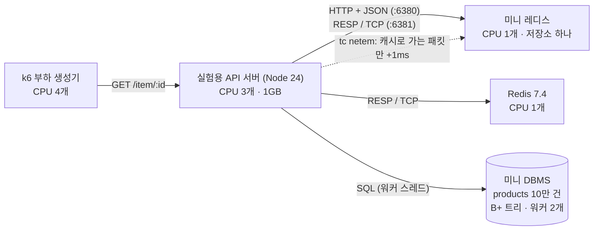
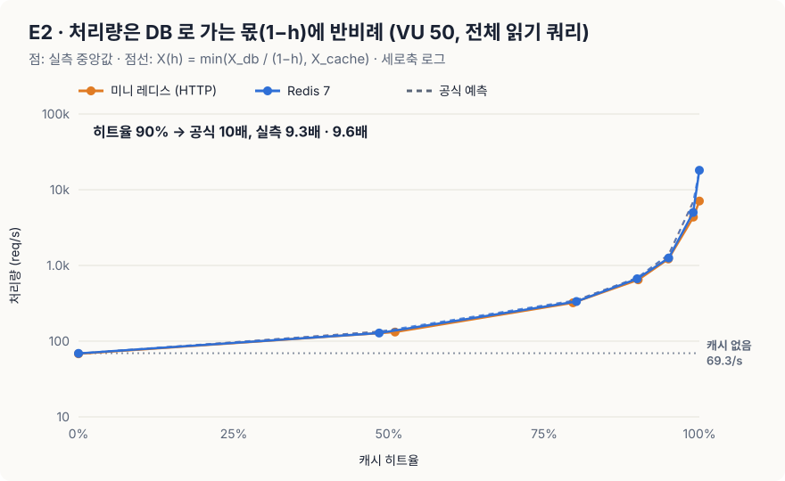
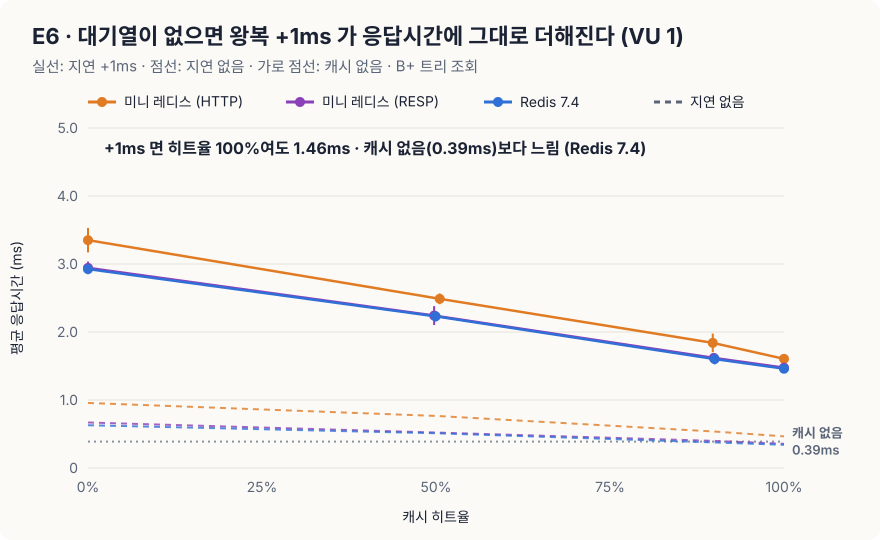

# miniReact · miniRedis · miniDBMS — 2주차 발표 자료

> 📢 **발표 안내:** 아래 [🔬 발표: 캐시는 정말 몇 배 빠를까?](#-발표-캐시는-정말-몇-배-빠를까--미니-레디스--미니-dbms-실측) 섹션을 위에서부터 스크롤하며 발표합니다. (발표 대본은 [`experiment/PRESENTATION.md`](experiment/PRESENTATION.md) 참고)

---

## 🔬 발표: 캐시는 정말 몇 배 빠를까? — 미니 레디스 · 미니 DBMS 실측

### ① 무엇을 만들었고, 무엇이 문제였나

| 우리가 만든 것 | 핵심 구현 |
| :--- | :--- |
| **미니 레디스** | 직접 구현한 해시 테이블 키-값 저장소 · TTL · 태그 무효화 · AOF 영속성 · HTTP API (+ 실험용 RESP/TCP 포트) |
| **미니 DBMS** | SQL 처리기 · B+ 트리 인덱스 (10만~100만 건) · 읽기/쓰기 락 · 워커 스레드 풀 |

초기 테스트에서 **'캐시를 붙이면 10.7배 빨라진다'**는 수치가 나왔습니다. 그러나 원본 DB 로직을 분석한 결과, 실제 디스크/인덱스 쿼리가 아닌 인위적인 `await sleep(120ms)` 지연이었습니다.

| 이론 상한 계산 (VU 50명, 120ms 대기) | 실제 측정 결과 |
| :---: | :---: |
| 50 ÷ 0.120s = **416 req/s** | **401 req/s** |

즉, 10.7배라는 수치는 캐시의 성능이 아니라 **임의로 지정한 sleep 값이 만든 착시**였습니다. 이에 따라 본질적인 질문으로 실험을 다시 설계했습니다.

> *"진짜 DB 엔진 앞에서, 캐시는 언제 몇 배 이득이고 언제 손해인가? 그리고 누가 측정해도 재현 가능한 객관적 근거는 무엇인가?"*

---

### ② 실험 구조와 데이터 흐름

모든 컴포넌트는 Docker 컨테이너로 격리하고 CPU 코어(`cpuset`)를 분리 할당하여, 부하 생성기(k6)가 서버의 CPU를 잠식해 측정 결과가 왜곡되는 현상을 차단했습니다.

---

### ③ 공정한 비교를 위한 통제와 트러블슈팅

#### 🛠️ 측정 중 발생한 오염과 해결

| 증상 | 원인 분석 | 해결 방법 |
| :--- | :--- | :--- |
| **일부 회차에서 요청 0건 발생** | 측정 전 1,000건 캐시 워밍업 시 무거운 쿼리를 실행하여 60초 타임아웃 초과 | 워밍업 시에만 인덱스(B+ 트리) 조회를 활용하도록 개선 (60초 $\rightarrow$ **0.08초** 단축) |
| **회차별 2~4배 성능 편차 발생** | YCSB 쓰기(INSERT)로 인해 테이블이 **10만 건 $\rightarrow$ 34만 건**으로 팽창하여 전체 스캔 비용 증가 | DBMS의 파일 쓰기가 append-only 구조임을 활용, 매 측정 전 원본 크기로 `truncate`하여 **정확히 10만 건 원상복구** |
| **지터를 넣으면 TCP 재전송 우려** | `netem`의 지터는 패킷 순서를 바꿀 수 있음 | netem 안쪽 큐를 `pfifo`로 바꿔 순서 유지 (netem 공식 문서 방식) |

---

### ④ 핵심 결과 — 576회 측정, 재현 신뢰도 98.3%

| 번호 | 핵심 발견 | 검증 수치 |
| :---: | :--- | :--- |
| **1** | 처리량은 **$X_{\text{db}} \div (1 - h)$** 공식대로 증가 | 히트율 80%까지 공식 예측값과 **오차 8% 이내** (90%에서 8~10%, 95% 이상은 12~30% 낮음) |
| **2** | 미니 레디스가 느렸던 원인은 저장소가 아니라 **HTTP + JSON** | 같은 저장소를 RESP로: 히트율 100%에서 **6,760 → 18,989 req/s (2.8배)** · 요청당 CPU **0.201 → 0.075ms (Redis 7은 0.076ms)** |
| **3** | 캐시까지 **왕복 +1ms**: 동시 요청이 많으면 견디지만, 대기열이 없으면 손해 | VU 50 처리량은 **8~22% 감소**에 그침 · VU 1 응답시간은 **히트율 100%여도 캐시 없음의 3.8배** |
| **4** | 쓰기(Write) 비중이 늘어날수록 캐시 이득 급감 | Redis 7 기준: 읽기 100% **1.00배** $\rightarrow$ 쓰기 50% **0.75배** |

#### 발견 1 · 무거운 쿼리: 히트율이 곧 처리량 배율

| 히트율 ($h$) | 이론 공식 배율 $\frac{1}{1-h}$ | 미니 레디스 실측 | Redis 7 실측 |
| :---: | :---: | :---: | :---: |
| **0%** | 1.0배 | 233.2 req/s (0.95배) | 241.2 req/s (0.98배) |
| **50%** | 2.0배 | 454.6 req/s (1.9배) | 465.5 req/s (1.9배) |
| **80%** | 5.0배 | 1,061 req/s (4.3배) | 1,119 req/s (4.6배) |
| **90%** | 10.0배 | 2,117 req/s (8.6배) | 2,203 req/s (9.0배) |
| **95%** | 20.0배 | 3,477 req/s (14.2배) | 3,960 req/s (16.2배) |
| **99%** | 100.0배 | 6,181 req/s (25.2배) | 12,858 req/s (52.5배) |
| **100%** | 캐시 자체의 처리 한계 | 7,041 req/s (28.7배) | **18,232 req/s (74.4배)** |

*(배율은 캐시 없음 244.9 req/s 대비 · 11월 17일 측정. 공식은 실측한 히트율로 계산합니다)*

#### 발견 2 · 가벼운 쿼리: 미니 레디스가 느렸던 진짜 원인은 HTTP + JSON

| 캐시 없음(13,716 req/s) 대비 | 히트율 0% | 50% | 70% | 90% | 100% | 손익분기 히트율 |
| :--- | :---: | :---: | :---: | :---: | :---: | :---: |
| **미니 레디스 · HTTP + JSON** | 3,108 (0.23배) | 3,714 (0.27배) | 4,262 (0.31배) | 5,328 (0.39배) | 6,760 (0.49배) | **100%여도 손해** |
| **미니 레디스 · RESP/TCP** | 8,891 (0.65배) | 10,915 (0.80배) | 12,752 (0.93배) | 15,304 (1.12배) | **18,989 (1.38배)** | 78% |
| **Redis 7.4** | 7,921 (0.58배) | 10,371 (0.76배) | 11,193 (0.82배) | 13,937 (1.02배) | 17,399 (1.27배) | 88% |

*(단위 req/s · 6회 중앙값 · **11월 17일 재측정, 지금 코드**. 손익분기는 캐시 없음과 같아지는 히트율을 측정점 사이 직선으로 구한 값)*

| 요청 하나당 CPU 시간 (E3 · 히트율 100% · 11월 17일) | API 서버 (부르는 쪽) | 캐시 서버 (응답하는 쪽) | 합계 | 처리량 |
| :--- | :---: | :---: | :---: | :---: |
| 캐시 없음 (B+ 트리 조회) | 0.106ms | - | 0.106ms | 13,716 req/s |
| **미니 레디스 · HTTP + JSON** | **0.149ms** | **0.052ms** | **0.201ms** | 6,760 req/s |
| **미니 레디스 · RESP/TCP** | 0.053ms | 0.022ms | **0.075ms** | 18,989 req/s |
| **Redis 7.4** | 0.057ms | 0.018ms | **0.076ms** | 17,399 req/s |

#### 발견 3 · 캐시까지 왕복 +1ms: 동시 요청이 많으면 견디고, 대기열이 없으면 손해

> **추가 측정 E7 · DB도 1ms 멀리 두면**: 캐시만 멀리 있을 때(E6)는 히트율 100%여도 3.8배 느렸지만, 둘 다 멀리 있으면 Redis · 미니 RESP는 히트율 **약 96%**를 넘어야 이득이고 최대 이득도 **약 6%** 입니다 (미니 HTTP는 100%여도 본전). 결론의 방향은 같고 정도만 줄어듭니다.

#### 🏆 이 측정값을 신뢰할 수 있는 객관적 근거

| 검증 지표 | 측정 결과 | 해석 |
| :--- | :---: | :--- |
| **전체 측정 성공률** | **576 / 576 (100%)** | 10초 측정 중 에러율 1% 미만 |
| **회차별 재현 신뢰도** | **566 / 576 (98.3%)** | 각 회차 측정값이 동일 조건 중앙값의 $\pm 15\%$ 이내 |
| **조건별 변동계수 (CV)** | **96개 중 93개가 10% 미만** | 최대 12.8% (E2 · Redis 7 히트율 99%, 처리량이 급히 오르는 구간) |
| **시간에 따른 변화** | **96개 중 6개가 ±10% 초과** | 앞 회차(r1·r2)와 뒤 회차(r5·r6)의 처리량 비교. 최대 −15.8% (E2 Redis 히트율 90%) |
| **대조군 (지연 경로 확인)** | **캐시 없음 −3.0% / −2.7%** | VU 50 / VU 1 처리량. 둘 다 신뢰구간 안. 지연을 넣어도 캐시를 안 쓰는 요청은 그대로 → 지연이 캐시 경로에만 걸림 |
