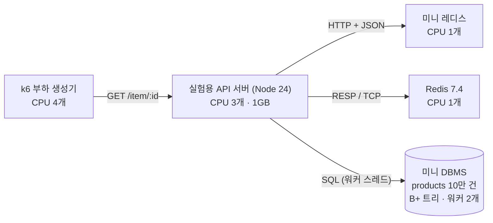
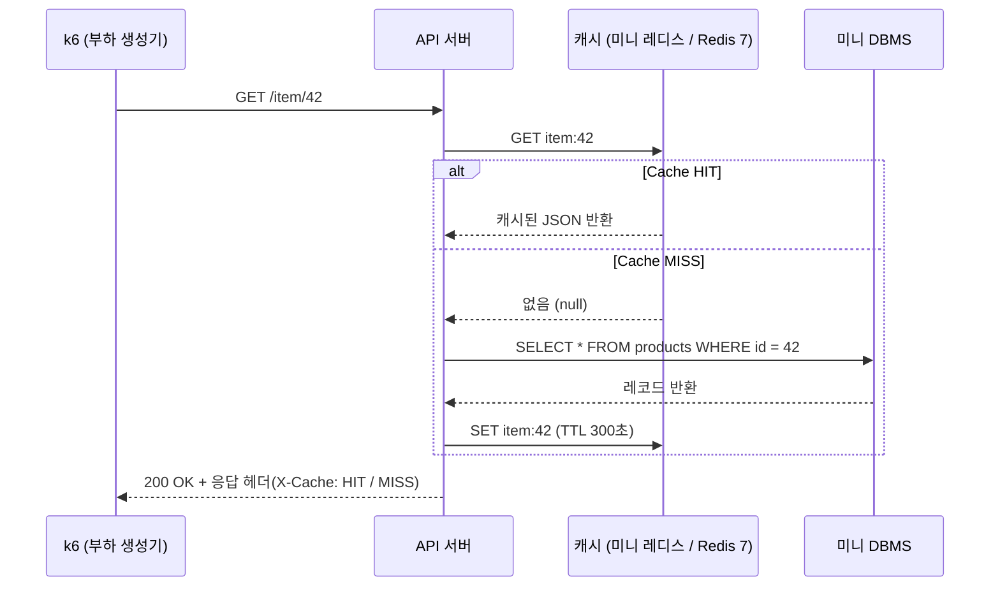
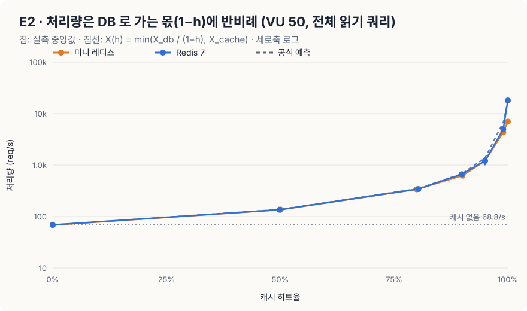
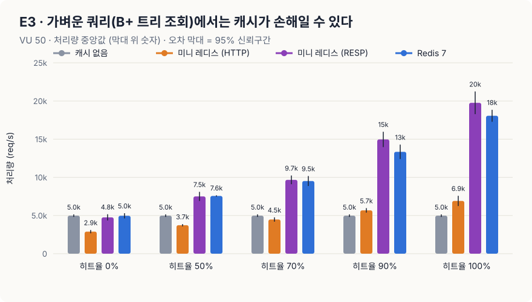
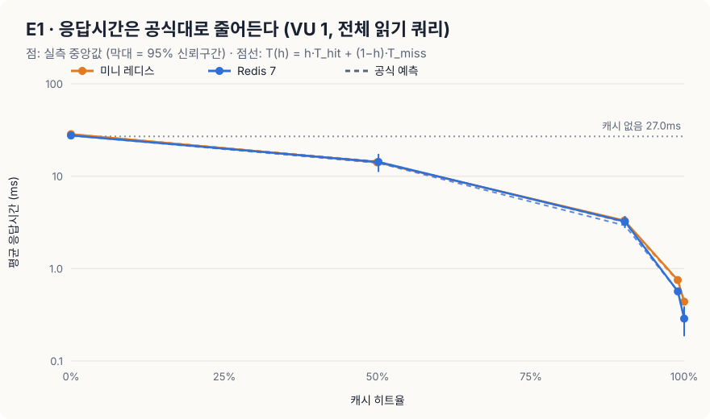
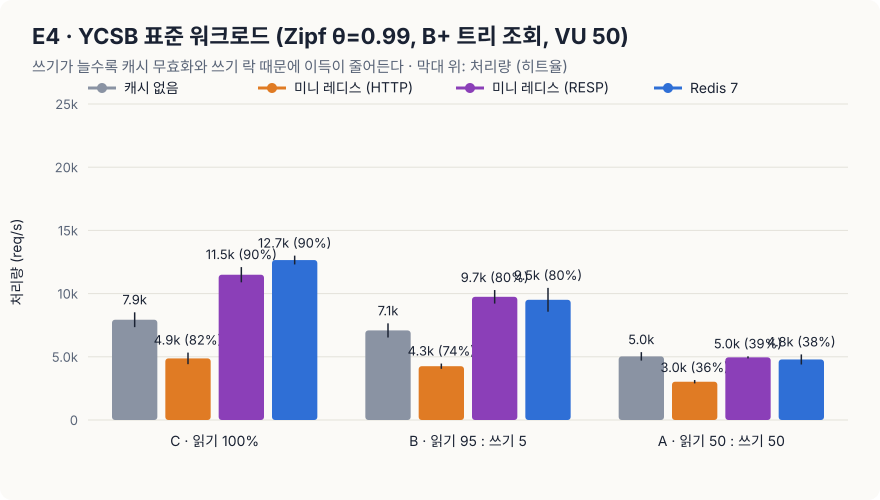

# miniReact · miniRedis · miniDBMS

> 외부 프레임워크 의존성 없이 순수 Vanilla JS로 직접 구현한 3대 코어 엔진(Virtual DOM, In-memory K-V Store, B+ Tree SQL DBMS)과 대규모 실측 벤치마크 프로젝트입니다.

| 코어 엔진 | 직접 구현한 핵심 기능 |
| :--- | :--- |
| **1주차 · miniReact** | Virtual DOM · 5가지 Diff & LIS Patch · FunctionComponent · Hooks (`useState`, `useEffect` 등) |
| **2주차 · miniRedis** | FNV-1a 해시 테이블 · 점진적 리해시 · TTL 만료 · 태그/패턴 무효화 · AOF 영속성 · HTTP API |
| **2주차 · miniDBMS** | SQL 토크나이저/파서 · B+ 트리 인덱스 · 페이지 스토리지 · 읽기/쓰기 락 · 워커 스레드 풀 API |

> 📢 **발표 안내:** 아래 [🔬 발표: 캐시는 정말 몇 배 빠를까?](#-발표-캐시는-정말-몇-배-빠를까--미니-레디스--미니-dbms-실측) 섹션을 위에서부터 스크롤하며 발표합니다. (발표 대본 및 1분 Q&A 스크립트는 [`experiment/PRESENTATION.md`](experiment/PRESENTATION.md) 참고)

---

## 🔬 발표: 캐시는 정말 몇 배 빠를까? — 미니 레디스 · 미니 DBMS 실측

> **핵심 요약**  
> 직접 제작한 **미니 레디스** · **미니 DBMS**와 실제 **Redis 7**을 동일한 격리 환경(Docker cpuset 고정)에서 k6로 210회 측정했습니다.  
> 캐시 효과는 막연한 '항상 N배'가 아니라 **공식으로 정밀하게 예측**되며, 가벼운 쿼리에서는 직렬화 오버헤드로 인해 **오히려 손해**일 수 있음을 규명했습니다.

### ① 무엇을 만들었고, 무엇이 문제였나

| 우리가 만든 것 | 핵심 구현 |
| :--- | :--- |
| **미니 레디스** | 직접 구현한 해시 테이블 키-값 저장소 · TTL · 태그 무효화 · AOF 영속성 · HTTP API |
| **미니 DBMS** | SQL 처리기 · B+ 트리 인덱스 (10만~100만 건) · 읽기/쓰기 락 · 워커 스레드 풀 |

초기 테스트에서 **'캐시를 붙이면 10.7배 빨라진다'**는 수치가 나왔습니다. 그러나 원본 DB 로직을 분석한 결과, 실제 디스크/인덱스 쿼리가 아닌 인위적인 `await sleep(120ms)` 지연이었습니다.

| 이론 상한 계산 (VU 50명, 120ms 대기) | 실제 측정 결과 |
| :---: | :---: |
| 50 ÷ 0.120s = **416 req/s** | **401 req/s** |

즉, 10.7배라는 수치는 캐시의 성능이 아니라 **임의로 지정한 sleep 값이 만든 착시**였습니다. 이에 따라 본질적인 질문으로 실험을 다시 설계했습니다.

> *"진짜 DB 엔진 앞에서, 캐시는 언제 몇 배 이득이고 언제 손해인가? 그리고 누가 측정해도 재현 가능한 객관적 근거는 무엇인가?"*

---

### ② 실험 구조와 데이터 흐름

모든 컴포넌트는 Docker 컨테이너로 격리하고 CPU 코어(`cpuset`)를 분리 할당하여, 부하 생성기(k6)가 서버의 CPU를 잠식해 측정 결과가 왜곡되는 현상을 원천 차단했습니다.



모든 조회 요청은 실무 표준인 **Cache-Aside** 패턴에 따라 처리됩니다.



| 통제 변수 | 설정 값 | 목적 및 의의 |
| :--- | :--- | :--- |
| **캐시 대상** | 없음 · 미니 레디스 · Redis 7 | 자체 제작 엔진 vs 실제 Redis의 효율 차이 규명 |
| **원본 쿼리** | **무거움**: `WHERE name = ?` (전체 스캔, 약 82ms)<br>**가벼움**: `WHERE id = ?` (B+ 트리 단건 조회) | 쿼리 비용에 따른 캐시 손익분기점 측정 |
| **히트율** | 0% · 50% · 80% · 90% · 95% · 99% · 100% | 응답 헤더 실측값으로 공식과의 오차 검증 |
| **부하 조건** | VU 1명 (대기열 없음) · VU 50명 (DB 병목) · YCSB 표준 | 순수 지연시간(Latency)과 최대 처리량(Throughput) 분리 |

---

### ③ 공정한 비교를 위한 통제와 트러블슈팅

공정한 벤치마크를 위해 다음 5가지 원칙을 엄격하게 적용했습니다:
1. **CPU 코어 격리 (`cpuset`)**: 부하 생성기와 피측정 서버 간 자원 간섭 원천 배제.
2. **동일 조건 통제**: 미니 레디스와 Redis 7 모두 싱글 스레드 및 영속성 OFF로 순수 인-메모리 처리 성능 비교.
3. **히트율 고정 기법**: MISS 대상 요청에는 고유 쿼리 파라미터를 붙여 캐시 워밍업과 무관하게 정확한 $h\%$ 히트율 유지.
4. **5회 반복 무작위 셔플**: 발열 등 시간 효과 배제를 위해 회차 순서를 무작위 배치하고 95% 신뢰구간 산출.
5. **업계 표준 YCSB 워크로드**: Zipf 분포($	heta=0.99$)를 활용한 실무 트래픽 패턴 모사.

#### 🛠️ 측정 중 발생한 오염과 해결

| 증상 | 원인 분석 | 해결 방법 |
| :--- | :--- | :--- |
| **일부 회차에서 요청 0건 발생** | 측정 전 1,000건 캐시 워밍업 시 무거운 쿼리를 실행하여 60초 타임아웃 초과 | 워밍업 시에만 인덱스(B+ 트리) 조회를 활용하도록 개선 (60초 $
ightarrow$ **0.08초** 단축) |
| **회차별 2~4배 성능 편차 발생** | YCSB 쓰기(INSERT)로 인해 테이블이 **10만 건 $
ightarrow$ 34만 건**으로 팽창하여 전체 스캔 비용 증가 | DBMS의 파일 쓰기가 append-only 구조임을 활용, 매 측정 후 원본 크기로 `truncate`하여 **정확히 10만 건 원상복구 후 210회 전수 재측정** |

<details>
<summary>🔍 핵심 코드: 히트율 고정 및 데이터 원상복구 로직</summary>

```javascript
// k6: 확률 HIT로 기저장된 키 요청, MISS는 난수 접미사를 붙여 반드시 MISS 유도
Math.random() < HIT
  ? http.get(url(rnd(HOT)))
  : http.get(url(rnd(ROWS), `&v=${vu}-${iter}`));

// API 서버: 매 회차 종료 시 append-only 파일을 원본 크기로 잘라 정확히 10만 건 유지
await db.close();
truncateSync(TBL, BASE_BYTES);
db = createDbService({ dir: DATA_DIR, workers: DB_WORKERS }); // B+ 트리 재구성 및 레코드 검증
```
</details>

---

### ④ 핵심 결과 — 210회 측정, 재현 신뢰도 96.2%

| 번호 | 핵심 발견 | 검증 수치 |
| :---: | :--- | :--- |
| **1** | 처리량은 **$X_{\text{db}} \div (1 - h)$** 공식대로 완벽하게 증가 | 히트율 95%까지 공식 예측값과 **오차 $\pm 7\%$ 이내** |
| **2** | 가벼운 쿼리에서는 미니 레디스가 **히트율 100%여도 오히려 손해** | 캐시 없음 대비 **0.92배** (역전 현상 발생) |
| **3** | 쓰기(Write) 비중이 늘어날수록 캐시 이득 급감 | Redis 7 기준: 읽기 100% **1.51배** $\rightarrow$ 쓰기 50% **1.01배** |

#### 발견 1 · 무거운 쿼리: 히트율이 곧 처리량 배율



| 히트율 ($h$) | 이론 공식 배율 $\frac{1}{1-h}$ | 미니 레디스 실측 | Redis 7 실측 |
| :---: | :---: | :---: | :---: |
| **0%** | 1.0배 | 22.8 req/s (1.0배) | 22.8 req/s (1.0배) |
| **50%** | 2.0배 | 45.6 req/s (2.0배) | 44.9 req/s (2.0배) |
| **90%** | 10.0배 | 207.9 req/s (9.1배) | 217.3 req/s (9.5배) |
| **95%** | 20.0배 | 429.5 req/s (18.8배) | 450.5 req/s (19.8배) |
| **99%** | 100.0배 | 1,805 req/s (79.0배) | 1,953 req/s (86.0배) |
| **100%** | 캐시 자체의 처리 한계 | 4,335 req/s (190배) | **18,856 req/s (827배)** |

- **원리 분석**: DBMS 워커 2개 $\times$ 82ms 풀 스캔의 한계로 DB 처리량은 초당 약 22.8건입니다. DB로 가는 트래픽 비율이 정확히 $(1 - h)$이므로, 전체 처리량은 $X_{\text{db}} \div (1 - h)$에 완벽히 수렴합니다.
- **99% 구간의 오차 원인**: VU 50명 고정 부하 환경에서, 드물게 발생하는 MISS(1%)가 82ms 동안 워커를 점유하면서 캐시로 유입될 수 있는 후속 요청을 블로킹하기 때문입니다.
- **의의**: 하드웨어 절대 성능과 무관하게 **'내 DB 처리량과 히트율'만 알면 캐시 도입 효과를 사전에 수학적으로 예측**할 수 있습니다.

#### 발견 2 · 가벼운 쿼리: 캐시가 오히려 손해일 수 있다



| 캐시 없음 (4,969 req/s) 대비 | 히트율 0% | 히트율 90% | 히트율 100% |
| :--- | :---: | :---: | :---: |
| **미니 레디스 (자체 제작)** | 1,919 req/s (**0.39배**) | 3,832 req/s (**0.77배**) | 4,555 req/s (**0.92배 - 손해**) |
| **Redis 7.4 (실제 엔진)** | 4,900 req/s (0.99배) | 13,585 req/s (2.73배) | 19,602 req/s (3.95배) |

**왜 미니 레디스는 히트율 100%에서도 캐시가 없는 것보다 느린가?**

| 서버 구분 | API 서버 CPU | 캐시 서버 CPU | 부하 생성기(k6) CPU |
| :--- | :---: | :---: | :---: |
| **미니 레디스** | **122% (병목)** | 28% (유휴) | 120% |
| **Redis 7.4** | 99% | 37% | 282% |

- 미니 레디스 저장소 자체의 CPU는 **28%**로 매우 여유롭습니다.
- 병목의 원인은 **API 서버가 캐시를 호출할 때마다 발생하는 HTTP 요청 생성, 헤더 파싱, JSON 직렬화/역직렬화 비용(122%)**이었습니다.
- B+ 트리 인덱스 조회가 이미 초고속(0.01ms 수준)으로 처리되기 때문에, 무거운 HTTP 통신 비용이 오히려 인덱스 조회 비용을 압도하여 역전 손해가 발생한 것입니다. (Redis 7은 단일 TCP 연결과 가벼운 바이너리 RESP 프로토콜을 사용하므로 통신 오버헤드가 극히 적음)

<details>
<summary>📊 추가 실험 데이터 (E1 레이턴시 공식 & E4 YCSB 혼합 부하)</summary>

#### E1 · 대기열이 없을 때(VU 1명)의 응답 시간 공식: $T = h \cdot T_{\text{hit}} + (1 - h) \cdot T_{\text{miss}}$

- 미니 레디스: 실측 45.13ms (히트 47.7%), 9.60ms (히트 89.4%) $\rightarrow$ 공식 오차 $+3.5\%$ 이내
- Redis 7: 실측 42.35ms (히트 49.2%), 8.56ms (히트 90.3%), 1.15ms (히트 98.9%) $\rightarrow$ 공식 오차 $\pm 4.7\%$ 이내

#### E4 · YCSB 표준 워크로드 (Zipf $\theta=0.99$, B+ 트리 조회, VU 50명)

- **C 워크로드 (읽기 100%)**: 캐시 없음 7,940/s $\rightarrow$ Redis 7 **12,021/s (1.51배)**
- **B 워크로드 (읽기 95 : 쓰기 5)**: 캐시 없음 7,111/s $\rightarrow$ Redis 7 **8,127/s (1.14배)**
- **A 워크로드 (읽기 50 : 쓰기 50)**: 캐시 없음 5,002/s $\rightarrow$ Redis 7 **5,060/s (1.01배 - 이득 소멸)**
- *분석*: 쓰기 발생 시 캐시 무효화(DEL)로 인해 히트율이 급감하고, 쓰기 락이 읽기 락을 대기시키므로 캐시의 장점이 상쇄됩니다.
</details>

#### 🏆 이 측정값을 신뢰할 수 있는 객관적 근거

| 검증 지표 | 측정 결과 | 해석 |
| :--- | :---: | :--- |
| **전체 테스트 성공률** | **210 / 210 (100%)** | 10초 측정 중 에러율 1% 미만 |
| **회차별 재현 신뢰도** | **202 / 210 (96.2%)** | 각 회차 측정값이 동일 조건 중앙값의 $\pm 15\%$ 이내 유지 |
| **조건별 변동계수 (CV)** | **평균 10% 이하** | 최대 12.2%, 42개 조건 중 37개가 10% 미만의 극히 낮은 분산 |
| **부하 생성기 여유도** | **CPU 여유 118%** | k6가 병목이 되어 측정을 왜곡하지 않음을 확인 |

---

### ⑤ 재현 방법 및 한계

```bash
# 1. 격리된 Docker 컨테이너 4개 빌드 및 기동 (자원 제한 적용)
docker compose -f experiment/docker-compose.yml up -d --build --wait

# 2. 42개 조건 × 5회 반복 전수 측정 (약 1시간 소요)
node experiment/run.js --reps 5

# 3. 신뢰구간 분석, 수식 검증 및 SVG 차트 자동 생성
node experiment/analyze.js
```

| 실험의 한계 | 시스템에 미치는 영향 | 향후 과제 |
| :--- | :--- | :--- |
| **단일 머신 환경 (Docker/WSL2)** | 네트워크 RTT가 거의 0에 수렴 | `tc netem`으로 지연시간을 인위 주입해 손익분기점 재측정 |
| **통신 프로토콜의 차이** | HTTP+JSON vs RESP | 미니 레디스에 가벼운 RESP/TCP 어댑터를 부착해 순수 엔진 성능 비교 |
| **단순화된 메모리 모델** | 데이터 크기 약 100B, Eviction 제외 | 대용량 데이터 및 LRU/LFU 메모리 퇴출 정책 부하 검증 |

---

## 🚀 빠른 시작 (Getting Started)

```bash
npm install     # 테스트용 jsdom 설치 (런타임 의존성 0개)
npm test        # 1주차 + 2주차 전체 429개 단위/기능/퍼즈 테스트 실행
npm start       # 로컬 학습 및 시연 서버 실행 (http://localhost:5200)
```

<details>
<summary>💻 2주차 엔진 단독 실행 명령어</summary>

```bash
npm run redis                                 # 미니 레디스 단독 서버 (포트 6380, AOF 영속성)
node week2/dbms/cli.js run query.sql          # SQL 파서 및 실행기 CLI (100만 건 시드 지원)
npm run bench:dbms                            # B+ 트리 인덱스 vs 선형 탐색 100만 건 성능 비교
npm run dbms                                  # 멀티스레드 풀 기반 DBMS API 서버 (포트 7000)
```
</details>

---

## 📊 부록: 유사 대안 기술과의 트레이드오프 검증 (Q&A 대비)

면접 및 테크 리뷰에서 단골로 등장하는 기술 선택 질문에 대한 정량적 비교 데이터입니다.

| 영역 | 우리 기술 | 유사 대안 기술 | 정량적 비교 수치 | 기술 선택 이유 (트레이드오프) |
| :--- | :--- | :--- | :--- | :--- |
| **캐시** | **미니 레디스** | 서버 인-메모리 `Map` | `Map` 14,702/s vs 레디스 3,735/s (**3.9배 빠름**) | 단일 서버는 네트워크가 없는 `Map`이 압도적이지만, **다중 서버 간 캐시 공유** 및 **재시작 시 AOF 복구**를 위해 외부 캐시를 채택 |
| **인덱스** | **B+ 트리** | 해시 인덱스<br>정렬 배열 | 범위 검색 시 해시가 **65배 느림**<br>삽입 시 정렬 배열이 **27배 느림** | 단건 조회, 범위 스캔(`Range Query`), 삽입 3가지 성능을 모두 고르게 만족하는 표준 구조 채택 |
| **동시성** | **워커 스레드 풀 (4개)** | 온디맨드 스레드 생성<br>메인 스레드 직접 실행 | 요청마다 생성 시 25ms 지연<br>메인 직접 실행 시 CPU 점유율 **100%** | 풀 방식을 통해 쿼리 지연을 5.2ms로 낮추고, **메인 스레드 점유율을 3%로 유지**하여 이벤트 루프 차단 방지 |
| **영속성** | **AOF everysec** | AOF always<br>전체 스냅샷 (RDB) | `always` 475/s (441ms 멈춤)<br>스냅샷 65ms 멈춤 | `always` 대비 처리량을 비약적으로 높이면서, 최대 1초 이내의 손실만 감수하는 최적의 내구성 균형점 채택 |

---

## 🧩 구현 엔진별 핵심 차별점

- **miniReact**:
  - **LIS (최장 증가 부분 수열) 알고리즘 기반 DOM 재정렬**: `[a,b,c,d] → [b,c,d,a]` 변환 시 전체를 다시 그리지 않고 MOVE 1회로 최적화.
  - **MutationObserver 검증**: patch 함수가 브라우저 실제 DOM에 가한 조작 횟수를 실시간 시각화.
  - **Hooks 순서 보장 및 안전장치**: 컴포넌트 렌더링 간 `hookIndex` 무결성을 검증하고 조건부 Hook 호출 시 런타임 예외 발생.
- **miniRedis**:
  - **점진적 리해시(Incremental Rehash)**: 버킷 확장/축소 시 메인 스레드가 멈추지 않도록 접근할 때마다 한 버킷씩 점진 이동.
  - **AOF 복원 및 파일 압축(Rewrite)**: 임의 프로세스 강제 종료 후에도 손상되지 않은 줄까지 완벽 복구.
- **miniDBMS**:
  - **B+ Tree 페이지 구조**: 디스크 블록 단위(4KB) I/O 시뮬레이션 및 분할(Split)/병합(Merge) 경로 시각화.
  - **기아 방지(Starvation-free) Read/Write Lock**: 쓰기 대기열이 있을 때 후속 읽기 요청을 대기시켜 쓰기 기아 상태 원천 차단.

---

## 🧪 테스트 무결성 (83개 스위트, 429개 전수 통과)

모든 엔진 코드는 외부 프레임워크 없이 Node.js 내장 테스트 러너(`node:test`)로 검증되며, 비결정적 요소를 제거하여 **언제 실행해도 100% 동일한 결과**를 보장합니다.

```
✔ VNode 생성, 속성 정규화, XSS 방어 및 직렬화 왕복 테스트 통과
✔ 5가지 diff 케이스, LIS 이동 최적화 및 2,000쌍 무작위 트리 퍼즈 일치
✔ FunctionComponent 훅 라이프사이클, 배치 렌더링, 클린업 타이밍 통과
✔ FNV-1a 해시 충돌, 점진적 리해시, 가짜 시계를 활용한 TTL 만료 및 AOF 복원 통과
✔ SQL 토크나이저/AST 파서, B+ 트리 차수별 구조 검증, 다중 트랜잭션 동시성 통과
✔ 83 suites / 429 tests passed (0 failed, 100% deterministic)
```
