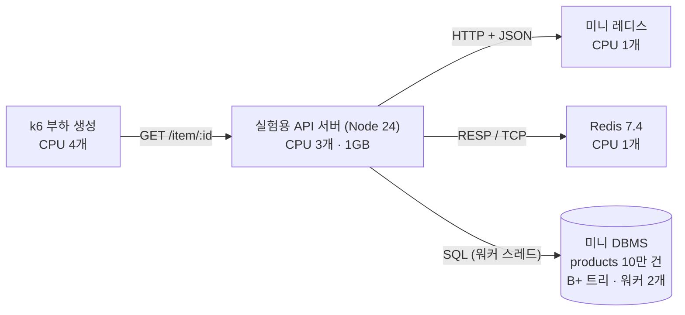
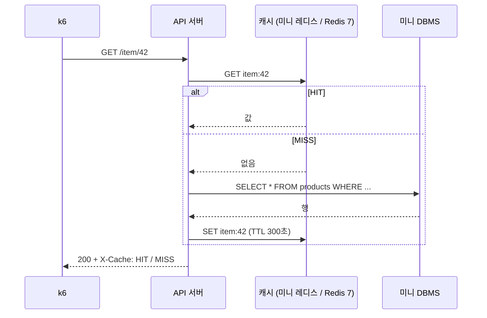

## 🔬 발표: 캐시는 정말 몇 배 빠를까? — 미니 레디스 · 미니 DBMS 실측

> **한 줄 요약** — 직접 만든 미니 레디스 · 미니 DBMS 와 실제 Redis 7 을 같은 조건(Docker 자원 고정)에서 k6 로 210회 측정했습니다. 캐시 효과는 "항상 N배" 가 아니라 **공식으로 예측되고**, 가벼운 쿼리에서는 **오히려 손해**일 수 있습니다.

### ① 무엇을 만들었고, 무엇이 문제였나

| 우리가 만든 것 | 핵심 |
| --- | --- |
| **미니 레디스** | 직접 만든 해시 테이블 키-값 저장소 · TTL · 태그 무효화 · AOF · HTTP + JSON API |
| **미니 DBMS** | SQL 처리기 · B+ 트리 인덱스 · 읽기/쓰기 락 · 스레드 풀 워커 |

지난주 측정에서 **"캐시를 붙이면 10.7배"** 가 나왔습니다. 그런데 원본 "DB" 는 진짜 쿼리가 아니라 `await sleep(120)` 이었습니다.

| | 계산 |
| --- | --- |
| VU 50명이 120ms 씩 기다리면 이론 상한 | 50 ÷ 0.120s = **416 req/s** |
| 실측 | **401 req/s** |

→ 10.7배는 캐시의 성능이 아니라 **sleep 값이 정한 숫자**였습니다. 그래서 질문을 바꿨습니다.

> **진짜 DB 앞에서, 캐시는 언제 몇 배 이득이고 언제 손해인가? 그리고 그걸 누가 돌려도 같은 결과로 말할 수 있는가?**

### ② 실험 구조와 데이터 흐름



요청 하나는 **cache-aside** 순서로 처리됩니다.



| 바꿔 가며 잰 것 | 값 |
| --- | --- |
| 캐시 | 없음 · 미니 레디스 · Redis 7 |
| 원본 쿼리 | **무거움**: `WHERE name = ?` 전체 읽기 (약 82ms) · **가벼움**: `WHERE id = ?` B+ 트리 조회 |
| 히트율 | 0 · 50 · 80 · 90 · 95 · 99 · 100% (설정이 아니라 응답 헤더로 **실측**) |
| 부하 | VU 1명 (대기열 없음) · VU 50명 (DB 가 병목) · YCSB A/B/C (Zipf θ=0.99) |

### ③ 공정한 비교를 위한 결정과, 측정 중 만난 문제

| 결정 | 이유 |
| --- | --- |
| 컨테이너마다 **다른 CPU 코어**(cpuset)와 메모리 제한 | k6 와 서버가 CPU 를 뺏으면 누가 느린지 구분 불가 |
| 두 캐시 모두 **영속성 끔 · 스레드 1개** | 미니 레디스와 Redis 의 조건을 맞춤 |
| 히트율은 **MISS 요청마다 새 캐시 키** | 무작위 키는 캐시가 차면서 히트율이 계속 변함 → 정확히 h% 로 고정 |
| 조건마다 **5회 반복, 반복마다 순서를 섞음** + 95% 신뢰구간 | 한 번 잰 숫자는 우연일 수 있음 · 발열 같은 시간 효과가 한 조건에 몰리지 않게 |
| 업계 표준 **YCSB** 워크로드 | "내 마음대로 정한 패턴" 이라는 비판을 피함 |

측정하면서 **결과가 오염된 것을 두 번 발견하고 고쳤습니다.**

| 증상 | 원인 | 해결 |
| --- | --- | --- |
| 210회 중 10회가 **요청 0건** | 측정 전 캐시 채우기를 무거운 쿼리로 1,000번 → 60초 제한 초과 | 값은 같으므로 채울 때만 B+ 트리 조회로 (60초 → 0.08초) |
| 같은 조건인데 **앞 회차와 뒤 회차가 2~4배 차이** | YCSB 쓰기(INSERT)가 테이블을 **10만 → 34만 건**으로 키워 전체 읽기가 점점 느려짐 | 측정마다 테이블 파일을 처음 크기로 잘라 **정확히 10만 건**으로 되돌리고 검증 → 210회 전부 다시 측정 |

<details><summary>코드 보기 — 히트율 고정, 테이블 되돌리기</summary>

```js
// k6: 확률 HIT 로 미리 데운 키, 나머지는 한 번도 쓴 적 없는 키 → 반드시 MISS
Math.random() < HIT
  ? http.get(url(rnd(HOT)))
  : http.get(url(rnd(ROWS), `&v=${vu}-${iter}`));

// API 서버: INSERT 는 파일 끝에만 붙으므로(append-only) 처음 크기로 자르면 정확히 되돌아간다
await db.close();
truncateSync(TBL, BASE_BYTES);
db = createDbService({ dir: DATA_DIR, workers: DB_WORKERS });   // B+ 트리 재구성 후 10만 건인지 검사
```

</details>

### ④ 결과 — 210회 측정, 신뢰도 96.2%

| # | 발견 | 숫자 |
| --- | --- | --- |
| 1 | 처리량은 **X_db ÷ (1 − 히트율)** 공식대로 늘어난다 | 히트율 95% 까지 공식과 오차 **±7% 이내** |
| 2 | 가벼운 쿼리에서 미니 레디스는 **히트율 100% 여도 손해** | 캐시 없음 대비 **0.92배** (Redis 7 은 3.95배) |
| 3 | 쓰기가 늘수록 캐시 이득이 사라진다 | Redis 7: 읽기 100% **1.51배** → 쓰기 50% **1.01배** |

#### 발견 1 · 무거운 쿼리: 히트율이 곧 배율


| 히트율 | 공식이 말하는 배율 1/(1−h) | 미니 레디스 | Redis 7 |
| --- | --- | --- | --- |
| 0% | 1배 | 22.8/s (1.0배) | 22.8/s (1.0배) |
| 50% | 2배 | 45.6/s (2.0배) | 44.9/s (2.0배) |
| 90% | 10배 | 207.9/s (9.1배) | 217.3/s (9.5배) |
| 95% | 20배 | 429.5/s (18.8배) | 450.5/s (19.8배) |
| 99% | 100배 | 1,805/s (79배) | 1,953/s (86배) |
| 100% | 캐시의 한계 | 4,335/s (190배) | **18,856/s (827배)** |

- **이유:** DB 는 1초에 22.8건밖에 못 합니다(무거운 쿼리 82ms × 워커 2개). DB 로 가는 몫이 (1 − h) 이니, 전체 처리량은 X_db ÷ (1 − h).
- **99% 에서 공식보다 16~19% 낮은 이유:** VU 50명으로 부하를 고정했기 때문에, 드물게 오는 MISS 가 수 초씩 VU 를 붙잡아 캐시로 보낼 요청 자체가 줄어듭니다.
- **이 공식이 "모두에게 같은 결과" 입니다.** 내 DB 처리량과 히트율만 알면 캐시 이득을 계산할 수 있습니다.

#### 발견 2 · 가벼운 쿼리: 캐시가 손해일 수 있다


| 캐시 없음 4,969/s 대비 | 히트율 0% | 90% | 100% |
| --- | --- | --- | --- |
| 미니 레디스 | 1,919/s (**0.39배**) | 3,832/s (**0.77배**) | 4,555/s (**0.92배**) |
| Redis 7 | 4,900/s (0.99배) | 13,585/s (2.73배) | 19,602/s (3.95배) |

**왜 미니 레디스만 느린가 — 히트율 100% 동안 CPU 사용률**

| | API 서버 | 캐시 서버 | k6 (4코어 중) |
| --- | --- | --- | --- |
| 미니 레디스 | **122%** | 28% | 120% |
| Redis 7 | 99% | 37% | 282% |

미니 레디스 **서버는 28% 만 씁니다.** 느린 건 저장소가 아니라 **API 서버가 캐시를 부를 때마다 HTTP 요청을 만드는 비용**(헤더 · URL · JSON)입니다. B+ 트리 조회 한 번이 그보다 싸서, 캐시를 거치는 게 손해가 됩니다. Redis 는 연결 하나로 짧은 RESP 메시지를 이어 보내므로 이 비용이 거의 없습니다.

<details><summary>추가 실험 — E1 응답시간 공식 · E4 YCSB</summary>

**E1 · 대기열이 없을 때(VU 1명) 응답시간 = h × T_hit + (1 − h) × T_miss**


| 캐시 | 히트율 | 실측 | 공식 예측 | 오차 |
| --- | --- | --- | --- | --- |
| 미니 레디스 | 47.7% | 45.13ms | 43.68ms | +3.3% |
| 미니 레디스 | 89.4% | 9.60ms | 9.28ms | +3.5% |
| Redis 7 | 49.2% | 42.35ms | 41.36ms | +2.4% |
| Redis 7 | 90.3% | 8.56ms | 8.17ms | +4.7% |
| Redis 7 | 98.9% | 1.15ms | 1.16ms | −1.2% |

**E4 · YCSB 표준 워크로드 (Zipf θ=0.99, B+ 트리 조회, VU 50)**


| 워크로드 | 캐시 없음 | 미니 레디스 | Redis 7 |
| --- | --- | --- | --- |
| C · 읽기 100% | 7,940/s | 3,318/s (0.42배, 히트 78%) | 12,021/s (**1.51배**, 히트 90%) |
| B · 읽기 95 : 쓰기 5 | 7,111/s | 2,795/s (0.39배, 히트 71%) | 8,127/s (1.14배, 히트 79%) |
| A · 읽기 50 : 쓰기 50 | 5,002/s | 2,138/s (0.43배, 히트 35%) | 5,060/s (1.01배, 히트 39%) |

쓰기마다 캐시를 지우니(DEL) 히트율이 떨어지고, 쓰기 락이 읽기를 막습니다.
※ 미니 DBMS 에 UPDATE 가 없어 쓰기는 INSERT + 캐시 DEL 로 대신했습니다.

</details>

**이 숫자를 믿을 수 있는 이유**

| 점검 | 결과 |
| --- | --- |
| 성공률 (요청 1건 이상 · 에러 1% 미만) | **210 / 210** |
| 재현성 (각 회차가 그 조건 중앙값의 ±15% 안) | **202 / 210 (96.2%)** |
| 조건별 변동계수(CV) | 최대 12.2% · 42개 중 37개가 10% 이하 |
| 시간에 따른 변화 (앞 회차 vs 뒤 회차) | ±10% 를 넘는 조건 4 / 42개 (약한 워밍업 효과) |
| k6 가 병목이 아닌지 | 가장 빠른 조건에서도 k6 는 4코어 중 282% 사용 (여유 있음) |

### ⑤ 재현 방법 · 한계 · 다음 과제

```bash
docker compose -f experiment/docker-compose.yml up -d --build --wait   # 컨테이너 4개 (자원 제한 포함)
node experiment/run.js --reps 5                                         # 42개 조건 × 5회 (약 1시간)
node experiment/analyze.js                                              # 중앙값 · 신뢰구간 · 공식 오차 · 그래프
```

절대값은 컴퓨터마다 다릅니다. 같아야 하는 것은 **배율, 경향, 공식과의 오차**입니다. 측정 환경은 [`experiment/results/env.json`](experiment/results/env.json), 전체 표는 [`summary.md`](experiment/results/summary.md) 에 있습니다.

| 한계 | 영향 |
| --- | --- |
| 노트북 한 대 (Intel Core Ultra 5 125H, Docker/WSL2) | 네트워크 지연이 거의 0 → 실제 서버보다 캐시 왕복 비용이 작게 나옴. **가벼운 쿼리에서의 손해는 실제로 더 클 것** |
| 프로토콜이 다름 (HTTP+JSON vs RESP) | 저장소 엔진만의 비교가 아니라 "만든 그대로의 시스템" 비교 |
| 값 약 100바이트, 측정 10초 | 큰 값 · 메모리 가득 찬 상황(eviction)은 다루지 않음 |

**다음 과제:** 팀원 노트북에서 재현해 배율 비교 · 미니 레디스에 RESP(TCP) 프로토콜 붙여서 HTTP 비용만 따로 측정 · 네트워크 지연을 넣은 상태(`tc netem`)에서 손익분기 히트율 다시 재기

> 실험 코드는 AI 와 함께 작성했습니다. 코드의 원리는 [`experiment/CODE-NOTES.md`](experiment/CODE-NOTES.md), 발표 대본과 예상 질문은 [`experiment/PRESENTATION.md`](experiment/PRESENTATION.md) 에 정리했습니다.
