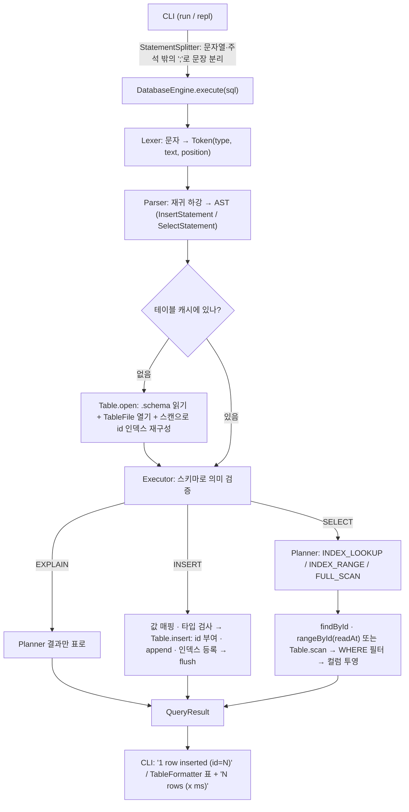

# Mini DBMS

Java 17로 직접 구현한 파일 기반 미니 DBMS. 외부 라이브러리는 Jackson만 쓴다.

| Phase | 내용 | 상태 |
|---|---|---|
| 1 | 파일 기반 SQL 처리기 (INSERT, SELECT, CLI) | ✅ |
| 2 | 메모리 B+ 트리 id 인덱스 + 100만 건 성능 비교 | ✅ |
| 3 | JDK HttpServer + ThreadPoolExecutor API 서버 | |

## 빠른 시작

```bash
./gradlew test        # 전체 테스트
./gradlew jar         # build/libs/mini-dbms.jar 생성 (의존성 포함)

java -jar build/libs/mini-dbms.jar run sql/sample.sql --data ./data
java -jar build/libs/mini-dbms.jar repl --data ./data
```

| 명령 | 설명 |
|---|---|
| `run <file.sql> [--data DIR]` | 파일의 문장을 순서대로 실행. 마지막 `;`는 생략 가능 |
| `repl [--data DIR]` | 대화형. `;`가 나올 때까지 여러 줄 입력, `.exit` 또는 EOF로 종료 |
| `generate --table T --count N [--seed 42]` | 대용량 테스트 데이터 생성 ([아래](#대용량-데이터-생성)) |
| `bench --table T [--queries 1000]` | 인덱스 조회 vs 선형 탐색 벤치마크 → `bench-result.md` ([아래](#벤치마크)) |

- `--data` 기본값은 `./data`. 디렉터리가 미리 있어야 한다.
- 한 문장이 실패해도 `ERROR: ...`를 출력하고 다음 문장을 계속 실행한다. run 모드는 `[line N]`으로 문장 위치를 알려준다.
- 종료 코드: `0` 성공 · `1` 실패한 문장이 있음 · `2` 사용법/파일 오류

```text
mini-dbms> INSERT INTO users (name) VALUES ('kim');
1 row inserted (id=1)
mini-dbms> SELECT * FROM users
        -> WHERE id >= 1;
+----+------+------+
| id | name | age  |
+----+------+------+
|  1 | kim  | NULL |
+----+------+------+
1 row (index range, 0.041 ms)
mini-dbms> EXPLAIN SELECT * FROM users WHERE id = 1;
+-------+--------------+-----------------+
| table | access_path  | detail          |
+-------+--------------+-----------------+
| users | INDEX_LOOKUP | id = 1 (id = 1) |
+-------+--------------+-----------------+
```

## 지원 SQL

```sql
INSERT INTO table [(col, ...)] VALUES (value, ...);
SELECT * | col, ... FROM table [WHERE condition];
EXPLAIN SELECT ...;                 -- 실행하지 않고 실행 경로만 보여준다
-- condition: col op value | col BETWEEN value AND value (양 끝 포함)
-- op: =  !=  <>  <  <=  >  >=      value: 정수 | '문자열' | NULL
```

- 키워드·테이블·컬럼 이름은 대소문자를 구분하지 않는다. 결과 컬럼 이름은 스키마 표기를 따른다.
- 문자열 안의 작은따옴표는 `''`로 쓴다. `--`부터 줄 끝까지는 주석이다.
- `id`는 엔진이 자동 부여한다(현재 최대 id + 1). 직접 넣으면 오류.
- 컬럼 목록을 생략하면 `id`를 뺀 스키마 순서대로 값을 받는다. 지정하지 않은 컬럼은 NULL.
- 타입은 엄격하게 검사한다. INT 컬럼에 `'30'`을 넣거나 비교하면 오류(암묵적 변환 없음).
- NULL과의 비교는 항상 false다. `age != 30`에도 age가 NULL인 행은 나오지 않는다.
- 문자열 비교는 유니코드 코드 포인트 순이다(`'B' < 'a' < '가'`).

### 오류 종류 (`common` 패키지, 모두 `DbException` 하위)

| 예외 | 언제 |
|---|---|
| `ParseException` | 문법 오류, 값 개수 불일치, INSERT 컬럼 중복 |
| `TableNotFoundException` | 스키마 파일이 없는 테이블, 잘못된 테이블 이름 |
| `ColumnNotFoundException` | 스키마에 없는 컬럼 |
| `TypeMismatchException` | 값 타입이 컬럼 타입과 다름 |
| `ConstraintViolationException` | `id`를 직접 지정 |
| `DuplicateKeyException` | B+ 트리에 이미 있는 키를 삽입 |
| `StorageException` | 파일 I/O 실패, 스키마·레코드 형식 손상 |

## 저장 포맷

테이블 하나 = 파일 두 개. 인코딩은 UTF-8.

### `data/{table}.schema`

한 줄에 `이름:타입`을 쉼표로 나열한다. 타입은 `INT`(64비트 정수)와 `STRING`. `id:INT` 컬럼이 반드시 있어야 한다.

```text
id:INT,name:STRING,age:INT,email:STRING
```

공백과 타입 대소문자는 무시한다(` id : int `도 된다). 빈 파일·중복 컬럼·모르는 타입은 `StorageException`.

### `data/{table}.tbl`

한 줄이 레코드 하나(`\n`으로 끝남), 필드는 스키마 순서대로 `|`로 구분한다.

```text
1|kim|30
2|o'brien; \| \\ 특수문자|19
3|no-age|\N
4||25
```

| 원래 값 | 저장 형태 |
|---|---|
| `\` | `\\` |
| `\|` (구분자) | `\\|` |
| 줄바꿈 / CR | `\n` / `\r` |
| NULL | 필드 전체가 `\N` |
| 빈 문자열 | 빈 필드 |

- 문자열 `"\N"`은 `\\N`으로 저장되므로 NULL과 겹치지 않는다.
- 줄바꿈과 CR을 이스케이프하므로 레코드 하나는 항상 물리적인 한 줄이다.
- 쓰기는 append만 한다. `TableFile.append`는 그 줄이 시작된 **byte offset**을 돌려준다(Phase 2에서 B+ 트리가 `id → offset`으로 사용).

### id 인덱스 (Phase 2)

테이블마다 메모리 B+ 트리(`BPlusTree<Long, Long>`, order 128)가 `id → .tbl 안의 byte offset`을 들고 있다.

- **INSERT**: id 부여 → `append`가 돌려준 offset을 인덱스에 등록 → `nextId++`. 파일 쓰기가 실패하면 인덱스·nextId는 그대로다.
- **조회**: `Table.findById(id)`는 인덱스에서 offset을 찾아 `TableFile.readAt(offset)`으로 그 줄만 읽는다. 아직 flush되지 않은 줄은 메모리 버퍼에서 읽는다.
- **재시작**: 테이블을 처음 열 때 `.tbl`을 한 번 훑어 인덱스를 다시 만들고 `nextId = 최대 id + 1`로 맞춘다. 같은 id가 두 번 있거나 id가 NULL이면 `StorageException`.
- **줄바꿈 없이 끝난 마지막 줄**(손으로 편집했거나 쓰다 중단됨): 파일 끝에 `\n`을 붙여 다음 레코드가 이어 붙지 않게 하고, 그 줄은 **이번 로딩에서만** 경고(stderr) 후 인덱스·스캔에서 뺀다. 그 줄의 id는 피해서 부여한다. 다음 재시작부터는 일반 레코드로 읽힌다(내용이 깨졌다면 그때 로딩이 실패한다).

### 실행 경로 (Planner)

| WHERE | 경로 | 동작 |
|---|---|---|
| `id = v` | `INDEX_LOOKUP` | 트리에서 키 하나 → 그 offset의 줄만 읽기 |
| `id <, <=, >, >=, BETWEEN` | `INDEX_RANGE` | 닫힌 구간 `[low, high]`로 바꿔(`id < 3` → `-∞..2`) 하한 리프부터 next를 따라 읽기 |
| 없음, `id !=`, id가 아닌 컬럼 | `FULL_SCAN` | 파일 전체를 읽으며 조건 검사 |

- 인덱스 경로로 고른 행도 FULL_SCAN과 같은 조건 함수를 한 번 더 통과한다. 그래서 두 경로의 결과 행 집합은 항상 같다.
- 순서: 인덱스 경로는 id 순, FULL_SCAN은 파일 순이다. 엔진이 쓴 파일은 id 순으로 append되므로 같지만, 손으로 편집한 파일은 다를 수 있다(ORDER BY 없음).
- SELECT 결과 줄에 경로와 시간을 표시한다: `2 rows (index range, 0.041 ms)`.
- 벤치마크용 스위치: `engine.setIndexEnabled(false)`면 항상 `FULL_SCAN`을 고른다. INSERT의 인덱스 등록은 계속하므로 다시 켜면 바로 쓸 수 있다.

### 쓰기 버퍼와 flush

`.tbl` 파일은 엔진이 처음 쓸 때 열어 두고 64KB 메모리 버퍼에 모은다. `readAt`이 버퍼 안의 줄도 읽어야 해서 버퍼를 직접 관리한다. 디스크(OS)로 내려가는 시점은

1. 새 줄이 버퍼의 남은 공간에 들어가지 않을 때 (버퍼보다 큰 줄은 버퍼를 거치지 않고 바로 쓴다)
2. `DatabaseEngine.execute` 호출 하나가 끝날 때 (성공이든 실패든, 그 호출에서 INSERT한 테이블마다 `flush()` 한 번)
3. SELECT 스캔을 시작할 때
4. 종료할 때 (`close()` — 정상 종료는 `finally`, Ctrl+C는 shutdown hook)

flush는 OS 페이지 캐시까지만 보장한다(fsync 없음). 디스크 쓰기가 한 번 실패하면 그 파일은 이후 쓰기를 거부한다(재시작하면 파일 기준으로 다시 맞춰진다).

## 대용량 데이터 생성

```bash
java -jar build/libs/mini-dbms.jar generate --table users --count 1000000 [--seed 42] [--data ./data] \
     [--batch 1000] [--reset] [--out users.sql]
```

- Phase 1 SQL 처리기를 그대로 거친다: `INSERT INTO users (name, age, email) VALUES (...)` 문자열을 만들어 `--batch`개씩 `DatabaseEngine.execute`에 넘긴다.
- 데이터: name은 소문자 5~10자, age는 1~100, email은 `user{n}@test.com`(n = 행 번호 = id). 같은 seed면 배치 크기와 상관없이 같은 데이터가 나온다.
- 스키마가 없으면 `id:INT,name:STRING,age:INT,email:STRING`로 만든다. email 고유성을 위해 테이블이 비어 있어야 하며, 데이터가 있으면 `--reset`(기존 .tbl 삭제)이 필요하다.
- `--out`: 실행하지 않고 같은 SQL을 파일로 쓴다. `run` 모드로 실행할 수 있다.
- 10만 건마다 진행률, 끝에 총 시간과 초당 INSERT 수를 출력한다.

### 병목 점검 (100만 건, Apple Silicon 노트북 기준)

| 항목 | 점검 결과 |
|---|---|
| 파일 open/close | 테이블 파일은 엔진이 처음 쓸 때 한 번 열고 끝까지 유지 → 문제 없음 |
| flush | **INSERT마다 flush(쓰기 시스템 콜 100만 번)가 전체의 절반**이었다. execute 호출 단위로 바꿔서 4.4 s → 2.2 s |
| 문자열 연결 | 배치용 `StringBuilder` 하나를 재사용하고 생성기가 그 안에 바로 쓴다. SQL 생성은 0.1 s |
| Lexer / Parser | 1000문장 배치 기준 0.8 s / 0.2 s. 문자열 리터럴을 substring으로 자르는 빠른 경로를 실험했지만 차이가 없어 넣지 않았다 |

| 방식 | 100만 건 |
|---|---|
| `generate` (배치 1000) | 약 2.2 s (≈ 45만 rows/s) |
| `generate --batch 1` | 약 5 s |
| `generate --out` 후 `run` | 내보내기 1.8 s + 실행 6.7 s (문장마다 execute·flush, 출력 100만 줄) |

## 벤치마크

```bash
java -jar build/libs/mini-dbms.jar generate --table users --count 1000000
java -jar build/libs/mini-dbms.jar bench --table users [--queries 1000] [--scan-queries 5] [--warmup 500] [--out bench-result.md]
```

| 항목 | SQL | 경로 |
|---|---|---|
| A | `WHERE id = ?` | INDEX_LOOKUP |
| B | `WHERE id = ?` + `setIndexEnabled(false)` | FULL_SCAN |
| C | `WHERE email = ?` | FULL_SCAN |

- 대상 행은 파일 순서 기준 앞(처음 1%)·중간(가운데 1%)·끝(마지막 1%)에서 무작위로 고른다.
- 항목마다 세 위치의 워밍업을 먼저 끝낸 뒤 잰다(처음 재는 위치만 JIT가 덜 된 상태로 측정되는 것을 막음).
- 스캔(B, C)은 100만 건에서 한 번에 1초 이상이라 `--queries` 대신 `--scan-queries`(기본 5회)만 잰다.
- 매 쿼리마다 실행 경로와 찾은 id를 확인해서, 의도와 다른 경로로 잰 숫자가 나오지 않게 한다.

100만 건 결과(전체는 [`bench-result.md`](bench-result.md)): A 평균 **0.025 ms**, B 약 1,350 ms, C 약 1,220 ms — 약 5만 배.
트리는 order 128, 높이 4, 노드 15,869개이고 테이블 로딩(인덱스 재구성)에 약 2.4 s가 걸린다.

## 처리 흐름



각 단계의 책임은 한 곳에만 있다.

| 단계 | 책임 | 하지 않는 것 |
|---|---|---|
| `StatementSplitter` | 문장 경계 찾기 (한 문장 실패 시 다음 문장 계속) | 토큰화 |
| `Lexer` | 키워드·식별자·숫자·문자열·기호, 위치 포함 오류 | 문법 |
| `Parser` | 문법 → AST, `Expected X but found 'Y' at N` | 스키마 검증 |
| `Executor` | 테이블·컬럼 존재, 타입, 개수, id 규칙, 실행 | 파일 포맷 |
| `Planner` | WHERE를 보고 실행 경로와 id 구간 결정 | 검증, 읽기 |
| `Table` | id 부여, id 인덱스 유지·재구성, id로 레코드 찾기 | SQL 의미 |
| `RecordCodec` / `TableFile` | 레코드 ↔ 한 줄, 버퍼링 append·scan·readAt | id·인덱스 |

엔진에 여러 문장을 한 번에 넘기면 전체를 먼저 파싱하므로, 문법 오류가 하나라도 있으면 아무것도 실행되지 않는다. 실행 중 오류는 앞 문장의 결과를 남긴다(트랜잭션 없음).

## 패키지 구조

```text
src/main/java/com/minidbms/
├── cli/          Main(인자 파싱·종료 코드), Cli(run/repl), StatementSplitter, TableFormatter
├── sql/lexer/    Lexer, Token, TokenType
├── sql/parser/   Parser, ast/(Statement, InsertStatement, SelectStatement, ExplainStatement, Condition, Operator, Literal)
├── engine/       DatabaseEngine(유일한 진입점), Executor, Planner, Plan, AccessPath, QueryResult
├── bench/        DataGenerator(generate 명령), UserRowGenerator, Benchmark(bench 명령)
├── storage/      Schema, Column, ColumnType, SchemaLoader, RecordCodec, TableFile, Table
├── index/        BPlusTree, Node, InternalNode, LeafNode
└── common/       DbException과 하위 예외
```

## 알려진 한계 (Phase 1)

- 엔진은 아직 스레드 안전하지 않다. 테이블 단위 `ReentrantReadWriteLock`은 Phase 3에서.
- 인덱스는 id 하나뿐이다. 다른 컬럼 조건은 항상 FULL_SCAN.
- WHERE는 조건 하나만 지원한다. `AND`는 `BETWEEN a AND b`의 구분자로만 쓴다.
- UPDATE·DELETE·CREATE TABLE이 없다. 테이블은 `.schema` 파일을 직접 만들어 정의한다.
