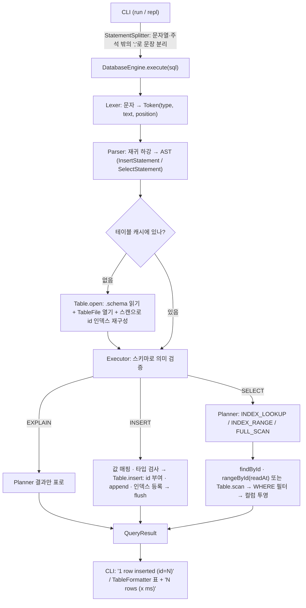

# Mini DBMS

Java 17로 직접 구현한 파일 기반 미니 DBMS. 외부 라이브러리는 Jackson만 쓴다.

| Phase | 내용 | 상태 |
|---|---|---|
| 1 | 파일 기반 SQL 처리기 (INSERT, SELECT, CLI) | ✅ |
| 2 | 메모리 B+ 트리 id 인덱스 + 100만 건 성능 비교 | ✅ |
| 3 | JDK HttpServer + ThreadPoolExecutor API 서버 | ✅ |

## 빠른 시작

```bash
./gradlew test        # 전체 테스트
./gradlew jar         # build/libs/mini-dbms.jar 생성 (의존성 포함)

java -jar build/libs/mini-dbms.jar run sql/sample.sql --data ./data
java -jar build/libs/mini-dbms.jar repl --data ./data
```

| 명령 | 설명 |
|---|---|
| `run <file.sql> [--data DIR]` | 파일의 문장을 순서대로 실행. 마지막 `;`는 생략 가능 |
| `repl [--data DIR]` | 대화형. `;`가 나올 때까지 여러 줄 입력, `.exit` 또는 EOF로 종료 |
| `generate --table T --count N [--seed 42]` | 대용량 테스트 데이터 생성 ([아래](#대용량-데이터-생성)) |
| `bench --table T [--queries 1000]` | 인덱스 조회 vs 선형 탐색 벤치마크 → `bench-result.md` ([아래](#벤치마크)) |
| `serve [--port 8080] [--threads 8] [--queue 1000] [--max-rows 10000] [--query-timeout 5000] [--grace 10]` | HTTP API 서버 ([아래](#api-서버)) |
| `loadtest [--url URL] [--clients 1,4,16,64]` | 동시 클라이언트 수별 TPS·지연 ([아래](#부하-테스트)) |

- `--data` 기본값은 `./data`. 디렉터리가 미리 있어야 한다.
- 한 문장이 실패해도 `ERROR: ...`를 출력하고 다음 문장을 계속 실행한다. run 모드는 `[line N]`으로 문장 위치를 알려준다.
- 종료 코드: `0` 성공 · `1` 실패한 문장이 있음 · `2` 사용법/파일 오류

```text
mini-dbms> INSERT INTO users (name) VALUES ('kim');
1 row inserted (id=1)
mini-dbms> SELECT * FROM users
        -> WHERE id >= 1;
+----+------+------+
| id | name | age  |
+----+------+------+
|  1 | kim  | NULL |
+----+------+------+
1 row (index range, 0.041 ms)
mini-dbms> EXPLAIN SELECT * FROM users WHERE id = 1;
+-------+--------------+-----------------+
| table | access_path  | detail          |
+-------+--------------+-----------------+
| users | INDEX_LOOKUP | id = 1 (id = 1) |
+-------+--------------+-----------------+
```

## 지원 SQL

```sql
INSERT INTO table [(col, ...)] VALUES (value, ...);
SELECT * | col, ... FROM table [WHERE condition] [LIMIT n];
EXPLAIN SELECT ...;                 -- 실행하지 않고 실행 경로만 보여준다
-- condition: col op value | col BETWEEN value AND value (양 끝 포함)
-- op: =  !=  <>  <  <=  >  >=      value: 정수 | '문자열' | NULL
```

- 키워드·테이블·컬럼 이름은 대소문자를 구분하지 않는다. 결과 컬럼 이름은 스키마 표기를 따른다.
- 문자열 안의 작은따옴표는 `''`로 쓴다. `--`부터 줄 끝까지는 주석이다.
- `id`는 엔진이 자동 부여한다(현재 최대 id + 1). 직접 넣으면 오류.
- 컬럼 목록을 생략하면 `id`를 뺀 스키마 순서대로 값을 받는다. 지정하지 않은 컬럼은 NULL.
- 타입은 엄격하게 검사한다. INT 컬럼에 `'30'`을 넣거나 비교하면 오류(암묵적 변환 없음).
- NULL과의 비교는 항상 false다. `age != 30`에도 age가 NULL인 행은 나오지 않는다.
- 문자열 비교는 유니코드 코드 포인트 순이다(`'B' < 'a' < '가'`). Java `String.compareTo`(UTF-16 단위)와 달리 보충 문자(U+10000 이상)도 U+E000~U+FFFF보다 크다.
- `LIMIT n`(0 이상)은 앞에서부터 n행만 돌려준다. n행을 모으는 순간 남은 파일·인덱스 범위를 읽지 않는다. 순서는 실행 경로를 따른다(인덱스는 id 순, 스캔은 파일 순).

### 오류 종류 (`common` 패키지, 모두 `DbException` 하위)

| 예외 | 언제 |
|---|---|
| `ParseException` | 문법 오류, 값 개수 불일치, INSERT 컬럼 중복 |
| `TableNotFoundException` | 스키마 파일이 없는 테이블, 잘못된 테이블 이름 |
| `ColumnNotFoundException` | 스키마에 없는 컬럼 |
| `TypeMismatchException` | 값 타입이 컬럼 타입과 다름 |
| `ConstraintViolationException` | `id`를 직접 지정 |
| `DuplicateKeyException` | B+ 트리에 이미 있는 키를 삽입 |
| `QueryTimeoutException` | 쿼리가 엔진의 제한 시간을 넘음 |
| `StorageException` | 파일 I/O 실패, 스키마·레코드 형식 손상 |

## 저장 포맷

테이블 하나 = 파일 두 개. 인코딩은 UTF-8.

### `data/{table}.schema`

한 줄에 `이름:타입`을 쉼표로 나열한다. 타입은 `INT`(64비트 정수)와 `STRING`. `id:INT` 컬럼이 반드시 있어야 한다.

```text
id:INT,name:STRING,age:INT,email:STRING
```

공백과 타입 대소문자는 무시한다(` id : int `도 된다). 빈 파일·중복 컬럼·모르는 타입은 `StorageException`.

### `data/{table}.tbl`

한 줄이 레코드 하나(`\n`으로 끝남), 필드는 스키마 순서대로 `|`로 구분한다.

```text
1|kim|30|kim@test.com
2|o'brien; \| \\ 특수문자|19|\N
3|no-age|\N|\N
4||25|empty-name@test.com
```

| 원래 값 | 저장 형태 |
|---|---|
| `\` | `\\` |
| `\|` (구분자) | `\\|` |
| 줄바꿈 / CR | `\n` / `\r` |
| NULL | 필드 전체가 `\N` |
| 빈 문자열 | 빈 필드 |

- 문자열 `"\N"`은 `\\N`으로 저장되므로 NULL과 겹치지 않는다.
- 줄바꿈과 CR을 이스케이프하므로 레코드 하나는 항상 물리적인 한 줄이다.
- 쓰기는 append만 한다. `TableFile.append`는 그 줄이 시작된 **byte offset**을 돌려준다(Phase 2에서 B+ 트리가 `id → offset`으로 사용).

### id 인덱스 (Phase 2)

테이블마다 메모리 B+ 트리(`BPlusTree<Long, Long>`, order 128)가 `id → .tbl 안의 byte offset`을 들고 있다.

- **INSERT**: id 부여 → `append`가 돌려준 offset을 인덱스에 등록 → `nextId++`. 파일 쓰기가 실패하면 인덱스·nextId는 그대로다.
- **조회**: `Table.findById(id)`는 인덱스에서 offset을 찾아 `TableFile.readAt(offset)`으로 그 줄만 읽는다. 아직 flush되지 않은 줄은 메모리 버퍼에서 읽는다.
- **재시작**: 테이블을 처음 열 때 `.tbl`을 한 번 훑어 인덱스를 다시 만들고 `nextId = 최대 id + 1`로 맞춘다. 같은 id가 두 번 있거나 id가 NULL이면 `StorageException`.
- **줄바꿈 없이 끝난 마지막 줄**(손으로 편집했거나 쓰다 중단됨): 파일 끝에 `\n`을 붙여 다음 레코드가 이어 붙지 않게 하고, 그 줄은 **이번 로딩에서만** 경고(stderr) 후 인덱스·스캔에서 뺀다. 그 줄의 id는 피해서 부여한다. 다음 재시작부터는 일반 레코드로 읽힌다(내용이 깨졌다면 그때 로딩이 실패한다).

### 실행 경로 (Planner)

| WHERE | 경로 | 동작 |
|---|---|---|
| `id = v` | `INDEX_LOOKUP` | 트리에서 키 하나 → 그 offset의 줄만 읽기 |
| `id <, <=, >, >=, BETWEEN` | `INDEX_RANGE` | 닫힌 구간 `[low, high]`로 바꿔(`id < 3` → `-∞..2`) 하한 리프부터 next를 따라 읽기 |
| 없음, `id !=`, id가 아닌 컬럼 | `FULL_SCAN` | 파일 전체를 읽으며 조건 검사 |

- 인덱스 경로로 고른 행도 FULL_SCAN과 같은 조건 함수를 한 번 더 통과한다. 그래서 두 경로의 결과 행 집합은 항상 같다.
- 순서: 인덱스 경로는 id 순, FULL_SCAN은 파일 순이다. 엔진이 쓴 파일은 id 순으로 append되므로 같지만, 손으로 편집한 파일은 다를 수 있다(ORDER BY 없음).
- SELECT 결과 줄에 경로와 시간을 표시한다: `2 rows (index range, 0.041 ms)`.
- 벤치마크용 스위치: `engine.setIndexEnabled(false)`면 항상 `FULL_SCAN`을 고른다. INSERT의 인덱스 등록은 계속하므로 다시 켜면 바로 쓸 수 있다.

### 쓰기 버퍼와 flush

`.tbl` 파일은 엔진이 처음 쓸 때 열어 두고 64KB 메모리 버퍼에 모은다. `readAt`과 스캔이 버퍼 안의 줄도 읽어야 해서 버퍼를 직접 관리한다(읽기는 flush하지 않는다 — 아래 동시성 참고). 디스크(OS)로 내려가는 시점은

1. 새 줄이 버퍼의 남은 공간에 들어가지 않을 때 (버퍼보다 큰 줄은 버퍼를 거치지 않고 바로 쓴다)
2. `DatabaseEngine.execute` 호출 하나가 끝날 때 (성공이든 실패든, 그 호출에서 INSERT한 테이블마다 `flush()` 한 번)
3. 종료할 때 (`close()` — 정상 종료는 `finally`, Ctrl+C는 shutdown hook)

flush는 OS 페이지 캐시까지만 보장한다(fsync 없음). 디스크 쓰기가 한 번 실패하면 그 파일은 이후 쓰기를 거부한다(재시작하면 파일 기준으로 다시 맞춰진다).

## 대용량 데이터 생성

```bash
java -jar build/libs/mini-dbms.jar generate --table users --count 1000000 [--seed 42] [--data ./data] \
     [--batch 1000] [--reset] [--out users.sql]
```

- Phase 1 SQL 처리기를 그대로 거친다: `INSERT INTO users (name, age, email) VALUES (...)` 문자열을 만들어 `--batch`개씩 `DatabaseEngine.execute`에 넘긴다.
- 데이터: name은 소문자 5~10자, age는 1~100, email은 `user{n}@test.com`(n = 행 번호 = id). 같은 seed면 배치 크기와 상관없이 같은 데이터가 나온다.
- 스키마가 없으면 `id:INT,name:STRING,age:INT,email:STRING`로 만든다. email 고유성을 위해 테이블이 비어 있어야 하며, 데이터가 있으면 `--reset`(기존 .tbl 삭제)이 필요하다.
- `--out`: 실행하지 않고 같은 SQL을 파일로 쓴다. `run` 모드로 실행할 수 있다.
- 10만 건마다 진행률, 끝에 총 시간과 초당 INSERT 수를 출력한다.

### 병목 점검 (100만 건, Apple Silicon 노트북 기준)

| 항목 | 점검 결과 |
|---|---|
| 파일 open/close | 테이블 파일은 엔진이 처음 쓸 때 한 번 열고 끝까지 유지 → 문제 없음 |
| flush | **INSERT마다 flush(쓰기 시스템 콜 100만 번)가 전체의 절반**이었다. execute 호출 단위로 바꿔서 4.4 s → 2.2 s |
| 문자열 연결 | 배치용 `StringBuilder` 하나를 재사용하고 생성기가 그 안에 바로 쓴다. SQL 생성은 0.1 s |
| Lexer / Parser | 1000문장 배치 기준 0.8 s / 0.2 s. 문자열 리터럴을 substring으로 자르는 빠른 경로를 실험했지만 차이가 없어 넣지 않았다 |

| 방식 | 100만 건 |
|---|---|
| `generate` (배치 1000) | 약 2.2 s (≈ 45만 rows/s) |
| `generate --batch 1` | 약 5 s |
| `generate --out` 후 `run` | 내보내기 1.8 s + 실행 6.7 s (문장마다 execute·flush, 출력 100만 줄) |

## 벤치마크

```bash
java -jar build/libs/mini-dbms.jar generate --table users --count 1000000
java -jar build/libs/mini-dbms.jar bench --table users [--queries 1000] [--scan-queries 5] [--warmup 500] [--out bench-result.md]
```

| 항목 | SQL | 경로 |
|---|---|---|
| A | `WHERE id = ?` | INDEX_LOOKUP |
| B | `WHERE id = ?` + `setIndexEnabled(false)` | FULL_SCAN |
| C | `WHERE email = ?` | FULL_SCAN |

- 대상 행은 파일 순서 기준 앞(처음 1%)·중간(가운데 1%)·끝(마지막 1%)에서 무작위로 고른다.
- 항목마다 세 위치의 워밍업을 먼저 끝낸 뒤 잰다(처음 재는 위치만 JIT가 덜 된 상태로 측정되는 것을 막음).
- 스캔(B, C)은 100만 건에서 한 번에 1초 이상이라 `--queries` 대신 `--scan-queries`(기본 5회)만 잰다.
- 매 쿼리마다 실행 경로와 찾은 id를 확인해서, 의도와 다른 경로로 잰 숫자가 나오지 않게 한다.

100만 건 결과(전체는 [`bench-result.md`](bench-result.md)): A 평균 **0.025 ms**, B 약 1,350 ms, C 약 1,220 ms — 약 5만 배.
트리는 order 128, 높이 4, 노드 15,869개이고 테이블 로딩(인덱스 재구성)에 약 2.4 s가 걸린다.

## 동시성 설계 (Phase 3)

요청 하나가 지나가는 계층 순서대로, 각 계층에서 무엇이 공유되고 어떻게 보호하는지:

| 계층 | 공유 상태 | 방법 | 이렇게 하지 않으면 |
|---|---|---|---|
| HttpServer dispatcher | 연결 수락 | JDK 스레드 1개가 받고 `executor.execute()`로 넘김 | — |
| 워커 풀 | 요청 큐 | `ThreadPoolExecutor` + 유한 `ArrayBlockingQueue`, 스레드 `db-worker-N` | 무한 큐면 과부하가 503이 아니라 끝없는 지연·메모리 증가로 나타난다 |
| 거절 | — | `BusyRejectionHandler`: dispatcher에서 ThreadLocal 표시를 달고 실행 → 가드가 503 | 예외를 던지면 클라이언트는 응답 없이 연결이 끊긴다 |
| 요청 통계 | 처리 수·시간 합 | `LongAdder` | `long`이면 동시 증가가 유실된다 |
| 요청 로그 | 출력 스트림 | `PrintStream.println` 한 번에 한 줄(내부 동기화), 스택 트레이스도 한 문자열로 | 여러 번 나눠 쓰면 다른 스레드 줄이 끼어든다 |
| 엔진 테이블 캐시 | `name → Table` | `ConcurrentHashMap.computeIfAbsent` | `get` 후 `put`이면 같은 파일을 두 번 열어 각자의 `nextId`로 id가 중복된다 |
| 엔진 설정 | 인덱스 스위치·최대 행 수 | `volatile` | 다른 스레드에 바뀐 값이 안 보일 수 있다 |
| 테이블 | 인덱스·`nextId`·쓰기 버퍼 | 테이블마다 `ReentrantReadWriteLock`. **쓰기**: INSERT(id 부여 → append → 인덱스 등록 → nextId++), flush, close. **읽기**: 인덱스 조회·범위·스캔 | id 중복, 인덱스에는 있는데 파일에 없는 레코드, 반쯤 쓰인 줄을 읽음 |
| 데이터 파일 읽기 | 버퍼·채널 | 읽기 경로(`readAt`·스캔)는 상태를 바꾸지 않는다. 위치 지정 `FileChannel` 읽기 + 버퍼는 메모리에서 이어 읽기 | 예전처럼 스캔이 flush하면 읽기 락을 함께 쥔 두 스캔이 같은 버퍼를 두 번 써서 레코드가 중복된다 |
| Lexer · Parser · Executor · Planner | 없음 | 호출마다 새로 만들거나 필드가 없다. 공유하는 것은 불변 키워드 표(`Map.of`)뿐 | — |

- SELECT 하나는 처음부터 끝까지 읽기 락 하나를 쥔다. 원자성은 문장 하나 단위다(트랜잭션 없음).
- id 부여와 append가 같은 쓰기 락 안에 있어서 파일 순서 = id 순서가 동시 INSERT에서도 유지된다.
- 검증: `ConcurrencyTest`(16스레드 × 1만 INSERT → id 1~160000 연속), `TableConcurrencyTest`(버퍼가 남은 상태의 동시 스캔),
  `ApiConcurrencyTest`(HTTP 클라이언트 50개 × 200건 → 성공 10,000, id 중복 없음), `ApiOverloadTest`(워커 1·큐 1에 60개 동시 → 200 2개, 503 58개).
  각 락을 일부러 빼면(쓰기 락 · computeIfAbsent · 읽기 락 · 스캔의 flush · 거절 핸들러) 해당 테스트가 실패하는 것도 확인했다.

## API 서버

```bash
java -jar build/libs/mini-dbms.jar serve --port 8080 --threads 8 [--max-threads 8] --queue 1000 --data ./data [--host 127.0.0.1]
curl localhost:8080/health
# {"status":"UP","uptimeMs":544,"pool":{"coreThreads":8,"maxThreads":8,"poolSize":1,"activeThreads":1,"queued":0,"queueCapacity":1000,"rejected":0}}
```

### API 명세

모든 응답은 `Content-Type: application/json; charset=utf-8`이다.

#### `POST /query`

| 항목 | 내용 |
|---|---|
| 요청 헤더 | `Content-Type: application/json` (charset이 있으면 utf-8만) |
| 요청 본문 | `{"sql": "문장; 문장; ..."}` — 최대 1MB, 다른 필드는 무시 |
| 200 응답 | `{"results": [문장별 결과...], "elapsedMs": 전체}` |

문장별 결과:

| type | 필드 |
|---|---|
| `INSERT` | `affectedRows`, `insertedId`, `elapsedMs` |
| `SELECT` | `columns`, `rows`(columns 순서의 배열, NULL은 `null`), `rowCount`, `truncated`, `accessPath`(`INDEX_LOOKUP`·`INDEX_RANGE`·`FULL_SCAN`), `elapsedMs` |
| `EXPLAIN` | `columns`(`table`, `access_path`, `detail`), `rows`(계획 한 행), `accessPath`, `elapsedMs` |

```bash
# INSERT 두 개 + 인덱스 범위 조회. here-doc을 쓰면 SQL의 작은따옴표를 이스케이프하지 않아도 된다.
curl -s -X POST localhost:8080/query -H 'Content-Type: application/json' -d @- <<'EOF'
{"sql": "INSERT INTO users (name, age) VALUES ('kim', 30); INSERT INTO users (name) VALUES ('lee'); SELECT * FROM users WHERE id BETWEEN 1 AND 2"}
EOF
```
```json
{"results":[
   {"type":"INSERT","affectedRows":1,"insertedId":1,"elapsedMs":0.081},
   {"type":"INSERT","affectedRows":1,"insertedId":2,"elapsedMs":0.064},
   {"type":"SELECT","columns":["id","name","age","email"],"rows":[[1,"kim",30,null],[2,"lee",null,null]],
    "rowCount":2,"truncated":false,"accessPath":"INDEX_RANGE","elapsedMs":0.312}],
 "elapsedMs":0.497}
```
```bash
# 실행 계획만
curl -s -X POST localhost:8080/query -H 'Content-Type: application/json' -d '{"sql": "EXPLAIN SELECT * FROM users WHERE id = 1"}'
# {"results":[{"type":"EXPLAIN","columns":["table","access_path","detail"],"rows":[["users","INDEX_LOOKUP","id = 1 (id = 1)"]],"accessPath":"INDEX_LOOKUP","elapsedMs":0.02}],"elapsedMs":0.05}

# 오류
curl -s -X POST localhost:8080/query -H 'Content-Type: application/json' -d '{"sql": "SELECT * FORM users"}'
# 400 {"error":"PARSE_ERROR","message":"Expected FROM but found 'form' at 9"}
```

- 큰 결과는 서버의 최대 행 수(`--max-rows`, 기본 10,000)에서 잘리고 `"truncated": true`가 된다. `LIMIT`을 주거나 `WHERE id BETWEEN`으로 나눠 받는다.
- 여러 문장 중 하나가 실행 중 실패하면 그 오류만 돌려준다. 앞 문장은 이미 반영됐을 수 있다(트랜잭션 없음). 문법 오류는 전체를 먼저 파싱하므로 아무것도 실행되지 않는다.

#### `GET /stats`

```bash
curl -s localhost:8080/stats
```
```json
{"pool":{"coreThreads":8,"maxThreads":8,"poolSize":8,"largestPoolSize":8,"activeThreads":1,"queued":0,
         "queueCapacity":1000,"completedTasks":10,"rejected":0},
 "requests":{"handled":5,"clientErrors":2,"serverErrors":0,"averageMs":1.734},
 "uptimeMs":775}
```

| 필드 | 뜻 |
|---|---|
| `pool.activeThreads` · `queued` | 지금 일하는 워커 수 · 큐에서 기다리는 요청 수 |
| `pool.completedTasks` | executor가 끝낸 작업 수(근사값). HttpServer 내부 작업도 포함돼 요청 수와 다를 수 있다 |
| `pool.rejected` | 503(`SERVER_BUSY`·`SHUTTING_DOWN`)으로 돌려보낸 요청 수 |
| `requests.handled` · `averageMs` | 워커가 처리한 요청 수 · 평균 처리 시간(거절 제외) |

#### `GET /health`

```bash
curl -s localhost:8080/health
# {"status":"UP","uptimeMs":544,"pool":{...}}
```

### 오류 응답

모든 오류는 `{"error": "CODE", "message": "..."}` JSON이다.

| 상태 | code | 언제 |
|---|---|---|
| 400 | `PARSE_ERROR` | SQL 문법, 값 개수 불일치, INSERT 컬럼 중복 |
| 400 | `COLUMN_NOT_FOUND` · `TYPE_MISMATCH` | 없는 컬럼, 타입 불일치 |
| 400 | `INVALID_JSON` | 본문이 JSON이 아님 / 비어 있음 |
| 400 | `INVALID_REQUEST` | `sql` 필드 없음·문자열 아님·빈 문자열·주석뿐, 본문이 객체가 아님 |
| 404 | `TABLE_NOT_FOUND` | 스키마 파일이 없는 테이블 |
| 404 | `NOT_FOUND` | 없는 경로 (등록 경로의 하위 경로 포함) |
| 405 | `METHOD_NOT_ALLOWED` | `GET /query`, `POST /stats` 등 (`Allow` 헤더) |
| 409 | `CONSTRAINT_VIOLATION` · `DUPLICATE_KEY` | id 직접 지정, 키 중복 |
| 413 | `PAYLOAD_TOO_LARGE` | 본문 1MB 초과 (Content-Length가 있으면 읽기 전에 거절) |
| 415 | `UNSUPPORTED_MEDIA_TYPE` | Content-Type이 `application/json`이 아니거나 charset이 utf-8이 아님 |
| 500 | `STORAGE_ERROR` · `DB_ERROR` | 파일 I/O·손상 — 응답은 고정 문구, 상세(경로·레코드 내용)는 서버 로그에만 |
| 500 | `INTERNAL_ERROR` | 예상 못 한 예외 — 메시지는 감추고 서버 로그에 스택 트레이스 |
| 503 | `SERVER_BUSY` | 워커·큐가 모두 참 (`Retry-After: 1`) |
| 503 | `SHUTTING_DOWN` | 종료 중에 들어온 요청 (`Connection: close`) |
| 503 | `QUERY_TIMEOUT` | 요청 하나가 `--query-timeout`(기본 5,000 ms)을 넘음. 다시 보내도 같으므로 `Retry-After` 없음 |

### 요청 로그

요청마다 한 줄(스레드, 메서드, 경로, 상태, 처리 시간). 거절된 요청은 dispatcher 스레드 이름으로 찍힌다.

```text
20:28:56.598 [db-worker-3] POST /query 200 1.646 ms
20:28:56.677 [db-worker-3] POST /query 404 2.637 ms
```

### 워커 풀과 503

`ThreadPoolExecutor(core=--threads, max=--max-threads, ArrayBlockingQueue(--queue))`, 스레드 이름 `db-worker-N`.
요청은 core 스레드 → 큐 → (큐가 차면) max까지 스레드 추가 → 거절 순으로 처리된다. 큐가 유한해야 과부하가 503으로 드러난다.

**거절된 요청에 응답을 보내는 방법**: HttpServer의 dispatcher 스레드는 연결마다 내부 Runnable을 만들어 `executor.execute()`에 넘기는데,
HTTP 요청을 읽어 `HttpExchange`를 만드는 일은 그 Runnable 안에서 일어난다. 그래서 `RejectedExecutionHandler`가 받는 시점에는 응답을 쓸 대상이 없고,
예외를 던지면 클라이언트는 상태 코드 없이 연결이 끊긴다(실험: `HTTP/1.1 header parser received no bytes`).

`BusyRejectionHandler`는 거절된 Runnable을 **호출한 dispatcher 스레드에서 ThreadLocal "거절됨" 표시를 단 채로 바로 실행**한다.
그러면 요청 파싱과 핸들러 호출이 그 자리에서 일어나고, 모든 핸들러를 감싼 가드가 표시를 보고 DB 작업 없이 503 JSON만 쓴다.
헤더를 읽고 작은 응답을 쓰는 비용이라 dispatcher를 오래 붙잡지 않는다. 한계: 헤더를 아주 느리게 보내는 클라이언트가 있으면 그동안 dispatcher가 묶인다.

### 종료 (Ctrl+C / SIGTERM)

shutdown hook이 `ApiServer.stop()`을 부른다. 순서:

1. **새 요청 거부** — `executor.shutdown()`. 이후 들어오는 요청은 거절 핸들러를 거쳐 503 `SHUTTING_DOWN`. 이미 큐에 있던 요청과 처리 중인 요청은 계속 실행된다.
2. **완료 대기** — 워커가 끝날 때까지 최대 `--grace`초(기본 10). 넘기면 워커를 interrupt하고 5초 더 기다린다.
3. **연결 닫기** — `HttpServer.stop(0)`.
4. **flush** — `engine.close()`가 테이블 버퍼를 파일로 내려쓰고 닫는다(테이블 쓰기 락을 거치므로 읽는 중인 요청이 끝난 뒤).

`HttpServer.stop`을 먼저 부르면 리스너와 함께 연결도 닫혀 큐에서 기다리던 요청이 응답할 곳을 잃는다. 그래서 executor를 먼저 닫는다.

```text
20:35:38.757 [mini-dbms-server-shutdown] 종료 시작: 새 요청 거부, 처리 중·대기 중 요청 1개를 최대 10초 기다립니다
20:35:38.997 [HTTP-Dispatcher] GET /health 503 0.731 ms
20:35:40.215 [db-worker-2] POST /query 200 1756.077 ms
20:35:40.216 [mini-dbms-server-shutdown] 종료 완료: 테이블 파일 flush 후 닫음
```

### 큰 결과와 오래 걸리는 요청

- **메모리**: SELECT가 모으는 행은 많아야 `max-rows + 1`개다(넘치는지 보려고 하나 더 읽는다). 100만 건 `SELECT *`가 1.2 s·100만 행 대신 1,000행·약 9 ms로 끝난다.
- **시간**: 행 수 제한은 결과가 큰 쿼리만 줄인다. `WHERE email = 'none'`처럼 결과는 0행인데 전체를 훑는 쿼리를 위해 **협조적 쿼리 타임아웃**을 둔다.
  - `engine.setQueryTimeoutMillis(ms)` (서버는 `--query-timeout`, 기본 5,000 ms, 0이면 끔. CLI·벤치마크는 제한 없음).
  - 범위는 `execute` 호출 하나(= `/query` 요청 하나) 전체다. 문장 사이와, 스캔·인덱스 범위 읽기 중 **후보 1,024행마다** 마감을 확인한다. 조건에 맞는 행이 아니라 읽은 행 기준이라 결과 0행인 스캔도 제때 멈춘다.
  - 넘으면 `QueryTimeoutException`을 던진다. 스레드를 강제로 멈추지 않고 실행 코드가 스스로 빠져나오므로, 읽기 락과 파일 스트림이 `finally`에서 정상적으로 풀리고 워커도 바로 다음 요청을 받는다.
  - 테이블을 처음 열 때의 인덱스 재구성 시간은 마감에서 뺀다. 그러지 않으면 큰 테이블을 처음 쓰는 쿼리가 로딩만으로 항상 실패한다.
  - 앞 문장의 INSERT는 남는다(트랜잭션 없음).
  - 100만 건, 제한 500 ms: `WHERE email = 'nobody@test.com'` → 0.52 s에 503 `QUERY_TIMEOUT` · 첫 `WHERE id = 1`(로딩 포함 5.1 s) → 200.

## 부하 테스트

```bash
java -jar build/libs/mini-dbms.jar loadtest [--url http://localhost:8080] [--data ./data] [--clients 1,4,16,64] \
     [--duration 5] [--warmup 2] [--workload lookup|insert|mixed] [--server-threads 8] [--out loadtest-result.md]
```

- `--url`이 없으면 `--data` 폴더로 서버를 같은 프로세스에 띄워 잰다(localhost 루프백).
- 클라이언트는 응답을 받은 뒤 다음 요청을 보내는 닫힌 루프다. 클라이언트 수마다 `--duration`초 동안 잰다.
- `lookup`: `WHERE id = 무작위`(최대 id는 이진 탐색으로 찾는다, id가 1부터 연속인 generate 데이터 가정) · `insert` · `mixed`: lookup 80% + insert 20%

100만 건, 워커 8, 노트북(CPU 8개) 결과:

**lookup**

| 클라이언트 | 요청 수 | TPS | 평균 (ms) | p50 (ms) | p99 (ms) | 최대 (ms) | 503 | 기타 오류 |
|---:|---:|---:|---:|---:|---:|---:|---:|---:|
| 1 | 8,863 | 1,772 | 0.5485 | 0.4107 | 2.56 | 11.98 | 0 | 0 |
| 4 | 30,943 | 6,188 | 0.6386 | 0.5280 | 2.45 | 21.78 | 0 | 0 |
| 16 | 49,724 | 9,942 | 1.61 | 1.44 | 4.55 | 74.16 | 0 | 0 |
| 64 | 52,742 | 10,540 | 6.07 | 5.50 | 17.81 | 71.57 | 0 | 0 |

**mixed (lookup 80% + insert 20%)**

| 클라이언트 | 요청 수 | TPS | 평균 (ms) | p50 (ms) | p99 (ms) | 최대 (ms) | 503 | 기타 오류 |
|---:|---:|---:|---:|---:|---:|---:|---:|---:|
| 1 | 11,920 | 2,384 | 0.4080 | 0.3506 | 1.45 | 8.35 | 0 | 0 |
| 4 | 32,059 | 6,411 | 0.6143 | 0.5274 | 2.19 | 50.67 | 0 | 0 |
| 16 | 44,031 | 8,804 | 1.81 | 1.62 | 5.35 | 54.19 | 0 | 0 |
| 64 | 44,799 | 8,950 | 7.14 | 5.88 | 28.48 | 108.6 | 0 | 0 |

- 클라이언트 1 → 4 → 16에서 TPS가 거의 비례해 늘다가 16 → 64에서 멈춘다. 워커가 8개이고 CPU도 8개라 그 이상은 큐에서 기다리는 시간만 늘어난다(p50 1.4 → 5.5 ms). 닫힌 루프라 TPS ≈ 클라이언트 수 / 평균 지연이다.
- mixed가 lookup보다 포화 TPS가 낮고 p99가 크다. INSERT는 테이블 쓰기 락을 잡고 파일에 쓰는 동안 같은 테이블의 모든 읽기를 막기 때문이다(테이블 단위 락의 비용).
- 503은 없다. 클라이언트 64 < 워커 8 + 큐 1000이라 거절할 일이 없다. 503은 `ApiOverloadTest`처럼 큐보다 동시 요청이 많을 때 나온다.

## 처리 흐름



각 단계의 책임은 한 곳에만 있다.

| 단계 | 책임 | 하지 않는 것 |
|---|---|---|
| `StatementSplitter` | 문장 경계 찾기 (한 문장 실패 시 다음 문장 계속) | 토큰화 |
| `Lexer` | 키워드·식별자·숫자·문자열·기호, 위치 포함 오류 | 문법 |
| `Parser` | 문법 → AST, `Expected X but found 'Y' at N` | 스키마 검증 |
| `Executor` | 테이블·컬럼 존재, 타입, 개수, id 규칙, 실행 | 파일 포맷 |
| `Planner` | WHERE를 보고 실행 경로와 id 구간 결정 | 검증, 읽기 |
| `Table` | id 부여, id 인덱스 유지·재구성, id로 레코드 찾기 | SQL 의미 |
| `RecordCodec` / `TableFile` | 레코드 ↔ 한 줄, 버퍼링 append·scan·readAt | id·인덱스 |

엔진에 여러 문장을 한 번에 넘기면 전체를 먼저 파싱하므로, 문법 오류가 하나라도 있으면 아무것도 실행되지 않는다. 실행 중 오류는 앞 문장의 결과를 남긴다(트랜잭션 없음).

## 패키지 구조

```text
src/main/java/com/minidbms/
├── cli/          Main(인자 파싱·종료 코드), Cli(run/repl), StatementSplitter, TableFormatter
├── sql/lexer/    Lexer, Token, TokenType
├── sql/parser/   Parser, ast/(Statement, InsertStatement, SelectStatement, ExplainStatement, Condition, Operator, Literal)
├── engine/       DatabaseEngine(유일한 진입점), Executor, Planner, Plan, AccessPath, QueryResult
├── bench/        DataGenerator(generate 명령), UserRowGenerator, Benchmark(bench 명령), LoadTest(loadtest 명령)
├── server/       ApiServer, QueryHandler, ErrorMapper, ApiException, ThreadPoolFactory, BusyRejectionHandler,
│                 RequestStats, ServerLog, ServeCommand(serve 명령), ServerConfig, Json
├── storage/      Schema, Column, ColumnType, SchemaLoader, RecordCodec, TableFile, Table
├── index/        BPlusTree, Node, InternalNode, LeafNode
└── common/       DbException과 하위 예외
```

### 보안상 기본값

이 서버에는 **인증과 TLS가 없다**. 그래서 기본값을 안전한 쪽으로 둔다.

| 항목 | 기본 동작 | 이유 |
|---|---|---|
| 바인딩 | `127.0.0.1`(같은 컴퓨터에서만). 다른 컴퓨터에서 쓰려면 `--host 0.0.0.0`을 명시하고, 그때는 시작할 때 경고를 출력한다 | 열린 포트에 닿는 누구나 SELECT·INSERT를 할 수 있고 SQL·결과가 평문으로 오간다 |
| 요청 읽기 시간 | `sun.net.httpserver.maxReqTime=10`(초). `-D`로 이미 정했으면 그 값 | 포화 시 거절된 요청은 dispatcher 스레드에서 파싱된다. 헤더를 끝내지 않는 연결이 dispatcher를 묶지 못하게 JDK 타이머가 끊는다(실험: 설정이 없으면 다음 요청이 8 s 넘게 막히고, 2 s면 2.8 s에 회복) |
| 결과 크기 | 행 수(`--max-rows`)와 별도로 대략 16M 문자 | 큰 문자열 컬럼을 수천 번 투영하면 한 행만으로 수백 MB가 된다 |
| 락 대기 | 쿼리 마감 시각까지만 `tryLock` | 다른 요청이 테이블을 오래 쥐고 있을 때 단건 조회가 마감을 넘겨 기다린 뒤 성공하지 않게 |
| 오류 메시지 | 4xx는 도메인 메시지(SQL·테이블·컬럼 이름), 5xx는 고정 문구. 테이블 없음 메시지에는 절대 경로 대신 파일 이름만 | 서버 디렉터리 구조와 저장된 레코드 내용을 밖으로 보내지 않는다 |
| 로그·표 출력 | 클라이언트 값의 제어 문자를 `\uXXXX`로 바꿔 출력 | `%0a`로 가짜 로그 줄을 끼우거나 ESC 시퀀스로 터미널을 조작하지 못하게 |

## 알려진 한계

- 인덱스는 id 하나뿐이다. 다른 컬럼 조건은 항상 FULL_SCAN.
- WHERE는 조건 하나만 지원한다. `AND`는 `BETWEEN a AND b`의 구분자로만 쓴다.
- UPDATE·DELETE·CREATE TABLE이 없다. 테이블은 `.schema` 파일을 직접 만들어 정의한다.
- 쿼리 타임아웃은 협조적이라 확인 지점(문장 사이, 1,024행마다, 락 대기) 사이의 일은 끊지 못한다. 테이블을 처음 여는 인덱스 재구성도 대상이 아니다.
- 인증·TLS가 없다. 기본 바인딩을 루프백으로 두는 것으로 대신한다.
- 결과 크기 상한은 대략적인 추정(문자열 길이 + 2, 숫자 20)이다. JSON 이스케이프로 늘어나는 만큼은 세지 않는다.
- 스키마는 `id` 말고 컬럼이 하나 이상 있어야 하고, 컬럼 이름은 SQL 식별자 규칙(영문자·숫자·밑줄, 키워드 불가)을 따라야 한다.
- id가 `Long.MAX_VALUE`까지 차면 그 테이블에는 더 INSERT할 수 없다(`CONSTRAINT_VIOLATION`).
