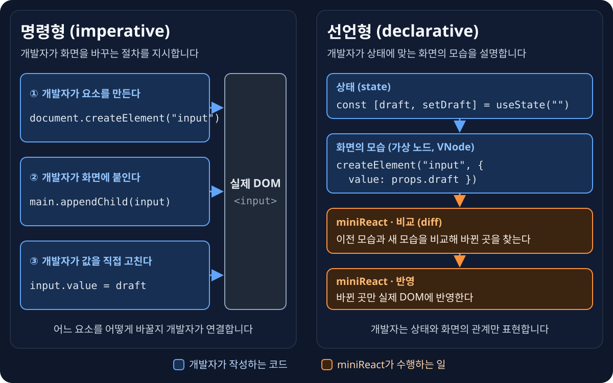
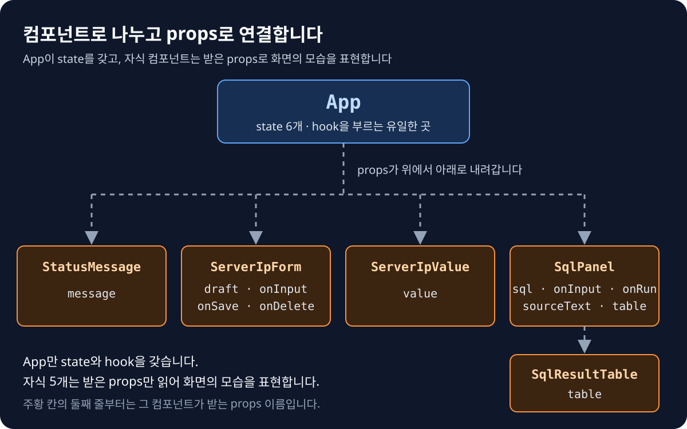
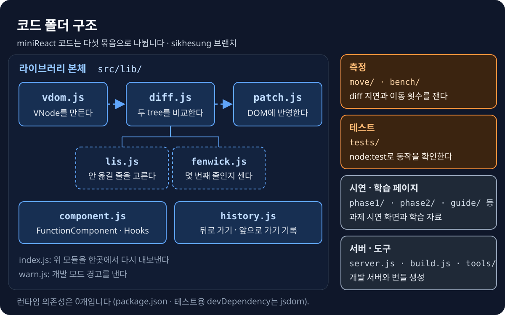
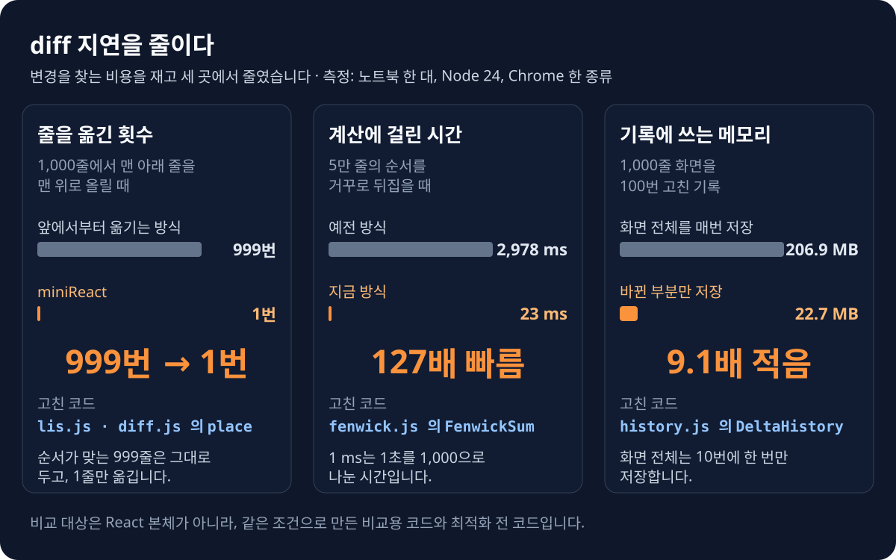
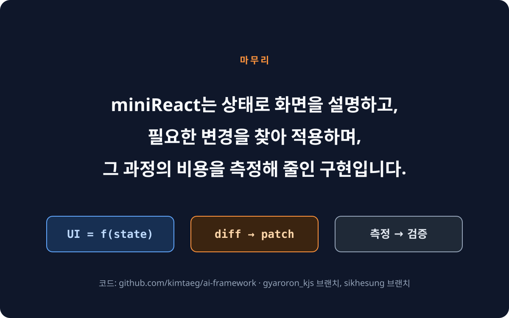

# miniReact — diff 지연을 줄이다

> 외부 프레임워크 의존성 없이 순수 Vanilla JS로 직접 구현한 miniReact(Virtual DOM · Diff · Patch · Hooks · 히스토리)의 4분 발표 자료입니다.

## 사용 방법

1. 브라우저에서 <kbd>F11</kbd>을 눌러 전체 화면으로 바꿉니다.
2. 아래 `시작 ›`을 누릅니다.
3. 그림을 누르면 다음 장으로 넘어갑니다. 그림 아래 오른쪽의 `‹ 이전` · `다음 ›`으로도 이동합니다.

## 구성

| 장 | 내용 | 시간 |
| --- | --- | --- |
| [1](#1--7) | 표지: `UI = f(state)` | 10초 |
| [2](#2--7) | 왜 React인가: 명령형(imperative)과 선언형(declarative) | 50초 |
| [3](#3--7) | 이점 ①: setState를 3번 불러도 화면은 한 번만 바뀜 | 50초 |
| [4](#4--7) | 이점 ②: 컴포넌트(component)로 나누고 props로 연결 | 45초 |
| [5](#5--7) | 코드 폴더 구조 | 30초 |
| [6](#6--7) | diff 지연을 줄이다: 알고리즘과 수치 (전체의 15%) | 36초 |
| [7](#7--7) | 마무리 | 19초 |

## 코드 출처

| 자료 | 브랜치 | 이 발표에서 쓰는 곳 |
| --- | --- | --- |
| [`mini_React/app.js`](https://github.com/kimtaeg/ai-framework/blob/gyaroron_kjs/mini_React/app.js) | `gyaroron_kjs` | 2 · 4장: React를 쓰는 이유와 이점 |
| [`phase2/app.js`](https://github.com/kimtaeg/ai-framework/blob/sikhesung/phase2/app.js) | `sikhesung` | 3장: mini React만 쓰는 Batching 데모 |
| [`src/lib/fenwick.js`](https://github.com/kimtaeg/ai-framework/blob/sikhesung/src/lib/fenwick.js) | `sikhesung` | 6장: 알고리즘 코드 |
| [`README.md`](https://github.com/kimtaeg/ai-framework/blob/gyaroron_kjs/README.md) | `gyaroron_kjs` | 제목, 5장의 폴더 구조, 6장의 측정값. 원본은 [백업 브랜치](https://github.com/gyaroron/ai-framework/blob/backup/gyaroron_kjs-original/README.md)에 보관 |

> [!NOTE]
> 2 · 4장의 코드는 `gyaroron_kjs` 브랜치의 구현이고, 3장의 코드와 5장의 폴더 구조, 6장의 알고리즘 · 측정값은 `sikhesung` 브랜치의 구현입니다. 두 브랜치는 diff를 구현한 방식이 다르므로, 6장의 측정값을 2 · 4장의 코드에 그대로 적용하지 않습니다.

<a href="#1--7">시작 ›</a>

<picture></picture>

###### 1 / 7

<a href="#2--7">다음 ›</a>

> 화면은 현재 상태(state)를 바탕으로 만든 결과입니다.

<picture></picture>

###### 2 / 7

<a href="#1--7">‹ 이전</a> &nbsp;·&nbsp; <a href="#3--7">다음 ›</a>

> 명령형에서는 개발자가 DOM을 고치는 순서를 관리하고, 선언형에서는 개발자가 상태와 화면의 관계만 표현합니다.

<picture></picture>

###### 3 / 7

<a href="#2--7">‹ 이전</a> &nbsp;·&nbsp; <a href="#4--7">다음 ›</a>

> 개발자가 `setCount`를 3번 불러도, miniReact가 변경을 모아 화면의 숫자를 한 번만 고칩니다.

<picture></picture>

###### 4 / 7

<a href="#3--7">‹ 이전</a> &nbsp;·&nbsp; <a href="#5--7">다음 ›</a>

> `App`만 state를 갖고, 자식 컴포넌트는 받은 props만 읽어 화면의 모습을 표현합니다.

<picture></picture>

###### 5 / 7

<a href="#4--7">‹ 이전</a> &nbsp;·&nbsp; <a href="#6--7">다음 ›</a>

> miniReact 코드는 라이브러리 본체, 측정, 테스트, 시연 · 학습 페이지, 서버 · 도구 다섯 묶음으로 나뉩니다.

<picture></picture>

###### 6 / 7

<a href="#5--7">‹ 이전</a> &nbsp;·&nbsp; <a href="#7--7">다음 ›</a>

> 상태가 바뀔 때마다 diff는 옛 tree와 새 tree를 비교합니다. 이 구현은 그 지연을 재고, 세 곳에서 줄였습니다.

| 줄인 곳 | 고친 코드 | 무엇을 바꿨나 |
| --- | --- | --- |
| 줄을 옮긴 횟수 999번 → 1번 | [`lis.js`](https://github.com/kimtaeg/ai-framework/blob/sikhesung/src/lib/lis.js) [`diff.js`](https://github.com/kimtaeg/ai-framework/blob/sikhesung/src/lib/diff.js)의 `place` | `place`가 `longestIncreasingSubsequence`로 서로의 앞뒤 순서가 그대로인 줄을 고르고, 그 줄은 옮기지 않습니다. |
| 계산에 걸린 시간 2,978 ms → 23 ms | [`fenwick.js`](https://github.com/kimtaeg/ai-framework/blob/sikhesung/src/lib/fenwick.js)의 `FenwickSum` | 줄의 현재 위치를 `indexOf` · `splice`로 목록을 훑어 찾던 것을, `countBefore`가 적은 횟수의 덧셈으로 구하게 바꿨습니다. |
| 기록에 쓰는 메모리 206.9 MB → 22.7 MB | [`history.js`](https://github.com/kimtaeg/ai-framework/blob/sikhesung/src/lib/history.js)의 `DeltaHistory` | 기록마다 화면 tree 전체를 저장하던 것을, 10번에 한 번만 tree를 저장하고 그 사이에는 패치(patch)만 저장하게 바꿨습니다. |

<picture></picture>

###### 7 / 7

<a href="#6--7">‹ 이전</a> &nbsp;·&nbsp; <a href="#1--7">처음 ↺</a>

> miniReact는 상태로 화면을 설명하고, 필요한 변경을 찾아 적용하며, 그 과정의 비용을 측정해 줄인 구현입니다.

<picture></picture>
